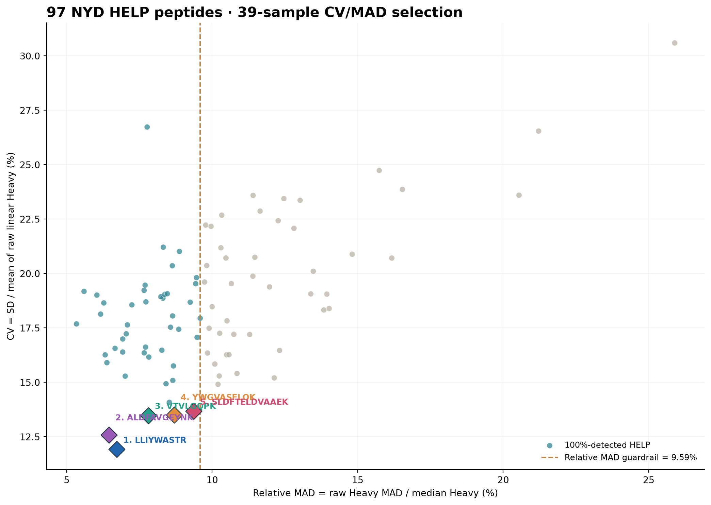
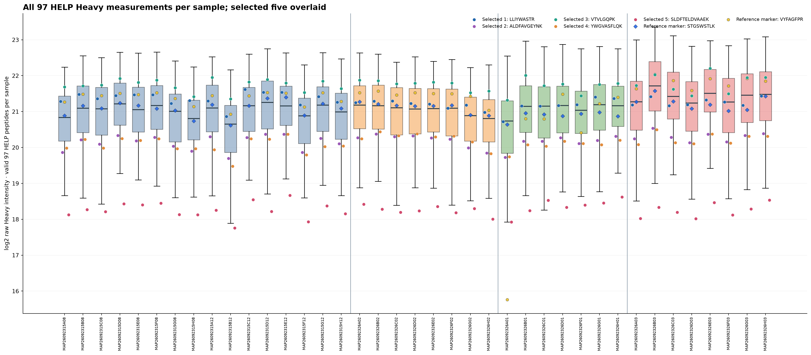
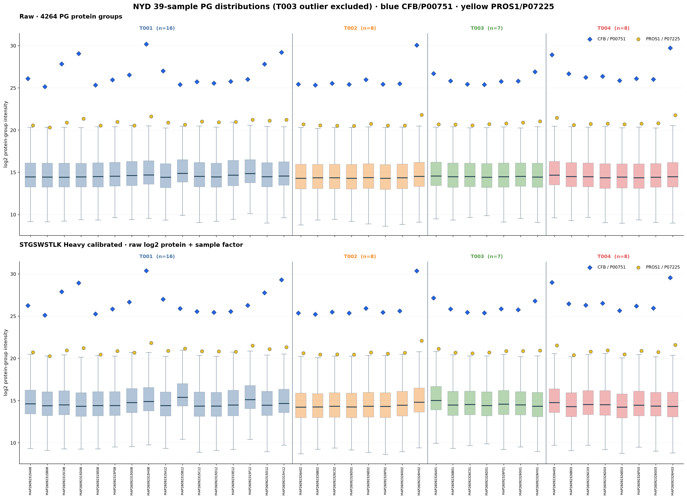
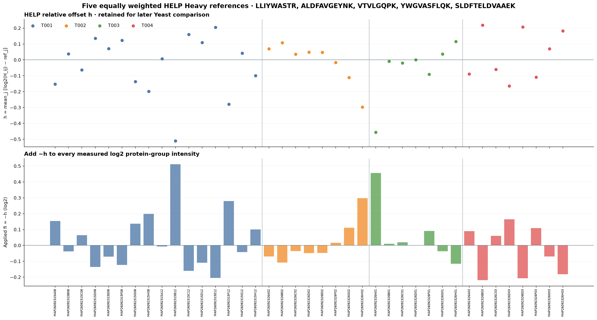
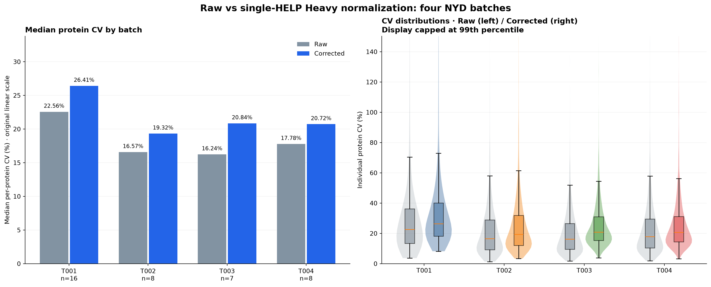
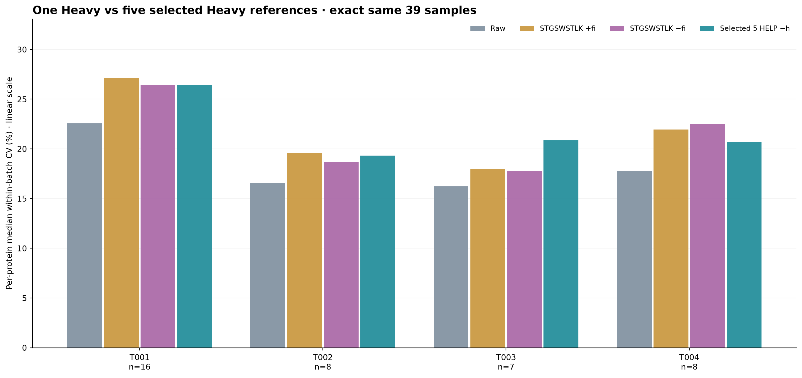
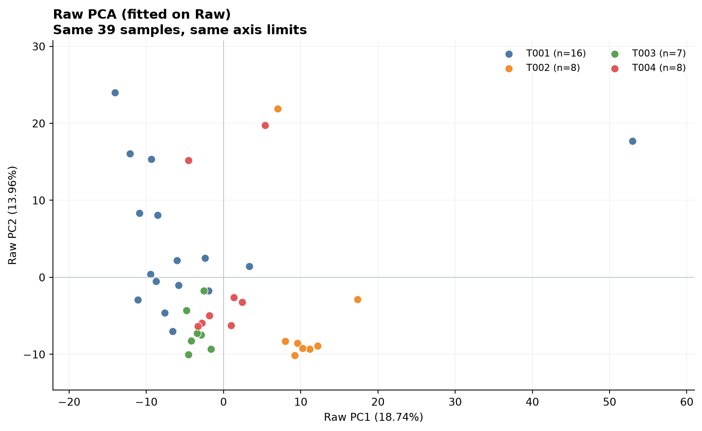
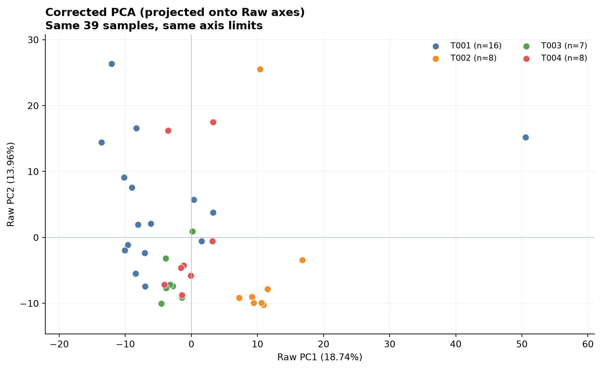
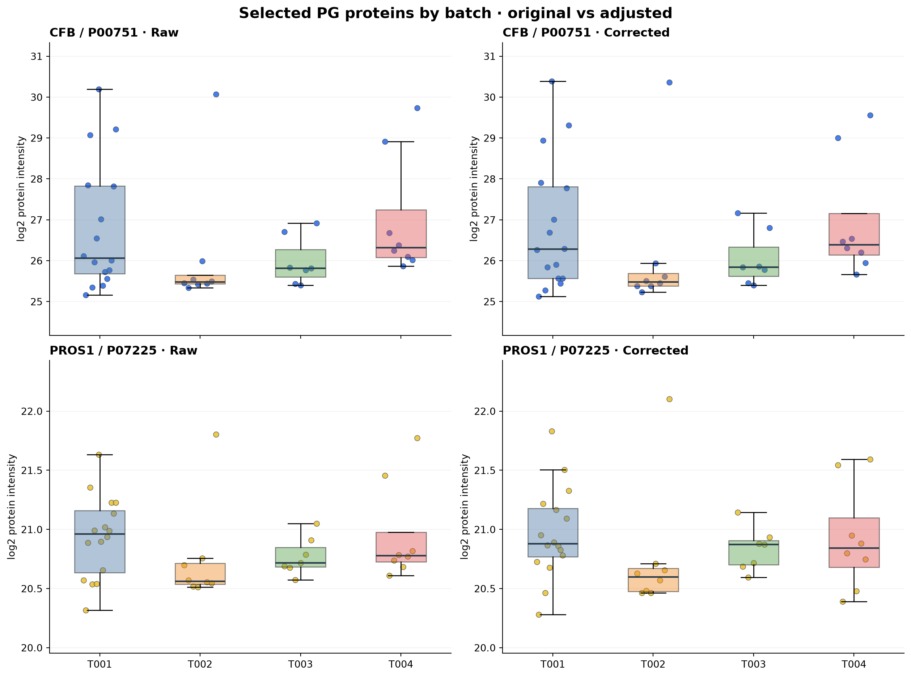
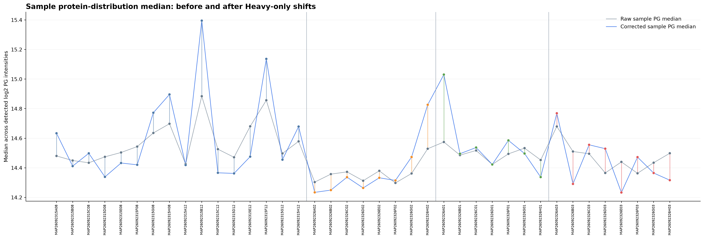

# NYD: five HELP Heavy references selected by CV and MAD

Input is the 97 HELP rows of NYD_data/40samples/Heavy.xlsx;
exclude known problematic T003 MAP26092326E01 before ranking, factor, CV and PCA.
Retained 39 samples: T001=16, T002=8, T003=7, T004=8.
No independent pooled QC samples exist here; all 39 samples provide the reference.

## Automatic selection (no manual choice)

1. For EVERY one of 97 HELP sequences, compute detection rate, CV on
   original linear Heavy intensity, raw MAD, normalized relative MAD
   and MAD on log2 Heavy intensity, across all 39 retained samples.
2. Require detection rate exactly 100% (39/39 finite positive).
3. Low-MAD guardrail: relative MAD no greater than the median relative
   MAD among all peptides meeting step 2. This controls for differences
   in raw intensity scale. Guardrail threshold: 9.5885%.
4. From the low-MAD candidate set, choose FIVE lowest CV% peptides
   (relative MAD ascending, sequence alphabetic for ties).
5. Full screening results for all 97 in HELP97_Heavy_CV_MAD_detection_ranking.csv.

## Selected five HELP peptides

| Rank | HELP sequence | CV (%) | Raw linear MAD | Relative MAD (%) | log2 MAD | log2 reference |
| ---: | --- | ---: | ---: | ---: | ---: | ---: |
| 1 | LLIYWASTR | 11.920 | 169669.539 | 6.725 | 0.09769 | 21.266766 |
| 2 | ALDFAVGEYNK | 12.575 | 80066.866 | 6.451 | 0.09019 | 20.243248 |
| 3 | VTVLGQPK | 13.480 | 279299.723 | 7.809 | 0.10848 | 21.770173 |
| 4 | YWGVASFLQK | 13.507 | 101612.280 | 8.696 | 0.13126 | 20.156139 |
| 5 | SLDFTELDVAAEK | 13.674 | 29542.722 | 9.363 | 0.13513 | 18.267360 |

## Heavy-only factor formula

For each chosen peptide j, reference_j = median of its log2 Heavy
among all 39 retained samples (same peptide; NEVER pooled QC).
For each sample i and each selected peptide j:
delta_ij = log2(Heavy_ij) - reference_j.
h_i = arithmetic mean of five delta_ij (each weight 1/5).
fi = -h_i, and corrected log2 PG_i = original log2 PG_i + fi.
Store h and five individual delta contributions in sample_five_HELP_h_and_negative_factors.csv
so future Yeast relative shifts can be compared.
No other HELP sequence contributes to any protein correction.

## Same-39-sample within-batch median protein CV (%)

| Batch | n | Raw | Single STGSWSTLK +fi | Single STGSWSTLK −fi | Five HELP −h |
| --- | ---: | ---: | ---: | ---: | ---: |
| T001 | 16 | 22.56 | 27.11 | 26.43 | 26.41 |
| T002 | 8 | 16.57 | 19.56 | 18.68 | 19.32 |
| T003 | 7 | 16.24 | 17.96 | 17.78 | 20.84 |
| T004 | 8 | 17.78 | 21.96 | 22.54 | 20.72 |

Batch CV is calculated on original linear protein intensity
with sample SD / mean (ddof=1), requiring at least 70% detected samples.
This CV includes biological differences between clinical samples and
is not an independent technical QC measure.

## Selection and distribution figures

## PG sample boxplots (blue CFB, yellow PROS1)

## Sample h and −h correction

## CV comparisons

## Separate PCA charts, COMMON Raw-fitted basis

One fit to Raw PG only; selected features, Raw imputation medians, Raw
centering and eigenvectors identical for corrected projection.
Same plotted x/y limits, no arrows or combined Raw/Corrected plot.

### Raw PCA

### Corrected PCA

## Other PG validation plots

## Reproducibility

CSV: full screening 97 HELP; five peptide reference medians;
39 sample offsets and all five individual contributions;
Raw-vs-corrected batch CV and per-PG per-batch CV;
Raw-only-fit PCA scores; full corrected 4264 x 39 log2 PG matrix.
Manifest includes source SHA256 and exact selection threshold.
No source or previous result was changed.
