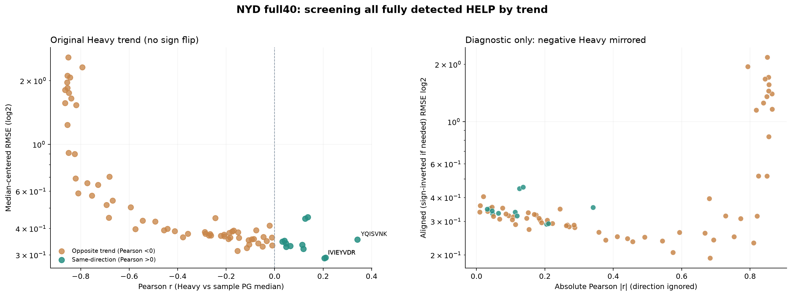
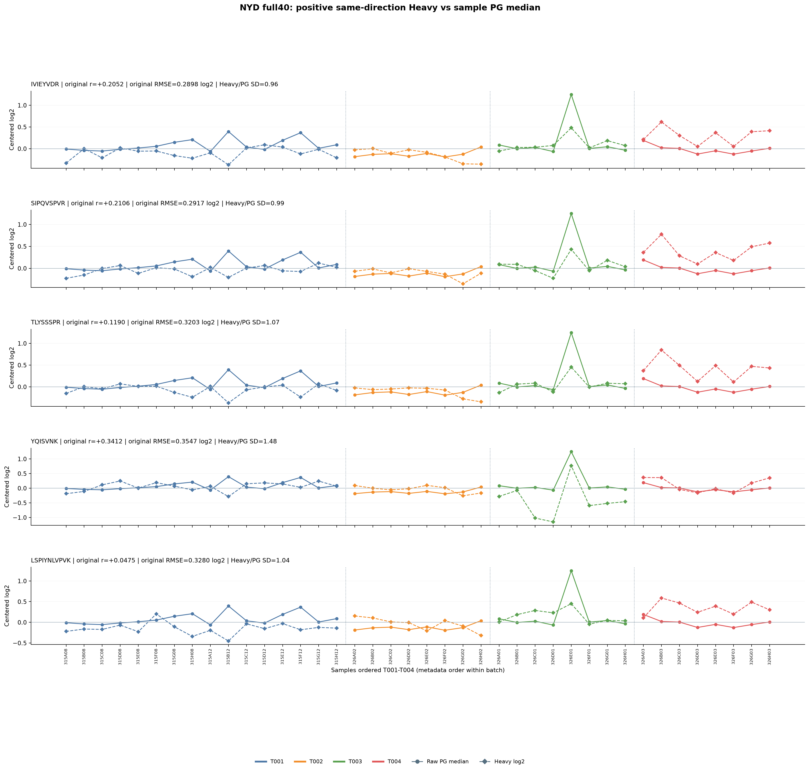
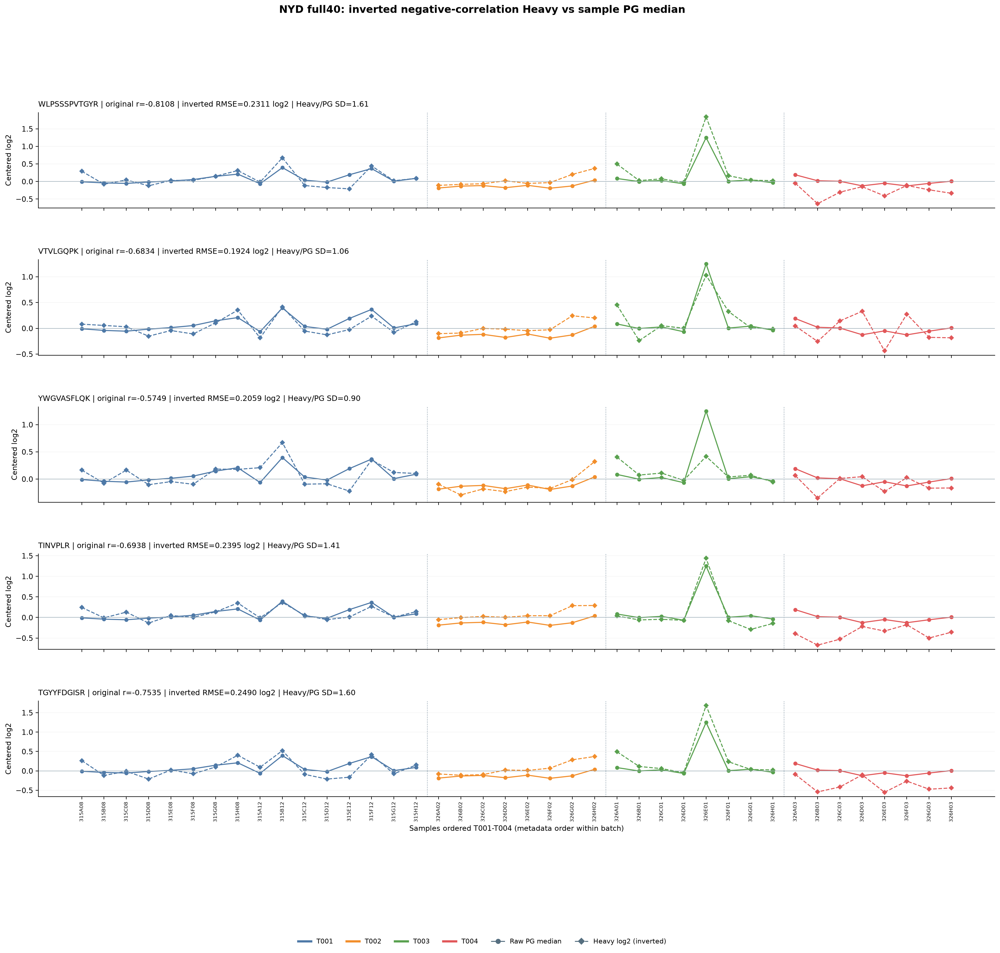
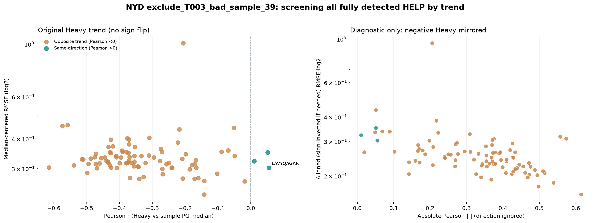
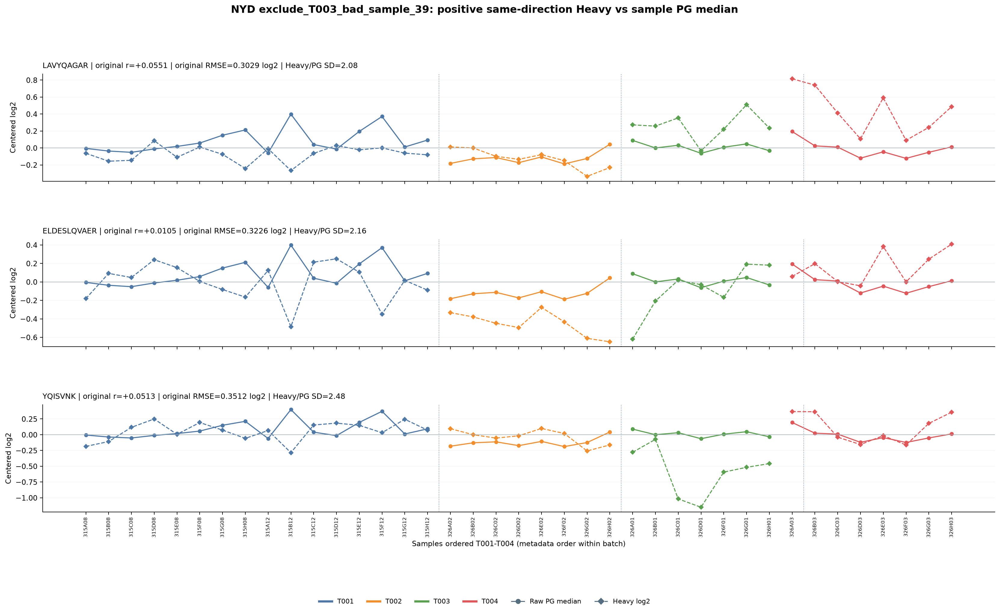
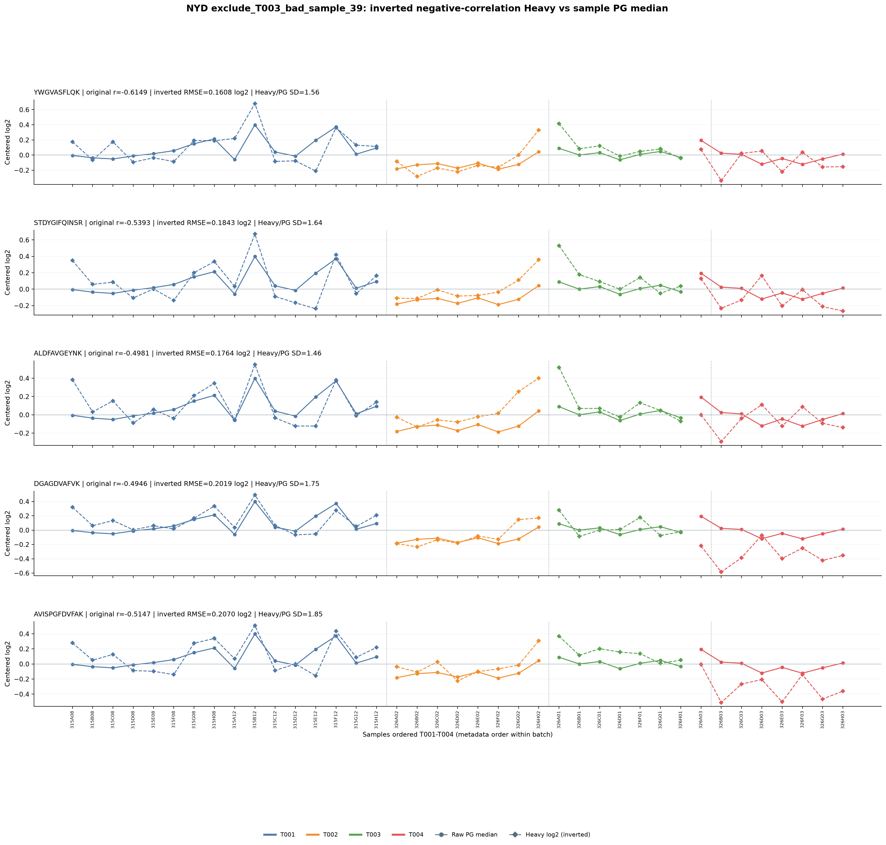

# NYD: Pearson and centered RMSE screen (Heavy vs PG sample medians)

One Heavy HELP (log2) across N samples vs N per-sample PG log2 medians.
Excludes missing PG intensity values from each median; no calibration.
Pearson computed on raw log2 values; centered RMSE has no free fit or rescaling.
Pearson-positive HELP are the only ones that naturally share the PG trend direction.
Negative Pearson HELP are presented separately. A sign-flipped visualization
is not evidence that their original curves match.

## full40

- HELP completely detected: 74/97.
- Same direction r>0: 12; opposite r<0: 62.

| Combined positive rank | HELP | Pearson r | Centered RMSE log2 | Heavy/PG SD |
|---:|---|---:|---:|---:|
| 1 | IVIEYVDR | +0.2052 | 0.2898 | 0.964 |
| 2 | SIPQVSPVR | +0.2106 | 0.2917 | 0.991 |
| 3 | TLYSSSPR | +0.1190 | 0.3203 | 1.069 |
| 4 | YQISVNK | +0.3412 | 0.3547 | 1.483 |
| 5 | LSPIYNLVPVK | +0.0475 | 0.3280 | 1.039 |

## exclude_T003_bad_sample_39

- HELP completely detected: 91/97.
- Same direction r>0: 3; opposite r<0: 88.

| Combined positive rank | HELP | Pearson r | Centered RMSE log2 | Heavy/PG SD |
|---:|---|---:|---:|---:|
| 1 | LAVYQAGAR | +0.0551 | 0.3029 | 2.077 |
| 2 | ELDESLQVAER | +0.0105 | 0.3226 | 2.163 |
| 3 | YQISVNK | +0.0513 | 0.3512 | 2.480 |

## Tables
- 01_all_full_detection_HELP_Pearson_centeredRMSE.csv: every fully detected HELP
- 03_positive_same_direction_combined_rank.csv
- 04_positive_rank_by_Pearson.csv
- 05_positive_rank_by_centered_RMSE.csv
- 06_negative_opposite_direction_inverted_diagnostic_rank.csv
- 02_all_HELP_curves_by_sample.csv.gz for reconstructing charts

## Cautions
- Full40 outlier may dominate correlation and RMSE; compare independent 39 set.
- Equal centered-RMSE is sensitive to Heavy/PG amplitudes; Pearson only shape.
- Good fit to clinical PG medians does not demonstrate better technical calibration.
