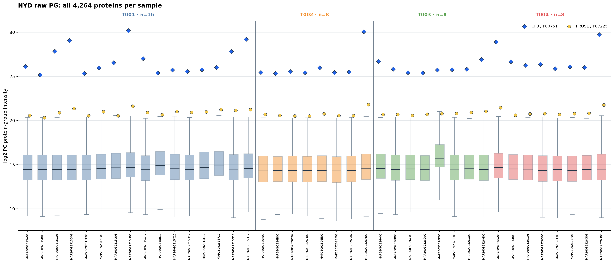
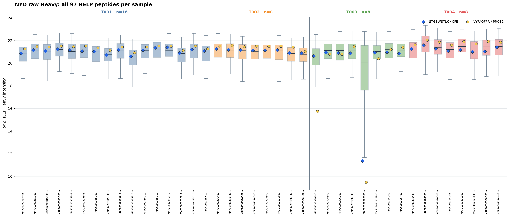
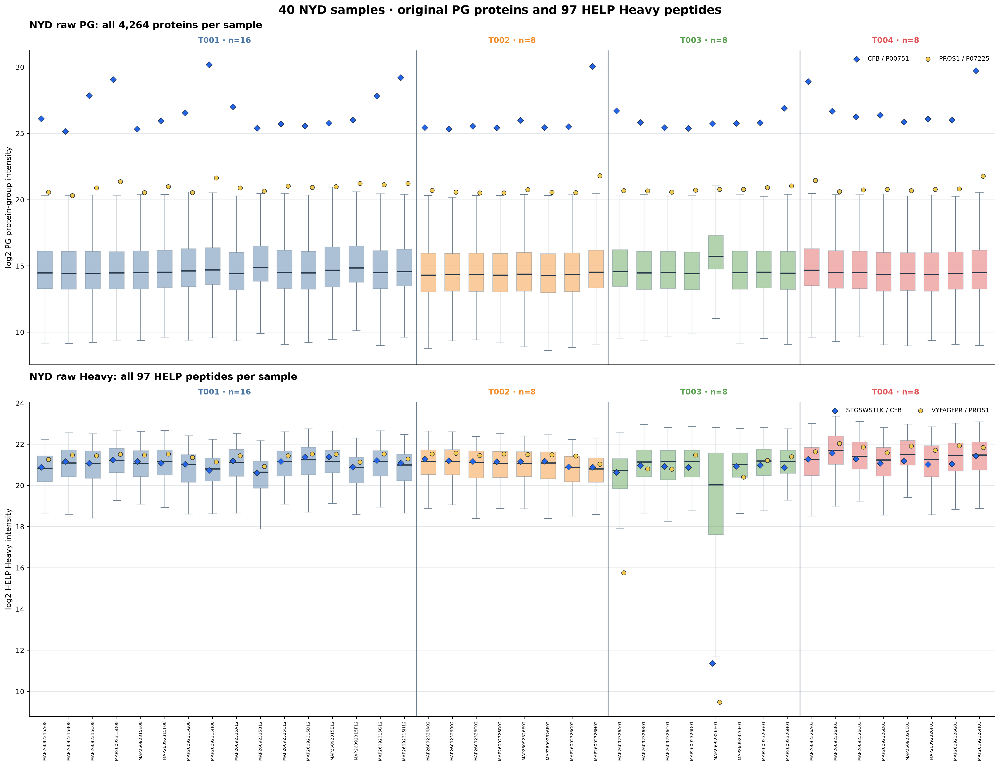

# NYD 40 samples · raw PG + HELP Heavy highlighting two references

**The two inputs are original, unnormalized signals:**
- PG background: NYD_pg_matrix2.tsv, 4,264 PG protein groups × 40 samples.
- HELP background: Heavy.xlsx, 97 stripped HELP peptides × 40 samples.
- Sample grouping: NYD_sampleinfo2.xlsx, T001 n=16, T002/T003/T004 n=8 each.
- Finite positive raw values are converted to log2 for plotting, with no imputation.
- Every sample box includes ALL available source features, NOT only two targets.
- Blue diamond: STGSWSTLK → CFB / P00751.
- Yellow circle: VYFAGFPR → PROS1 / P07225.
- Two colored markers are drawn at the true source value for each sample.
- Solid vertical lines distinguish batches; figures use identical sample ordering.

## Two individual PNGs

### 1. Original PG: 4,264 protein-group intensity boxplots (40 sample boxes)

### 2. Heavy.xlsx: 97 HELP peptide intensity boxplots (40 sample boxes)

### Combined overview

## Data and target audits

| Source | Valid positive | Missing/nonpositive/invalid |
| --- | ---: | ---: |
| PG_protein | 139947/170560 | 30613 |
| HELP_Heavy | 3853/3880 | 27 |

| HELP | PG protein group | 1-based PG row |
| --- | --- | ---: |
| STGSWSTLK | CFB / P00751 | 564 |
| VYFAGFPR | PROS1 / P07225 | 798 |

Both selected proteins and both selected HELP Heavy peptides have
valid positive values in every one of the 40 samples.
The two proteins are each uniquely matched to a PG row by exact accession.
No samples or low-detection samples were removed.

## Audit exports

- sample_distribution_summary.csv: 80 rows (2 sources × 40 samples), all-feature medians and quartiles.
- highlighted_two_targets_positions.csv: 160 rows (2 sources × 2 targets × 40 samples),
  original raw value, log2 value, difference from sample box median, percentile, and IQR flag.
- run_manifest.json: original input SHA256 and exact rules.

## Important PCA rule for future Raw vs Corrected plots

Fit PCA once on Raw and project Corrected into Raw's exact feature
selection, imputation constants, centering, eigenvectors and axis limits.
Do not separately fit Raw and Corrected PCA when interpreting individual
sample movement. No PCA was calculated for this boxplot-only task.

Original matrices, Heavy workbook and previous analyses remain unchanged.
