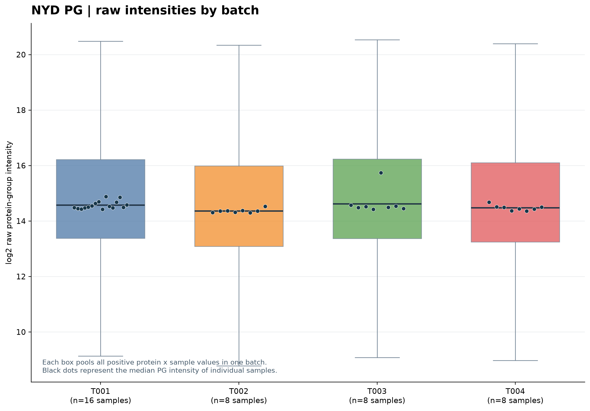
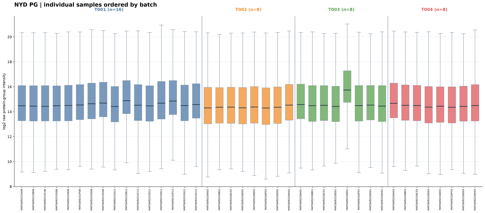
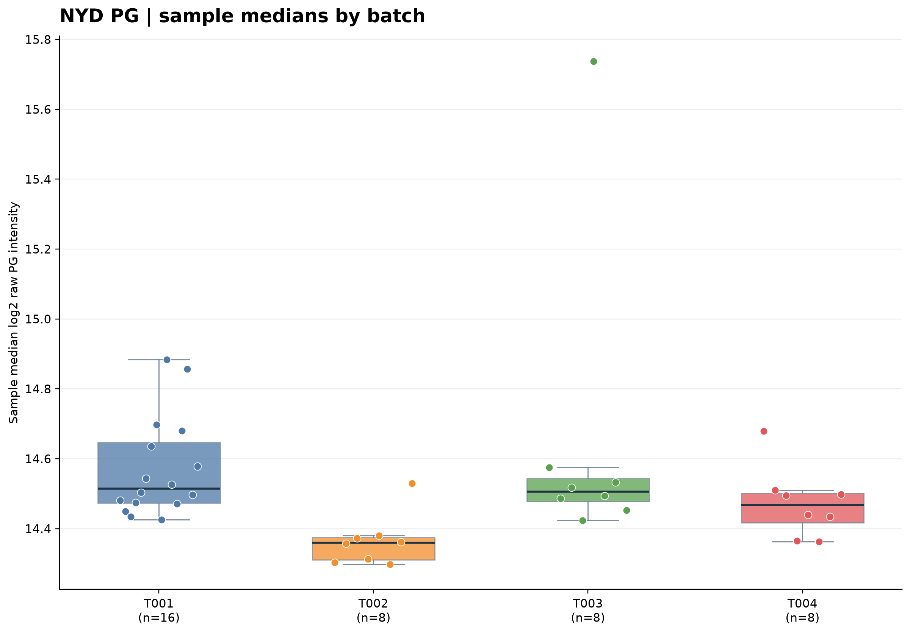

# Raw NYD PG protein intensity boxplots grouped by batch

The source NYD_pg_matrix2.tsv contains 4264 protein groups x 40 samples.
Sample assignment is taken from NYD_sampleinfo2.xlsx (sample ID joins, not column position).
T001 n=16; T002, T003 and T004 n=8 each.
No imputation, calibration, normalization or batch correction applied.
Finite positive PG intensities only are log2 transformed for display.

## 1. Protein intensity distribution by batch

Each colored box pools all valid protein x sample intensities within one batch.
Dark points show individual sample medians, one per sample.
Unequal batch sizes affect the number of observations in the pooled background.

## 2. Forty per-sample PG boxplots, ordered by batch

A single sample box summarizes its measured proteins; samples are grouped by batch.

## 3. Sample median distribution by batch

Each observation in this panel is a sample-level median PG intensity.
Use it to compare batch location/dispersion without mistaking proteins
within a sample for independent samples.

## Descriptive summary

| Batch | Samples | Positive/possible PG values | Detection rate | All-intensity median log2 | Sample median of medians log2 |
| --- | ---: | ---: | ---: | ---: | ---: |
| T001 | 16 | 54791/68224 | 80.31% | 14.572 | 14.515 |
| T002 | 8 | 29951/34112 | 87.80% | 14.363 | 14.360 |
| T003 | 8 | 26662/34112 | 78.16% | 14.614 | 14.506 |
| T004 | 8 | 28543/34112 | 83.67% | 14.473 | 14.468 |

## QC flag: sample-specific anomaly in T003

One sample should be examined before attributing visual shifts to the batch:

- MAP26092326E01 (T003): sample median log2 PG intensity = **15.738**;
  finite-positive detection = **48.71%** (2,077 of 4,264 protein groups).
- The other seven T003 sample medians range approximately **14.423–14.575**.
- The anomalously high median co-occurs with low detection: the median of
  detected proteins can be biased upward if many low-intensity proteins are absent.
  These descriptive observations do not establish the reason (technical failure,
  sample loading, filtering or biology). No samples were removed.

## Exported audit tables

- sample_pg_intensity_summary.csv: 40 sample rows, protein detection, medians and quartiles.
- batch_pg_intensity_summary.csv: pooled protein values and batch medians.
- run_manifest.json: original input SHA-256, matrix size, positive counts and plotting rules.
- scripts/nyd_pg_batch_boxplots.py: reproducible source code.

These figures describe raw signal distributions. They do not by themselves
prove the presence, absence or removal of an experimental batch effect.
