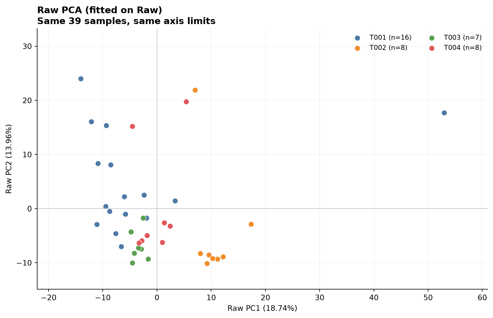
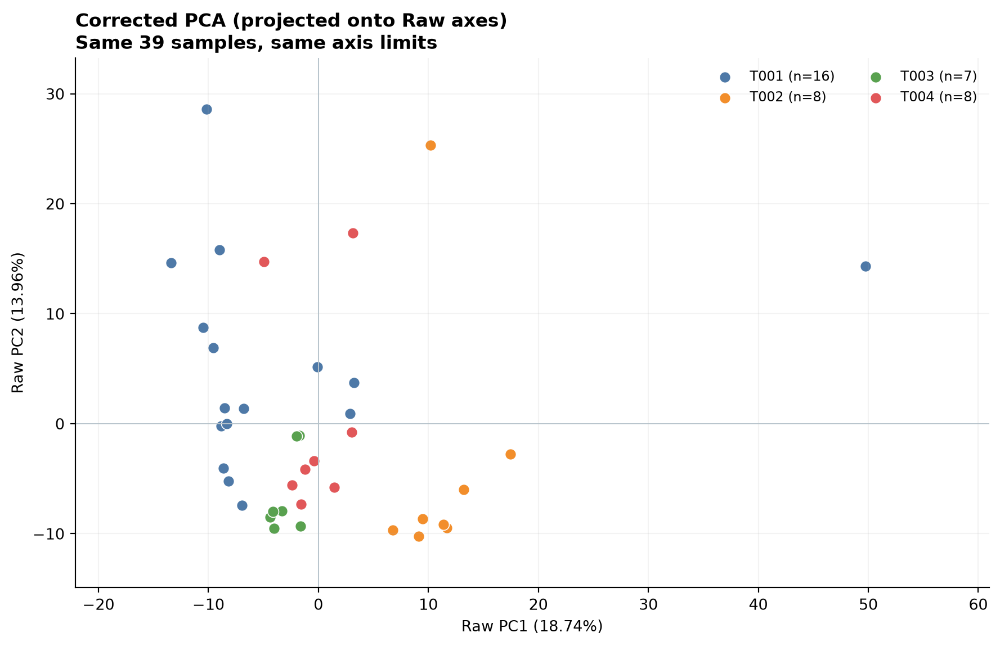
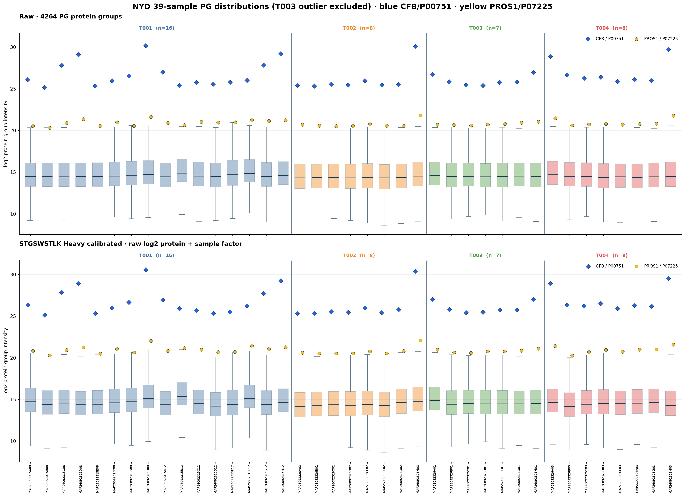
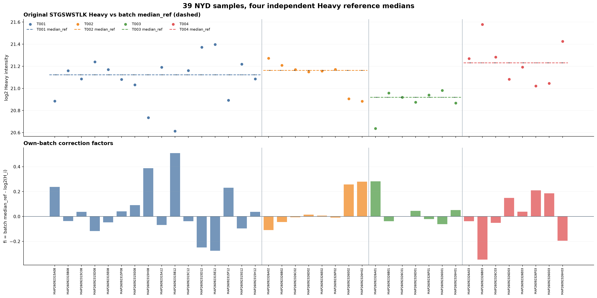
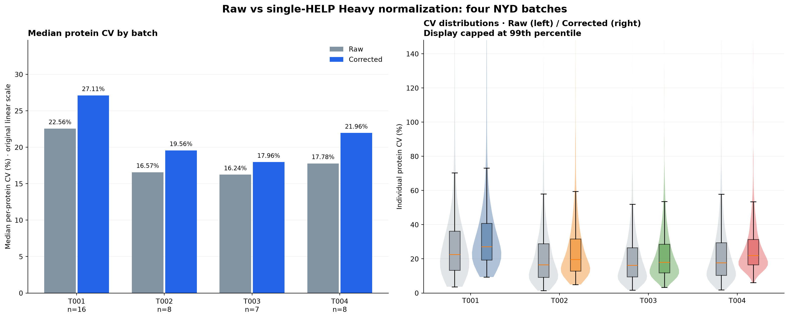
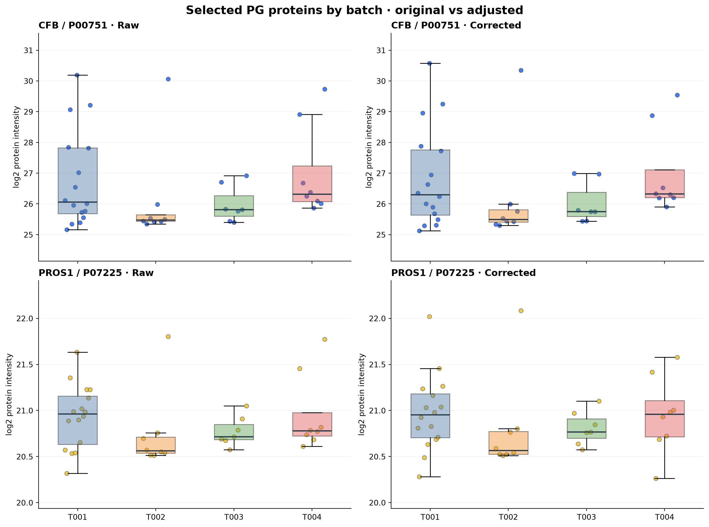
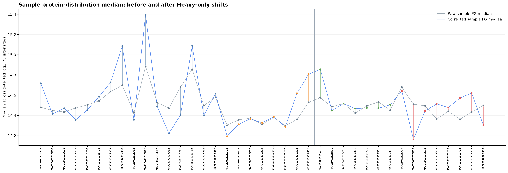
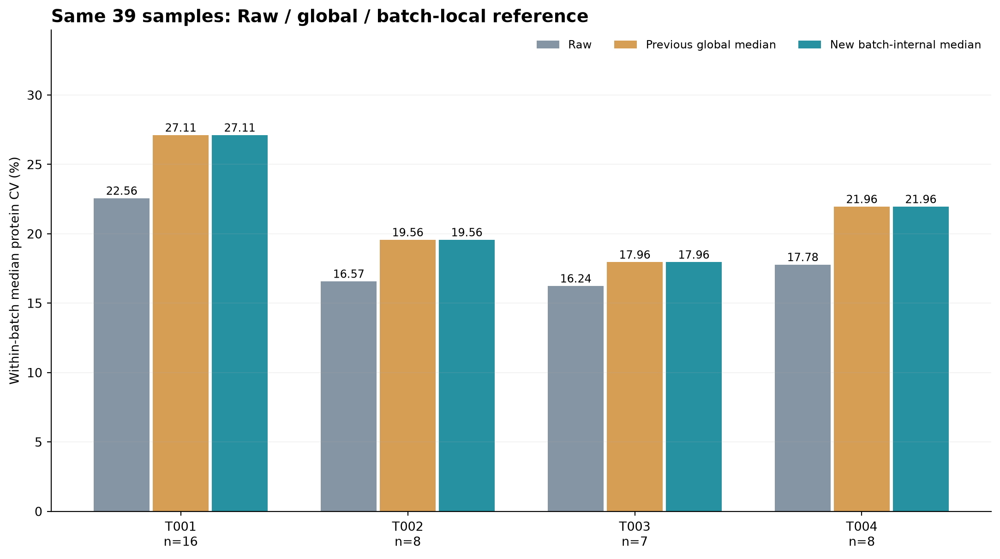

# NYD batch-internal STGSWSTLK Heavy normalization · 39 samples

Exclude MAP26092326E01 (T003) from analysis before recomputing factors.
Retained T001=16, T002=8, T003=7, T004=8. Original files unchanged.

## Method

One Heavy STGSWSTLK intensity per sample. Transform to log2 first.
For each batch, reference = median of only that batch's log2 Heavy values.
Each sample's fi = median_ref_own_batch - log2 Heavy_i.
Add fi to every observed log2 PG protein intensity in the same sample.
No sample gets a reference from another batch. Missing PGs remain missing.
This method aligns Heavy measurements WITHIN batches; it does not
force the four batch median references to be equal.

## Batch-specific reference medians

| Batch | n | median_ref log2 | median_ref linear | fi min | fi max |
| --- | ---: | ---: | ---: | ---: | ---: |
| T001 | 16 | 21.122744 | 2283387.5 | -0.2750 | 0.5094 |
| T002 | 8 | 21.163281 | 2348455.6 | -0.1089 | 0.2791 |
| T003 | 7 | 20.918815 | 1982397.0 | -0.0624 | 0.2820 |
| T004 | 8 | 21.230995 | 2461310.7 | -0.3466 | 0.2097 |

## Batch protein median CV (%)

| Batch | Raw | Global 39-sample median correction | Batch-internal correction | Batch - Raw (pp) |
| --- | ---: | ---: | ---: | ---: |
| T001 | 22.56 | 27.11 | 27.11 | +4.55 |
| T002 | 16.57 | 19.56 | 19.56 | +2.99 |
| T003 | 16.24 | 17.96 | 17.96 | +1.72 |
| T004 | 17.78 | 21.96 | 21.96 | +4.18 |

Because the difference between global and batch reference is a
constant offset within each batch, within-batch protein CV is
mathematically identical for both approaches (up to precision).
They differ in the BETWEEN-batch intensity alignment and PCA positions.

## PCA: two separate figures with the same Raw-fitted coordinates

Raw fit performed exactly once. Corrected projected to the Raw PCA
loadings, raw-selected proteins, Raw missingness imputation medians
and original Raw centering. Both figures have identical axis ranges.
No connecting arrows or before/after overlay.

### Raw PCA

### Corrected PCA

## Other diagnostic visualizations

## Audit tables

batch_STGSWSTLK_Heavy_median_references.csv: four batch references.
sample_batch_internal_factors.csv: 39 exact Heavy factors and two source proteins.
corrected_NYD_pg_matrix2_log2.tsv: 4,264 PG proteins x 39 samples.
batch_protein_CV_summary.csv, per_protein_batch_CV_long.csv,
Raw_global_batch_internal_CV_comparison.csv and
PCA_Raw_fitted_sample_coordinates.csv include detailed checks.
These batch groups may include true biological differences; batch CV
alone is not independent technical-quality validation.
