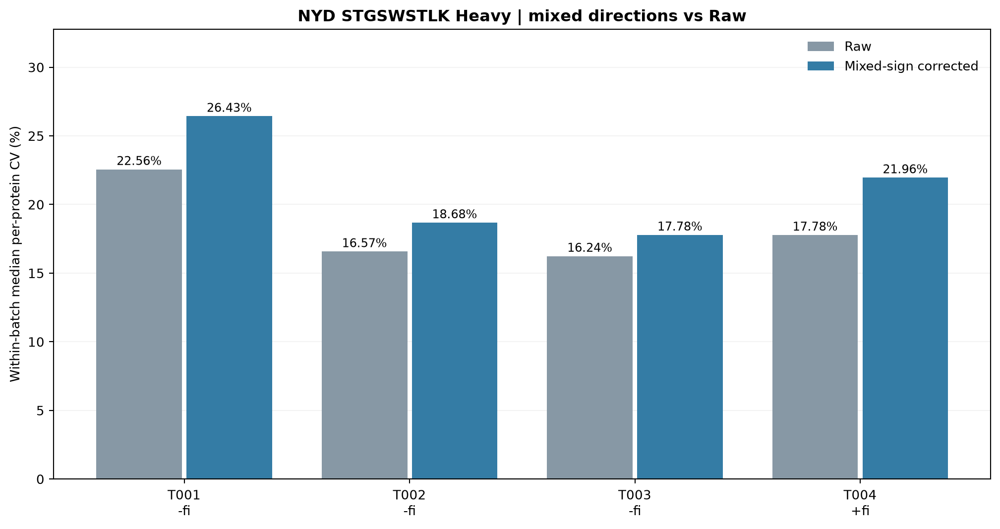
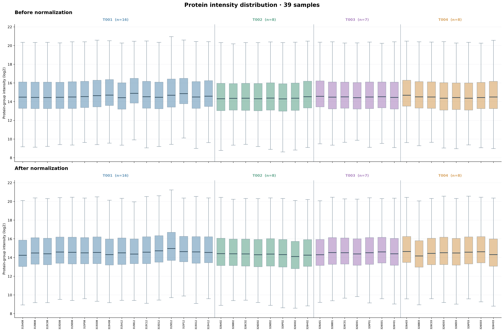
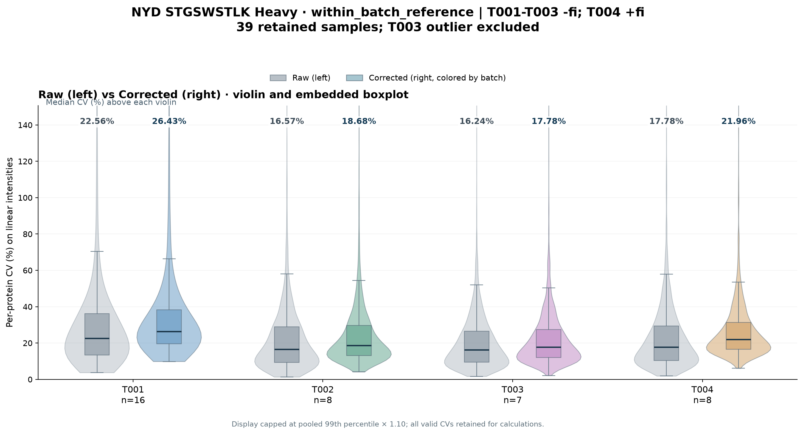

# NYD 39 repeated measurements | STGSWSTLK Heavy mixed-sign normalization

T001/T002/T003: subtract the unchanged original factor fi; T004: add fi.
The 39 samples are repeat measurements of the same specimen.
QC-excluded sample MAP26092326E01 is omitted from the analysis but retained in source.
No original matrix or historical experiment is changed.

## Definition

fi = median_ref - log2(original STGSWSTLK Heavy).
PG_corrected_log2 = PG_raw_log2 + sign(batch)*fi.
sign(T001/T002/T003)=-1; sign(T004)=+1.
The overall_reference version uses one 39-sample Heavy reference.
The within_batch_reference version uses each batch's own Heavy median.
All computed references use full floating-point precision.

- Global Heavy log2 reference: 21.085857242488732
- T001 Heavy log2 reference: 21.122744278499212
- T002 Heavy log2 reference: 21.163280893507395
- T003 Heavy log2 reference: 20.918814504900141
- T004 Heavy log2 reference: 21.230995360758140

## Within-batch median per-protein CV (%)

| Batch | n | Sign | Raw | Overall mixed | Within-batch mixed | Difference vs Raw (pp) |
| --- | ---: | --- | ---: | ---: | ---: | ---: |
| T001 | 16 | -fi | 22.56 | 26.43 | 26.43 | +3.87 |
| T002 | 8 | -fi | 16.57 | 18.68 | 18.68 | +2.10 |
| T003 | 7 | -fi | 16.24 | 17.78 | 17.78 | +1.55 |
| T004 | 8 | +fi | 17.78 | 21.96 | 21.96 | +4.18 |

CV is sample SD(ddof=1)/arithmetic mean x100 on back-transformed linear intensities.
For each protein within a batch require >=max(3,ceil(.7*n)) valid positive intensities.
Both methods have the SAME within-batch protein CV by construction:
the difference between global and batch medians is a constant within each batch.
This does not make absolute intensities or between-batch positions identical.
Mixed-sign calibration does not beat Raw in these four batch CV medians.

## Outputs

- 00_Raw_NYD_pg_matrix2_log2_39samples.tsv: 4,264 PG x 39 sample Raw log2 matrix
- 00_mixed_sign_CV_comparison.csv: Raw/overall/batch median CV comparison.
- overall_reference/ and within_batch_reference/: each has
  - corrected_NYD_pg_matrix2_log2.tsv: full 4,264 PG x 39 sample corrected log2 matrix
  - sample_factors_internal.csv: Heavy, original fi, actual direction and applied shift.
  - batch_protein_CV_summary.csv and per_protein_batch_CV_long.csv
  - PCA_Raw_fitted_sample_coordinates.csv and reference_and_processing.json
  - 01/02/03: separate before/after and paired protein intensity boxplots (no targeted highlights)
  - 04: applied factor chart, for internal audit only
  - 06: before/after sample PG medians (log2)
  - 04a_PCA_Raw.png and 04b_PCA_Corrected.png (both on one Raw-fitted basis)
  - 08_per_protein_CV_violin_Raw_vs_Corrected_median_labels.png and CSV

## Before/after plots

### Overall reference

### Within-batch reference

## Interpretation

This is an exploratory mixture of two directions, motivated by earlier data.
Do not interpret selecting the preferred signs on this SAME 39-sample dataset
as out-of-sample proof of improved technical precision or physical validity.
Within-sample cross-protein Pearson heatmaps would be unchanged by these shifts.
No missing-value imputation is used outside the standard Raw-fitted PCA procedure.
