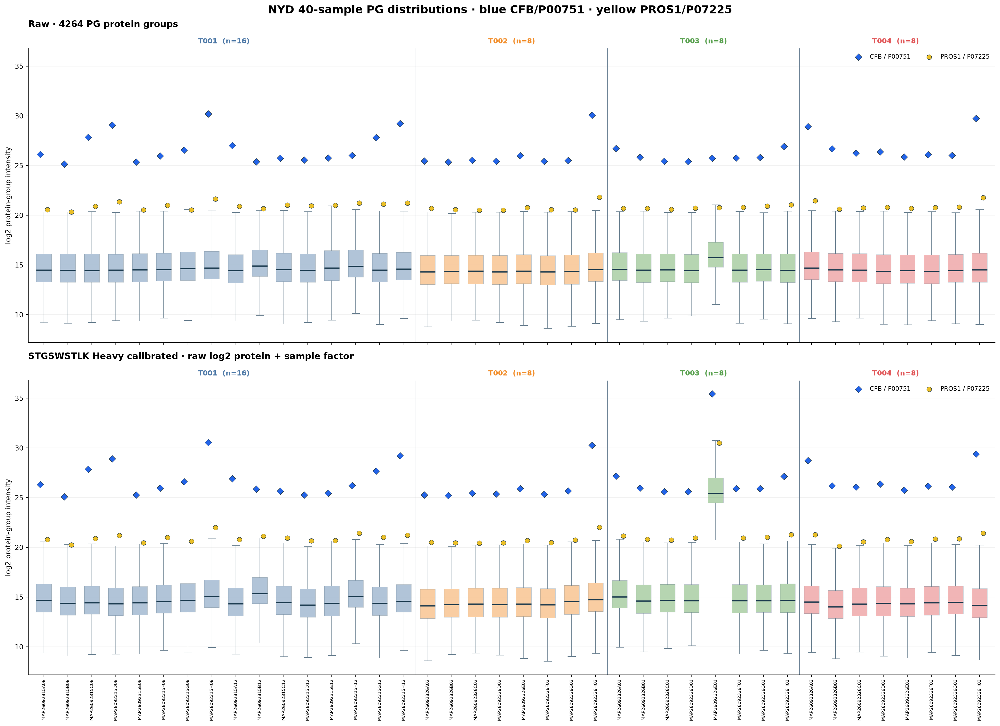
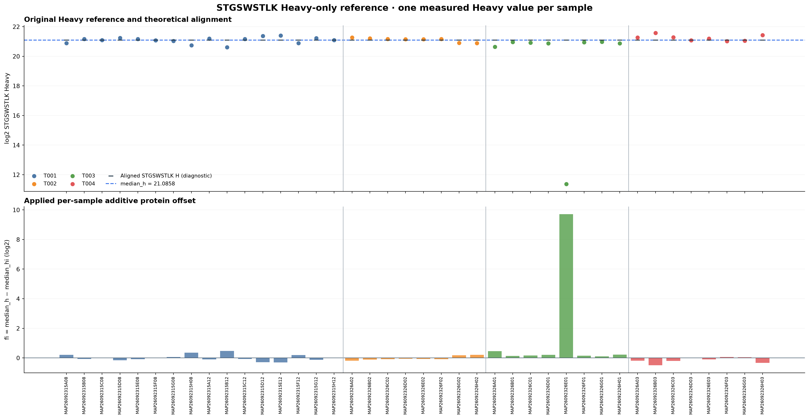
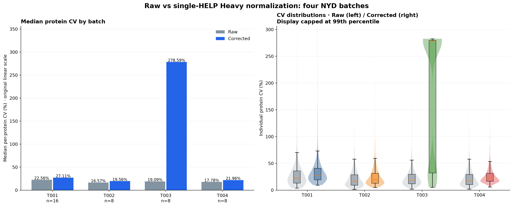
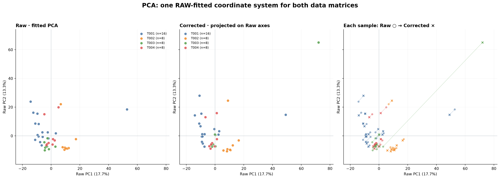
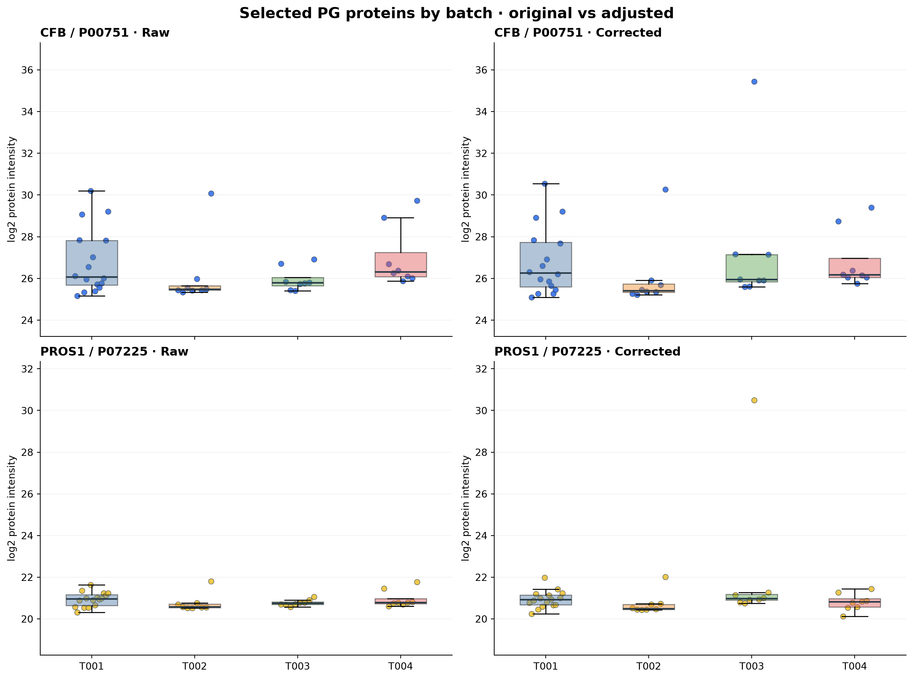
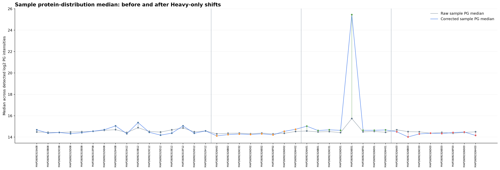

# NYD 40-sample single STGSWSTLK Heavy reference normalization

Independent, exploratory new trial. Original NYD PG and Heavy.xlsx unchanged.
40 samples from metadata: T001=16, T002/T003/T004=8 each; 4264 PG rows.
The ONE STGSWSTLK Heavy signal per sample is valid in all 40 samples.
No pooled QC exists in this 40-sample metadata; the median reference is
computed directly across the 40 original samples.

## Exact recipe

1. Log2-transform original positive PG and STGSWSTLK Heavy intensities.
2. median_hi = median of the singleton STGSWSTLK Heavy observation in sample i
   = log2(Heavy_i).
3. median_h = median(median_hi) across ALL 40 samples.
4. fi = median_h - median_hi.
5. Corrected PG_i = raw PG log2_i + fi for every detected protein.
6. Do NOT alter other HELP peptides, Heavy.xlsx, or original PG input.
Nonpositive/unobserved PG values are missing in log2 outputs (not imputed).
Correction multipliers on original linear intensities are 2**fi.
The corrected-Heavy trace on the factor graph is a THEORETICAL check;
the original Heavy workbook is intentionally unchanged.

## Median protein-group CV within each batch (%)

CV is computed on INVERSE-log2-transformed linear protein intensity
with sample SD (ddof=1), requiring at least max(3,ceil(70% of batch n))
positive measurements for each protein. HC/S disease labels are not used here.
These are within-batch biological-sample CV values, NOT pure technical QC.

| Batch | n | Raw protein median CV | Corrected protein median CV | Delta (pp) |
| --- | ---: | ---: | ---: | ---: |
| T001 | 16 | 22.56% | 27.11% | +4.55 |
| T002 | 8 | 16.57% | 19.56% | +2.99 |
| T003 | 8 | 19.09% | 278.59% | +259.51 |
| T004 | 8 | 17.78% | 21.96% | +4.18 |

## Visualization 1: raw and corrected all-protein sample boxplots

CFB / P00751 is a blue diamond; PROS1 / P07225 is a yellow circle.

## Visualization 2: STGSWSTLK Heavy reference and fi factors

## Visualization 3: per-batch protein CV

## Visualization 4: Raw-fitted PCA on common coordinates

Raw fit ONCE; corrected samples are projected onto identical Raw
features, missing-value medians, centering and PCA loadings.
PC1/PC2 explained percentages are from Raw only. Axis limits match
across panels, and the third panel shows each sample movement.

## Visualization 5: highlighted target proteins, Raw vs Corrected

## Visualization 6: sample-level all-protein medians

## Exported files

- corrected_NYD_pg_matrix2_log2.tsv: complete 4264 x 40 corrected PG matrix.
- sample_STGSWSTLK_Heavy_factors.csv: Heavy, medians, fi, linear multiplier,
  before/after PG sample median and CFB/PROS1 PG intensities.
- batch_protein_CV_summary.csv and per_protein_batch_CV_long.csv.
- PCA_Raw_fitted_sample_coordinates.csv: shared PCA scores and movement.
- run_manifest.json: exact original SHA256 and all methods.

## Caution

By using one Heavy peptide's deviation from an overall 40-sample
median, the procedure assumes its signal changes largely reflect
technical changes shared by other proteins. It can increase variation
if this peptide has measurement noise or non-shared fluctuations.
Lower across-clinical-sample CV does not prove better calibration.
