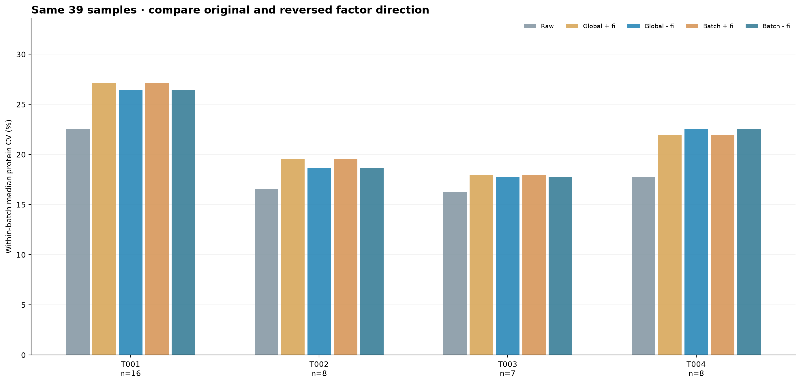
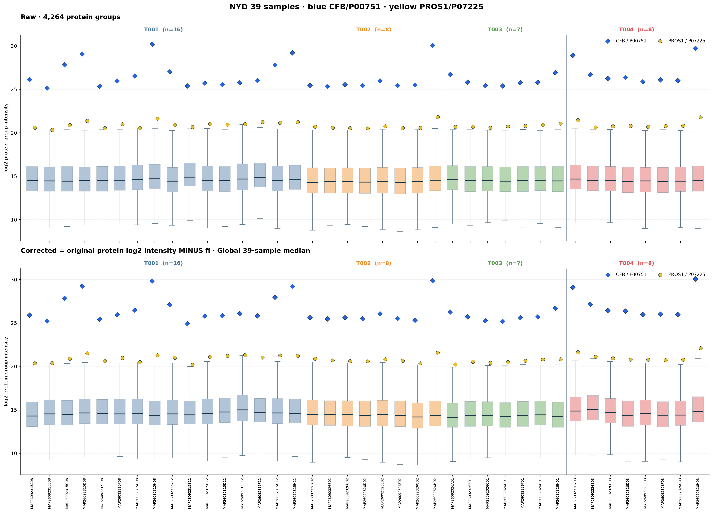
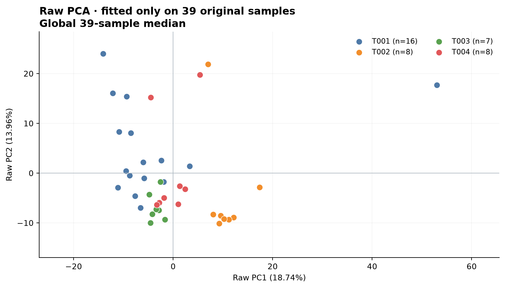
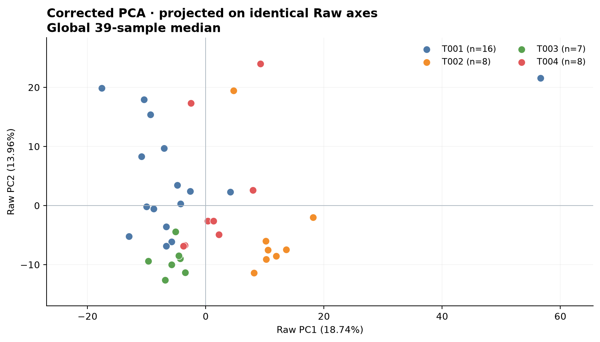
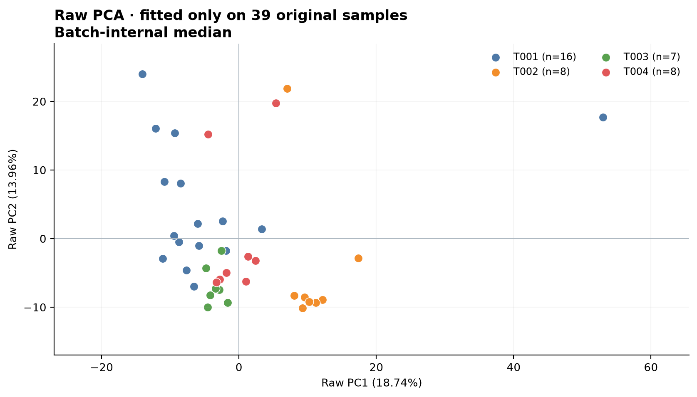
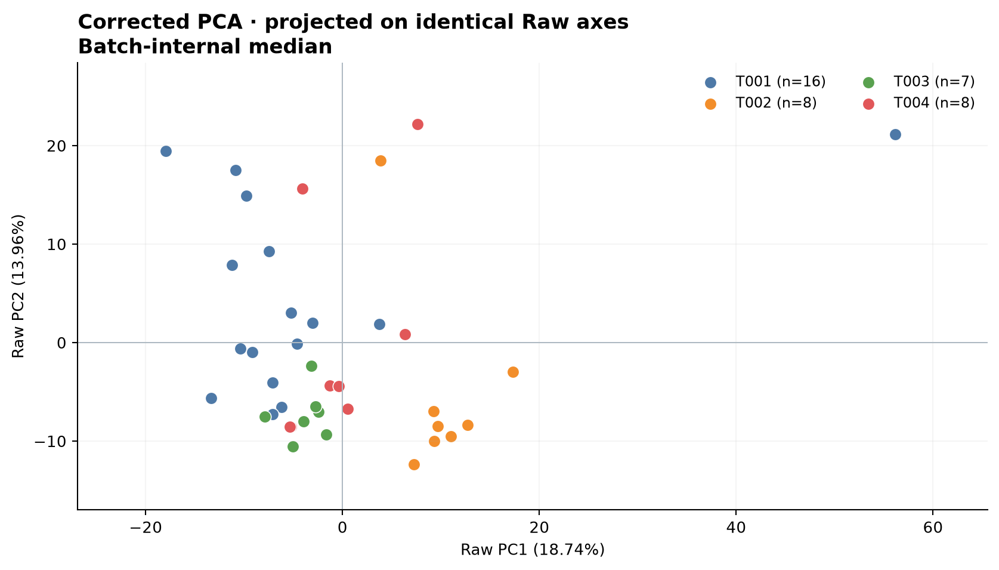
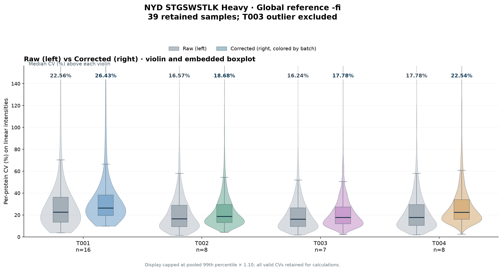
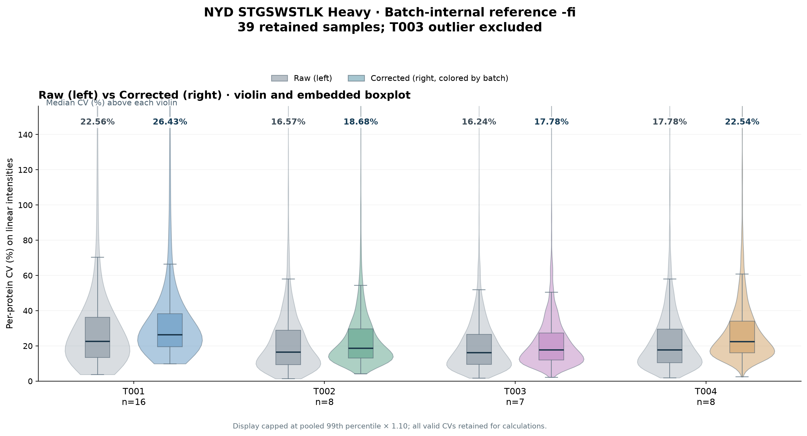

# NYD STGSWSTLK Heavy · reverse direction (-fi) trials

39 retained NYD clinical samples (T001=16, T002=8, T003=7, T004=8);
confirmed bad T003 sample MAP26092326E01 is excluded from BOTH trials.
Raw input files and both earlier positive-direction corrections untouched.

## Only change is the sign on the protein correction

Original reference definition is unchanged:
fi = median_ref − log2(H_STGSWSTLK,sample_i).
**Old:** corrected PG log2 = Raw PG log2 + fi.
**NEW:** corrected PG log2 = Raw PG log2 − fi.
Global version uses same reference median of all 39 samples.
Batch-internal version independently uses T001/T002/T003/T004 reference medians.
No other HELP peptide, weighting, limiting, outlier redefinition,
or other normalization steps. Heavy.xlsx is not modified.

These reverse shifts mathematically move STGSWSTLK Heavy *away*
from its reference if applied to Heavy. They are exploratory,
not a physically justified calibration.

## Median within-batch protein CV (%)

| Batch | n | Raw | Global + fi | Global − fi | Batch + fi | Batch − fi |
| --- | ---: | ---: | ---: | ---: | ---: | ---: |
| T001 | 16 | 22.56 | 27.11 | 26.43 | 27.11 | 26.43 |
| T002 | 8 | 16.57 | 19.56 | 18.68 | 19.56 | 18.68 |
| T003 | 7 | 16.24 | 17.96 | 17.78 | 17.96 | 17.78 |
| T004 | 8 | 17.78 | 21.96 | 22.54 | 21.96 | 22.54 |

**Within-batch CV is the same for global -fi and batch -fi**
because the two reversed corrections differ by only one constant
within each batch. The corresponding +fi approaches likewise
have identical within-batch CV. This does not imply the two
methods yield the same across-batch intensity or PCA.

## Variant directories

### global_subtract_fi

### batch_subtract_fi

## Files per variant

Seven PNGs including separate Raw and Corrected PCA images;
full 4264 x 39 corrected log2 PG matrix, per-sample original fi,
actual applied (-fi), per-batch protein CV, per-protein CV,
Raw-fitted PCA scores, and factor reference metadata.
All four PCA images from both variants use the exact same Raw
PC components, raw-based center, missingness treatment and axis limits.
Blue CFB/P00751 and yellow PROS1/P07225 are marked on PG boxes.

Because samples within each batch are different clinical specimens,
within-batch protein CV includes biological variation. A lower CV
is not by itself evidence of more accurate instrument calibration.

## Added violin plots with median CV labels

Following the original 39-sample single-Heavy CV figure RIGHT-hand violin panel:
paired Raw (left) and Corrected (right) violins with embedded boxplots,
each with its median per-protein CV (%) labeled at the very top.
Axes display up to the pooled 99th percentile x 1.10, matching
the prior style. All finite protein CV values are retained for
distributions, medians, and quartiles.

### Global -fi violin plot

### Batch-internal -fi violin plot

Both methods yield the same within-batch CV distribution, because
their factors differ only by a constant within each batch.
Corresponding 08_violin_median_CV_values.csv files record the plotted medians.
