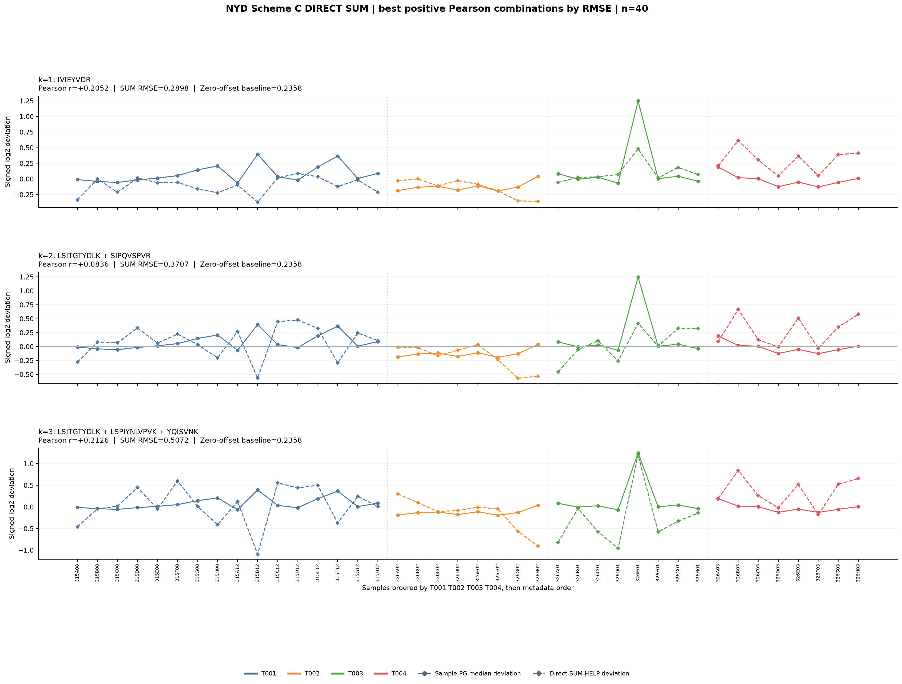
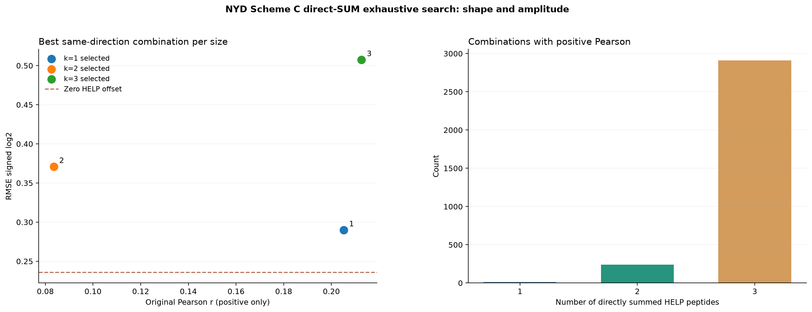
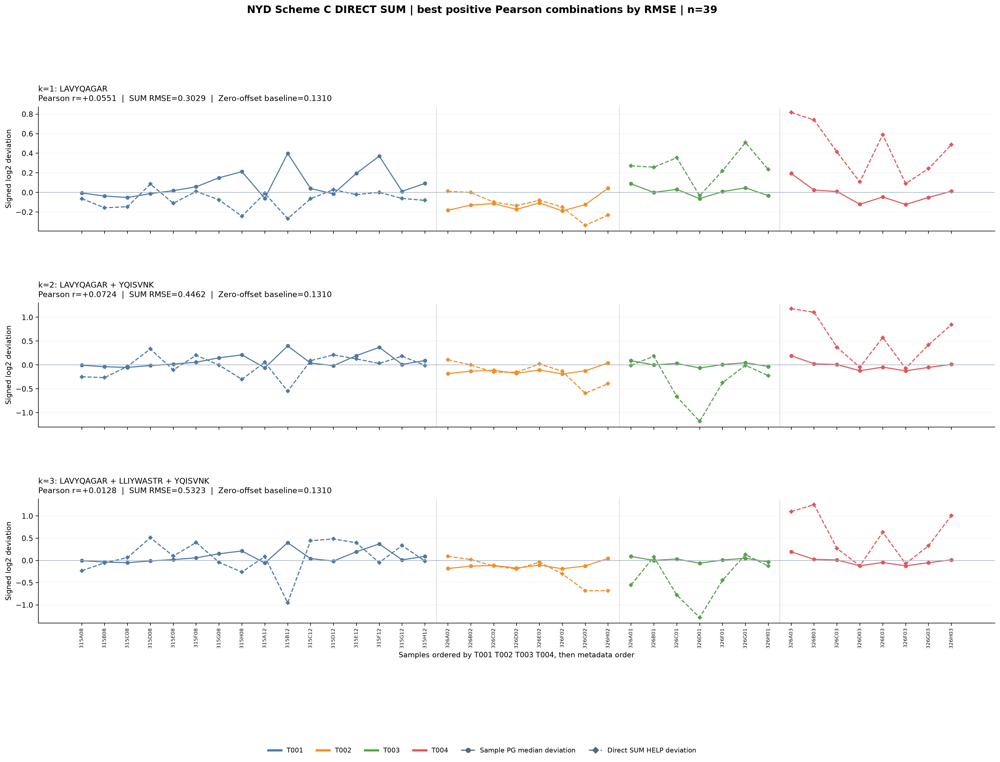
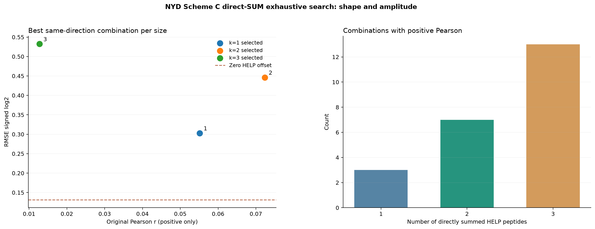

# NYD Scheme C v2: direct SUM of Heavy deviations (no weights / no mean)

For each Heavy peptide, subtract its own across-sample log2 median.
For the chosen combination, add peptide deviations directly with coefficient 1.
Neither divide by k nor recenter the final combination, nor fit scale/weights/sign.
Compare to each sample's own detected-PG median deviation (40 or 39 samples).

Only 1, 2, 3 HELP are exhaustively searched. This is a screening experiment
not proof of independent technical correction.

## full40

Full detected: 74/97; combinations: 67599.

Zero-offset baseline RMSE: 0.23578 log2.

| # HELP | # tested | same direction # | best positive r | best positive RMSE log2 | winner |
|---:|---:|---:|---:|---:|---|
| 1 | 74 | 12 | +0.2052 | 0.28979 | IVIEYVDR |
| 2 | 2701 | 242 | +0.0836 | 0.37074 | LSITGTYDLK + SIPQVSPVR |
| 3 | 64824 | 2910 | +0.2126 | 0.50724 | LSITGTYDLK + LSPIYNLVPVK + YQISVNK |

## exclude_T003_outlier_39

Full detected: 91/97; combinations: 125671.

Zero-offset baseline RMSE: 0.13099 log2.

| # HELP | # tested | same direction # | best positive r | best positive RMSE log2 | winner |
|---:|---:|---:|---:|---:|---|
| 1 | 91 | 3 | +0.0551 | 0.30285 | LAVYQAGAR |
| 2 | 4095 | 7 | +0.0724 | 0.44618 | LAVYQAGAR + YQISVNK |
| 3 | 121485 | 13 | +0.0128 | 0.53228 | LAVYQAGAR + LLIYWASTR + YQISVNK |

## Result files

- run_manifest.json: formulas and full winners
- COHORT/00_sample_PG_median_deviations.csv
- COHORT/01_all_combinations_1to3_unweighted_SUM.csv.gz
- COHORT/02_*HELP_*_top30.csv (RMSE, Pearson, reverse diagnostic)
- COHORT/03_winners_all_sizes_criteria.csv
- COHORT/04_best_same_direction_1_2_3HELP_direct_SUM.png
- COHORT/05_SUM_search_overview.png

## Limits

NYD uses different clinical samples, not pooled technical replicates.
Pearson is shape similarity; RMSE penalizes amplitude and offset.
The score of a zero-combination predictor is reported as an essential sanity check.
Negative-correlation combinations cannot be called same-direction;
the optional opposite-signed diagnostic does not influence primary search.
40 and 39 samples have different eligibility and must not be conflated.
Older Scheme C averaged HELP values. This NEW experiment uses SUM only.
