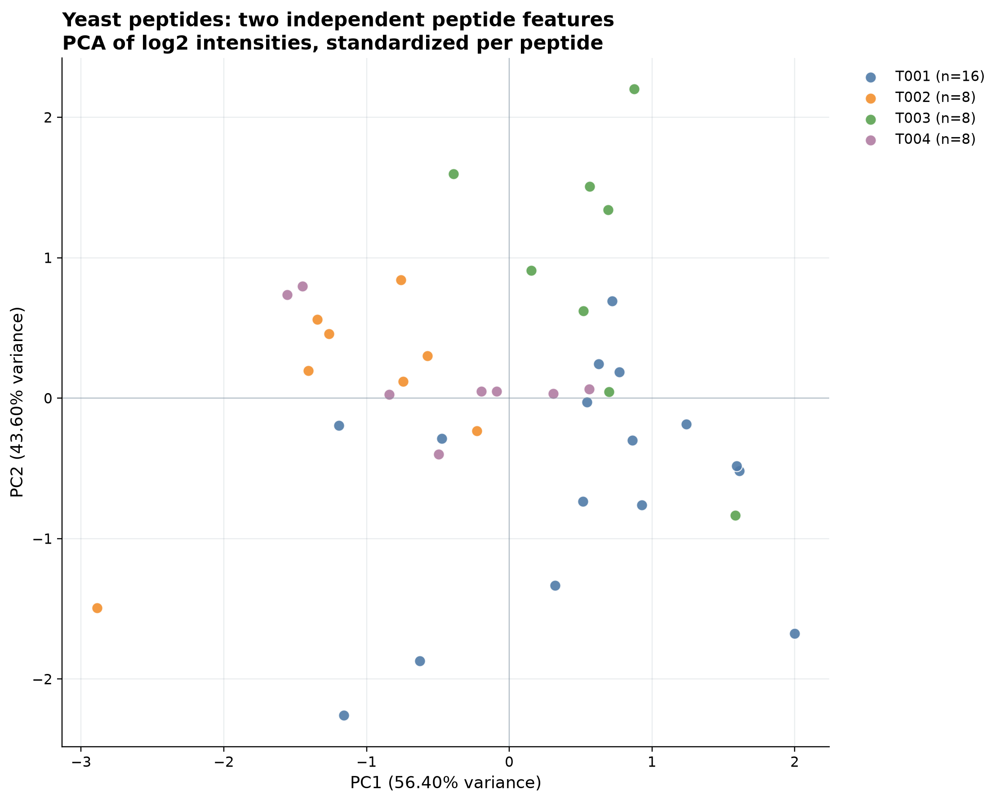
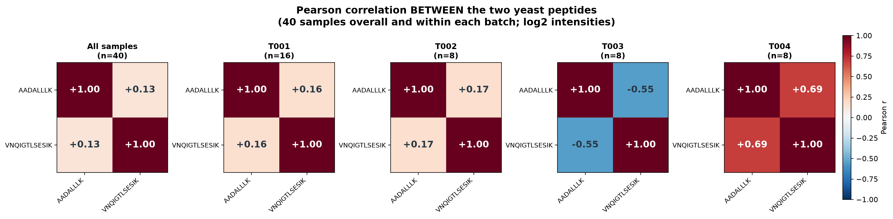
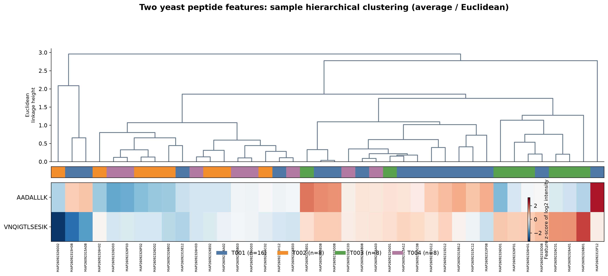
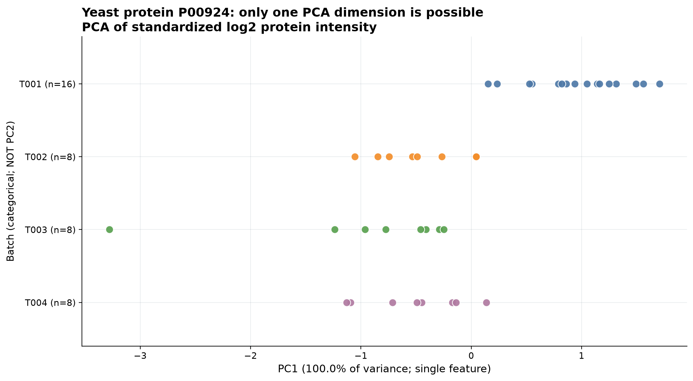
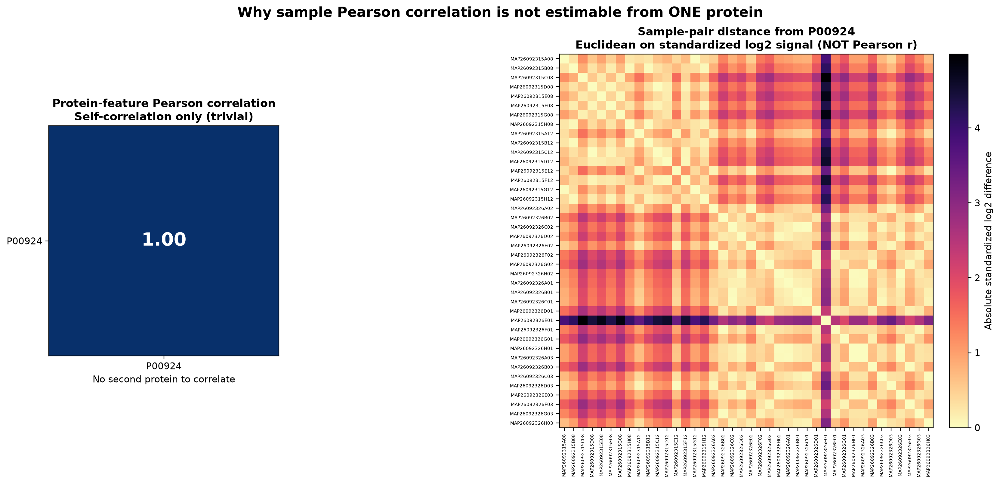
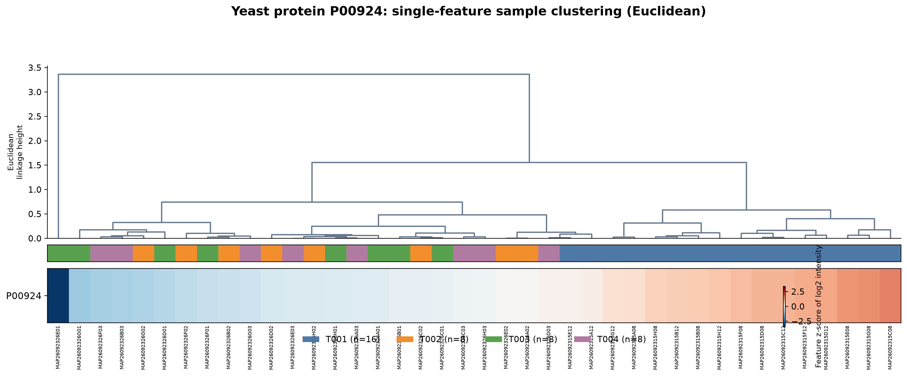

# NYD 40 samples: yeast peptide vs protein PCA, correlations and clustering

This is an exploratory analysis of YEAST.xlsx using NYD_sampleinfo2.xlsx
(T001 n=16, T002/T003/T004 n=8). Original source Excel files and previous
CV results are preserved without change.

## Exact features used

**Peptides (40 samples x 2 independent features):** AADALLLK, VNQIGTLSESIK.
A peptide's own charge-state precursors are linearly summed first (1+2 and 2+3
respectively), as in the previously verified charge-summed peptide CV.
**The two different peptides are NEVER added together.**
**Protein (40 samples x 1 feature):** P00924, directly from the protein row.
For exploratory PCA and clustering, each independent feature is transformed to
log2 and then centered/scaled to unit variance. The CV values previously
reported remain on their original linear intensity scale.

## 1. Two-peptide PCA

True two-feature PCA; points are samples, colors are metadata batches.
Explained variance: PC1 **56.40%**, PC2 **43.60%**.

## 2. Peptide correlation heatmaps

Pearson correlations are computed **between the two unique peptide features**
across all 40 samples and within each batch. This is a 2x2 FEATURE correlation
matrix per group, not an invalid 40x40 sample correlation based on 2 values.
The 2x2 diagonal is self-correlation (1.00).

## 3. Peptide sample cluster heatmap

Each column is a sample; rows are the two independently standardized peptide
signals. Hierarchical clustering uses sample Euclidean distances and average
linkage. The top stripe shows original batch labels in clustered order.

## 4. Protein PCA: mathematical limitation

**With one protein feature only PC1 exists.** A conventional PC1-versus-PC2
scatter would invent information: PC2 is undefined. The figure therefore plots
true one-dimensional PC1 scores on the horizontal axis and **batch category**
on the vertical axis (not PC2). PC1 accounts for all available variance.

## 5. Protein correlation: mathematical limitation and substitute

With only one protein, the protein-feature Pearson matrix is 1x1 and 1.00
(self-correlation), which tells nothing about between-sample similarity.
A 40x40 **sample Pearson correlation is undefined with one feature**.
To make this view useful, the right-hand heatmap instead shows the
**Euclidean distance between samples** on the single standardized log2
protein signal; its color is NOT Pearson correlation.

## 6. Protein sample cluster heatmap

Hierarchical clustering of the 40 samples on one standardized log2 P00924
signal using Euclidean distance and average linkage. With only one protein
this clustering can be fragile and must not be taken as evidence that
biological sample states or technical batches were reliably inferred.

## Exported audit tables

- feature_matrix_40samples.csv: all 40 sample IDs, batches, log2 and z-scored features.
- peptide_pca_scores.csv and peptide_pca_loadings.csv.
- peptide_feature_pearson_by_batch.csv: five 2x2 correlation summaries.
- peptide_sample_cluster_order.csv and protein_sample_cluster_order.csv.
- protein_1D_pca_scores.csv: PC2 explicitly shown as undefined.
- protein_sample_euclidean_distance_long.csv: 40x40 distance matrix (long-form).
- run_manifest.json: source hashes, feature declarations and method limitations.

**Interpretation warning:** Two peptides and one protein are insufficient
to assess global proteomic batch effects. Evaluate batch separation
descriptively, not as an instrument-quality conclusion.
