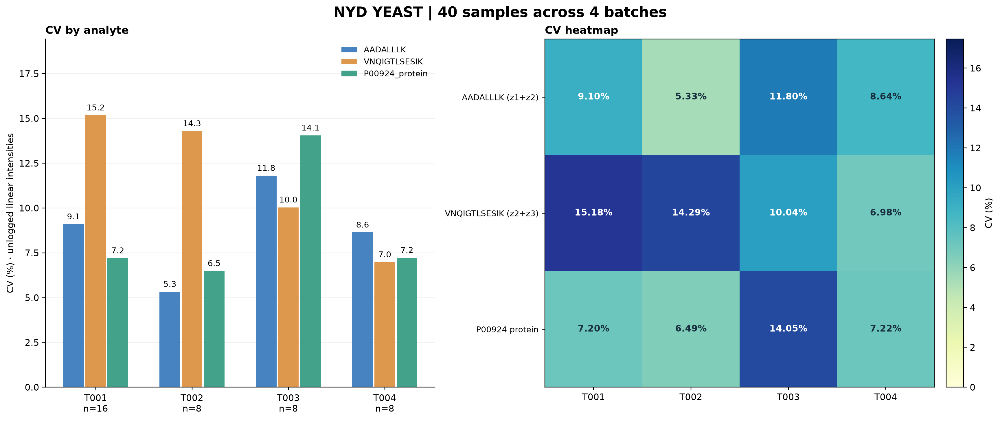
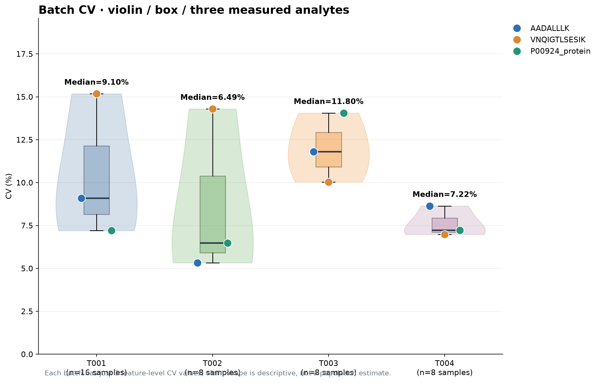
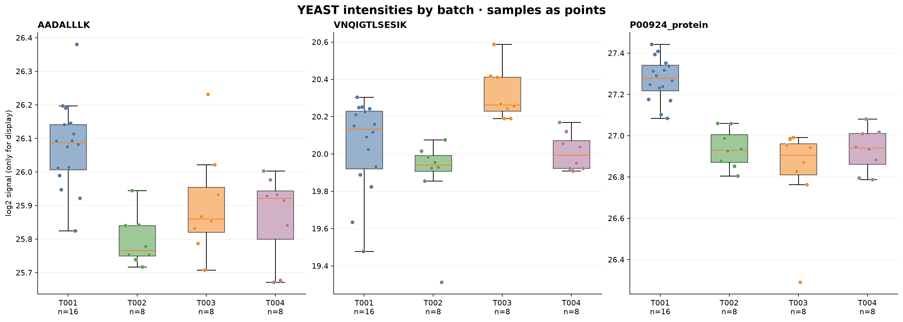

# NYD YEAST: 40-sample batch CV and visualizations

Original workbooks were not changed. Data were joined by exact sample ID.
The metadata has 16 T001 samples and 8 samples each for T002/T003/T004.
The peptide portion has AADALLLK precursor charge 1 and 2, and
VNQIGTLSESIK charge 2 and 3. For each sample, intensities are summed
in linear units across the two charge rows for each stripped sequence.
P00924 protein uses the single protein row without summation.

CV = 100 x sample SD (ddof=1) / arithmetic mean, on ORIGINAL LINEAR intensity.
Only finite positive measurements contribute. No missing-value imputation.
Valid CV requires >= max(3,ceil(0.7 x batch size)) observed values.
Log2 is only used for visualizing original intensities.

## Batch CV (%)

| Batch | n | AADALLLK (z1+z2) | VNQIGTLSESIK (z2+z3) | P00924 protein | Median of 3 |
| --- | ---: | ---: | ---: | ---: | ---: |
| T001 | 16 | 9.10% | 15.18% | 7.20% | 9.10% |
| T002 | 8 | 5.33% | 14.29% | 6.49% | 6.49% |
| T003 | 8 | 11.80% | 10.04% | 14.05% | 11.80% |
| T004 | 8 | 8.64% | 6.98% | 7.22% | 7.22% |

Missing/invalid original values: **0**.

## Figures

### 1. CV grouped bars and heatmap

### 2. CV violin / boxplot / scatter

Note: Each violin summarizes just three CV values per batch. Its smoothed
shape is not a statistically robust distribution estimate.

### 3. Sample-level log2 intensity boxplots (four batches)

## Output CSVs

- yeast_per_sample_charge_sums.csv: original precursor values and each summed peptide.
- yeast_batch_cv_long.csv: n, mean, sample SD, detection, CV and median by feature/batch.
- yeast_batch_cv_wide.csv: four-batch comparison.
- run_manifest.json: source SHA256, calculation policy and missing-value audit.

These are within-batch sample CVs and should not automatically be called
pure technical CV unless the samples are known homogeneous technical QCs.
