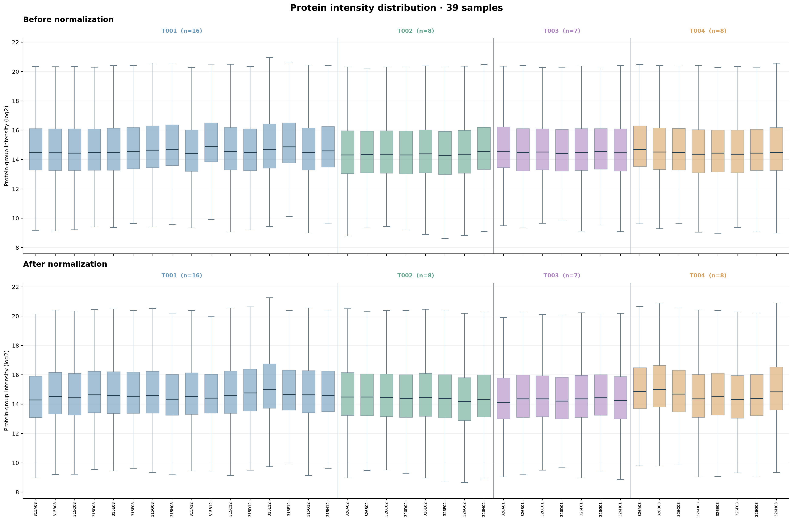
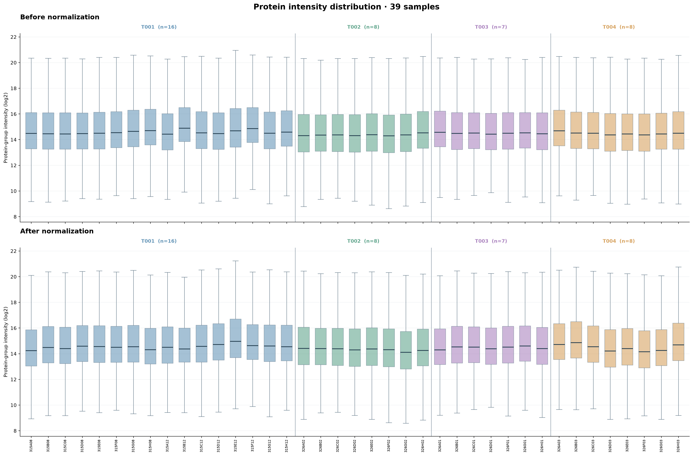
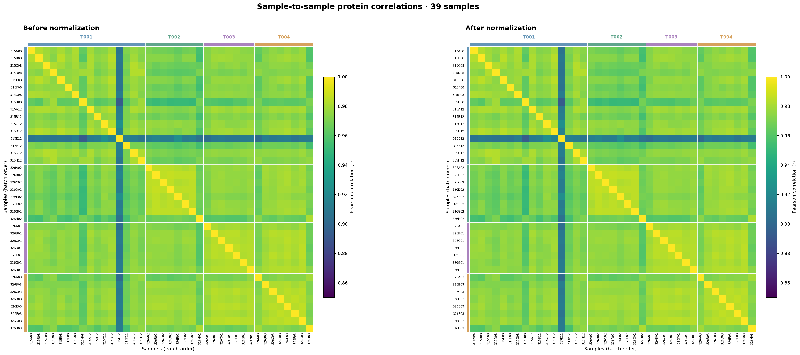

# NYD protein-intensity and correlation figures

## Scope

39 samples following sample-level quality control.
Four acquisition batches (T001: 16, T002: 8, T003: 7, T004: 8).
All available positive protein-group measurements are visualized
on the log2 intensity scale. Samples remain in the same order in
all panels; boxplots share one intensity scale.

## Processing variants

### Overall-reference normalization

### Within-batch normalization

## Notes on interpretation

Each heatmap is a 39 x 39 sample-to-sample Pearson correlation
matrix across quantified log2 protein intensities. A pair of samples
uses proteins detected in both (pairwise complete observations).
All heatmaps share the same correlation color scale and sample ordering.
**Pearson correlations are unchanged by a constant log2 shift of
every protein measurement in a sample.** Therefore the before and
after heatmaps are identical by design for these normalization variants.
The heatmap similarity is not evidence that nothing was corrected;
protein-intensity boxplots provide the appropriate shift comparison.
These are presentation figures, not an independent accuracy assessment.

## Figures supplied for each variant

- Protein intensity distributions: individual before and after PNGs.
- Protein intensity distributions: before-and-after paired PNG.
- Sample Pearson correlations: individual before and after PNGs.
- Sample Pearson correlations: before-and-after paired PNG.
- Supporting sample-to-sample correlation CSVs and sample-label key.

Figures emphasize protein distributions and sample correlations
without individual target-protein annotations.
