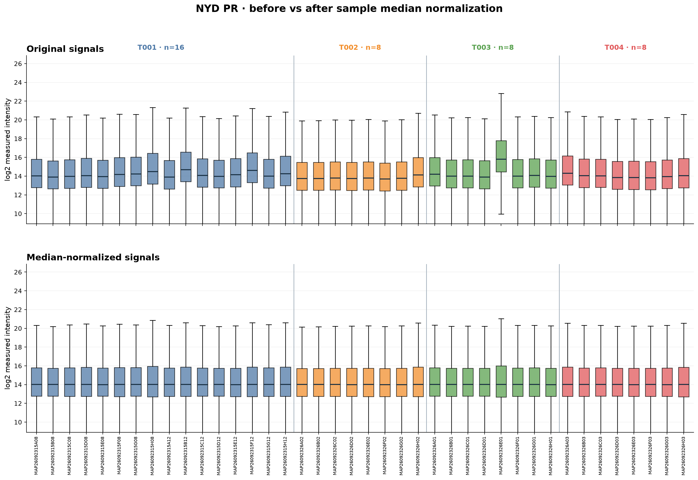
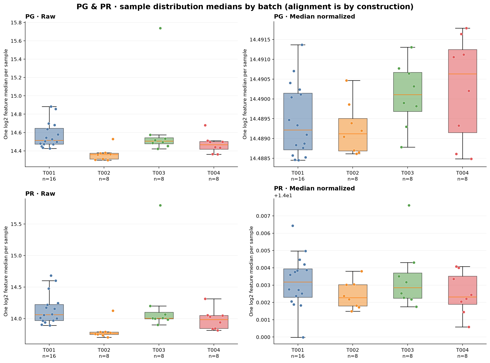
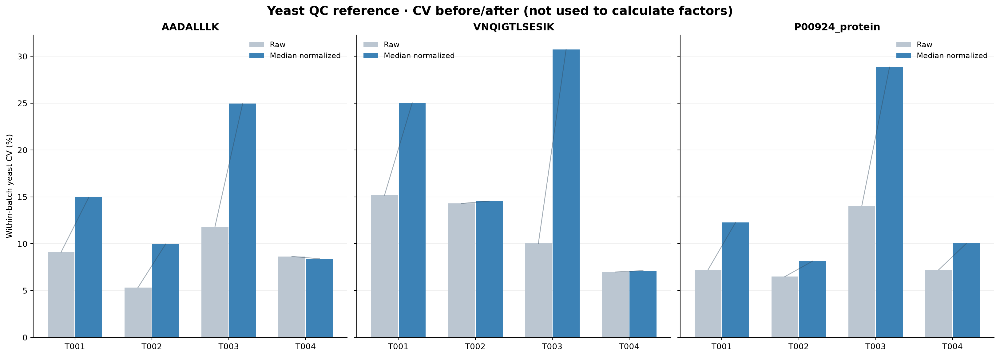
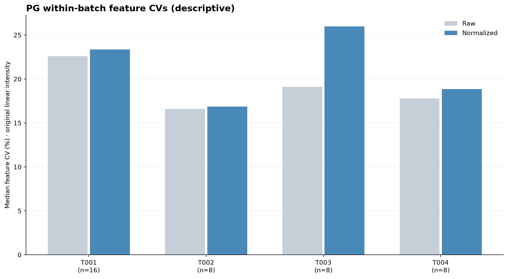
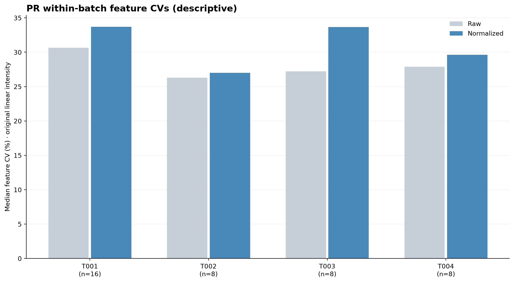

# NYD 40 samples: median normalization (MacCoss paper-inspired)

**Method:** per-sample median normalization performed directly on 40 biological samples.
Paper reference: Tsantilas et al. (2026), *Circulating extracellular vesicles in
plasma carry accessible molecular signatures of aging in mice*, MacCoss group.
doi:10.64898/2026.07.10.737625.
The paper reports median-normalized log intensities but does not specify its exact
software-scale factor formula in the supplied text. Our explicit reproducible
implementation is a paper-inspired choice, not a claim of exact software replication.

For each PG/PR matrix separately, m_s=median(log2(I_positive)),
m_ref=median_s(m_s); I_corrected=I_raw*2^(m_ref-m_s).
40 sample columns joined to NYD_sampleinfo2.xlsx by exact sample ID.
All samples are treated individually, not separately calibrated by batch.
The yeast P00924/ENO1_YEAST rows are excluded from computing factors
when present, and used only as hold-out signal diagnostics.
Raw nonpositive and missing entries remain exactly as observed;
no imputation, no replacement of source files.

## Outputs

- NYD_pg_matrix2_median_normalized.tsv: corrected PG protein-group intensity matrix.
- NYD_pr_matrix2_median_normalized.tsv: corrected PR feature intensity matrix.
- median_normalization_sample_factors.csv: 80 sample/matrix factors (PG and PR separately).
- sample_median_statistics.csv, batch_median_statistics.csv: distributions before/after.
- batch_feature_cv_statistics.csv: descriptive within-batch feature CV changes.
- yeast_before_after_per_sample.csv, yeast_cv_before_after.csv: independent yeast diagnostics.
- run_manifest.json: original SHA256 and exact mathematical method.

## Corrected PG and PR boxplots by sample

## Batch distribution of sample-level medians

## Yeast holdout CV before and after

Peptide reference features use the **PR** correction factors while the one
P00924 protein reference uses **PG** correction factors. Original peptide
charge states are summed within each unique peptide as in prior yeast CV.
CV is sample SD / mean * 100 calculated on original-linear signals.
The yeast is not an input to the normalization factor.

### Batch-specific yeast CV details

| Batch | Feature | Raw CV (%) | Post-normalization CV (%) | Delta pp |
| --- | --- | ---: | ---: | ---: |
| T001 | AADALLLK | 9.10 | 14.96 | +5.86 |
| T001 | VNQIGTLSESIK | 15.18 | 25.03 | +9.86 |
| T001 | P00924_protein | 7.20 | 12.28 | +5.08 |
| T002 | AADALLLK | 5.33 | 9.97 | +4.64 |
| T002 | VNQIGTLSESIK | 14.29 | 14.54 | +0.25 |
| T002 | P00924_protein | 6.49 | 8.14 | +1.65 |
| T003 | AADALLLK | 11.80 | 24.95 | +13.14 |
| T003 | VNQIGTLSESIK | 10.04 | 30.73 | +20.69 |
| T003 | P00924_protein | 14.05 | 28.85 | +14.80 |
| T004 | AADALLLK | 8.64 | 8.39 | -0.25 |
| T004 | VNQIGTLSESIK | 6.98 | 7.13 | +0.15 |
| T004 | P00924_protein | 7.22 | 10.04 | +2.81 |

## Within-batch PG/PR feature CV comparisons

These represent variation of individual biological sample measurements, NOT pure
technical precision. The batch sample-median contraction is guaranteed
by construction and cannot alone prove quality improvement.

## Interpretation and limitations

Median normalization assumes most measured proteomic features have
comparable central abundance across samples. Genuine global shifts in
abundance, systematic missingness, and differing biological compositions
can bias normalization; this is especially important for samples with
unusually low detection rates. The earlier PG quality analysis identified
a low-detection T003 sample (MAP26092326E01) that warrants particular review.
Median normalization does not by itself prove removal of a batch effect.
This analysis has no repeated pooled QC to independently establish
batch correction quality; yeast is examined as an additional holdout.
