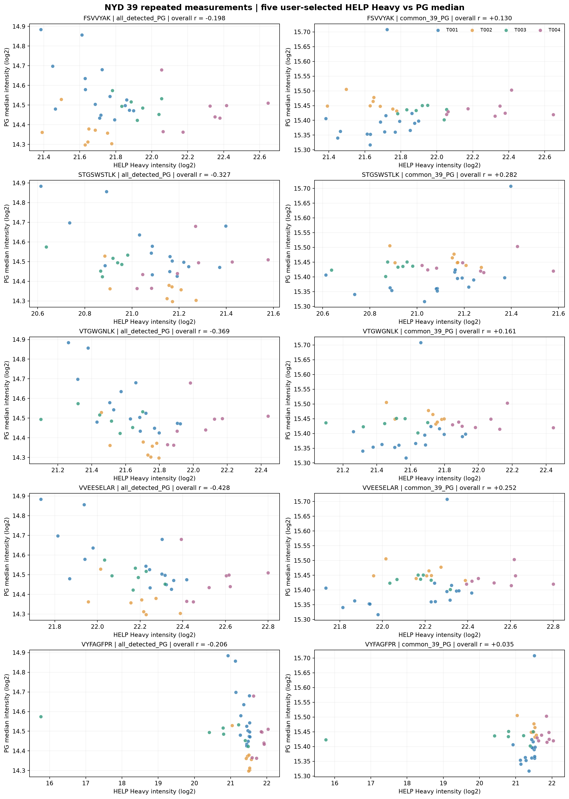
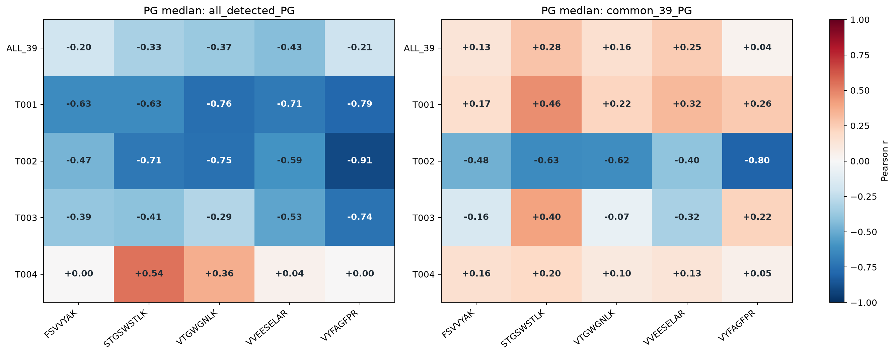

# NYD 39 sample | five user-selected HELP Heavy vs raw PG medians

Uses the five MANUALLY specified PACS HELP peptides: FSVVYAK, STGSWSTLK, VTGWGNLK, VVEESELAR, VYFAGFPR.
Do not confuse them with the separate NYD CV/MAD-selected five.

All values come from original Heavy.xlsx and NYD_pg_matrix2.tsv.
The T003 sample MAP26092326E01 is excluded without changing input files.
The 39 samples are repeated measurements of the same specimen.

## The two PG median definitions

1. all_detected_PG: for each sample independently, take median of log2 positive
   protein-group intensities among the PGs detected in THAT sample.
   Protein composition can differ by sample due to missingness.
2. common_39_PG: select once the PG rows with positive finite intensity
   in every one of the 39 samples, then take per-sample log2 medians
   using precisely the SAME protein rows for all samples.
   Common set size: 2259 PG out of 4264.

For each HELP, Pearson correlates its log2 raw Heavy intensity across samples
with each of the two per-sample PG log2 medians, overall and within batch.
n_pairs counts the samples usable for both values. No imputation.
Two-sided p-values are exploratory and unadjusted for multiple comparisons.
A five-HELP mean of peptide-wise centered log2 Heavy values is also shown
as a secondary composite; it is NOT used to normalize PGs.

## Outputs

- pearson_summary_all_and_by_batch.csv: 6 HELP representations x 2 PG definitions x 5 scopes.
- sample_level_log2_intensities.csv: 39 auditable sample-level records.
- common_39_PG_protein_list.csv: annotation list of fixed shared PG set.
- 01_scatter_5HELP_two_PG_definitions.png: two scatter comparisons per peptide.
- 02_Pearson_r_by_batch_heatmaps.png: each selected peptide's Pearson r.
- run_manifest.json: provenance and exact processing definitions.

## Interpretation

These are correlations across repeated sample measurements, NOT sample-to-sample
PG correlation heatmaps. Negative r does not by itself validate a -fi correction.
A change in sign between the two PG definitions suggests composition/missingness
effects may affect sample-wise medians. Batch sample sizes are small.
No historical files or source matrices were modified.
