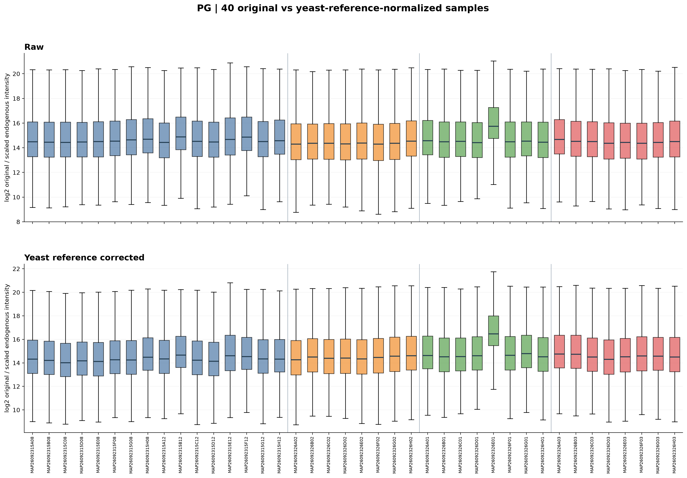
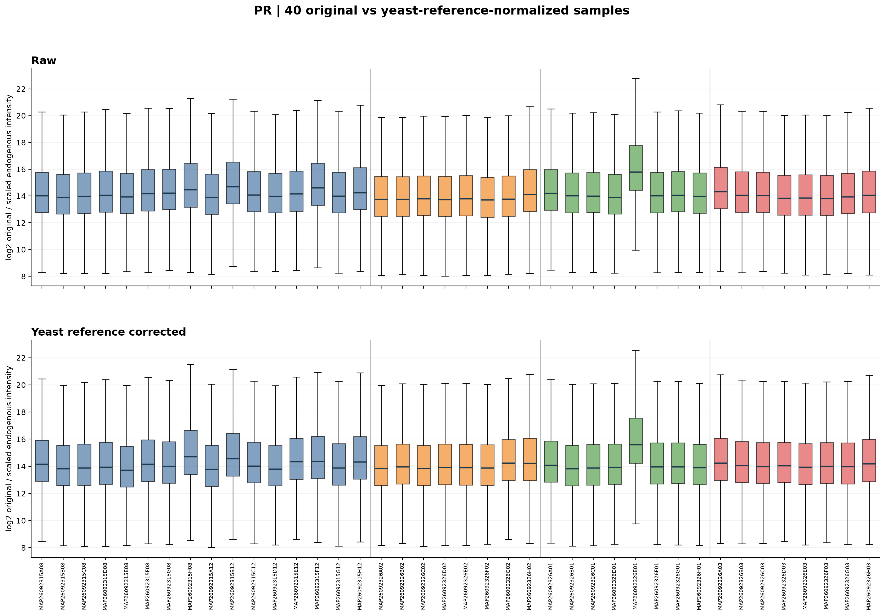
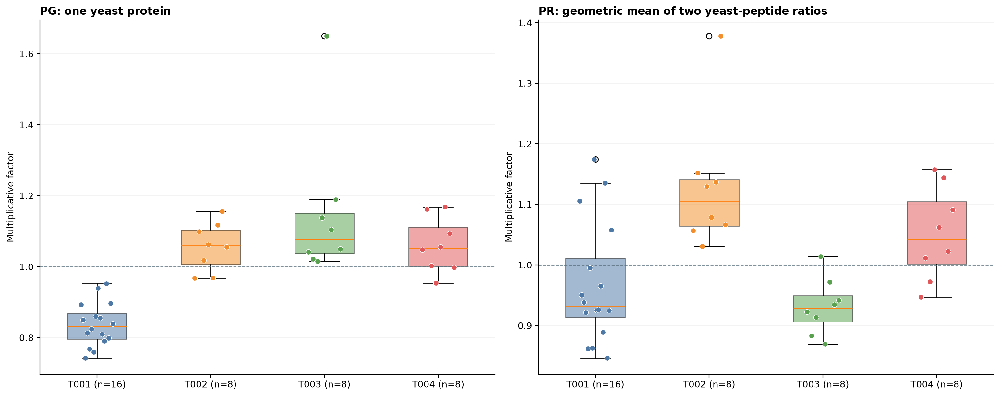
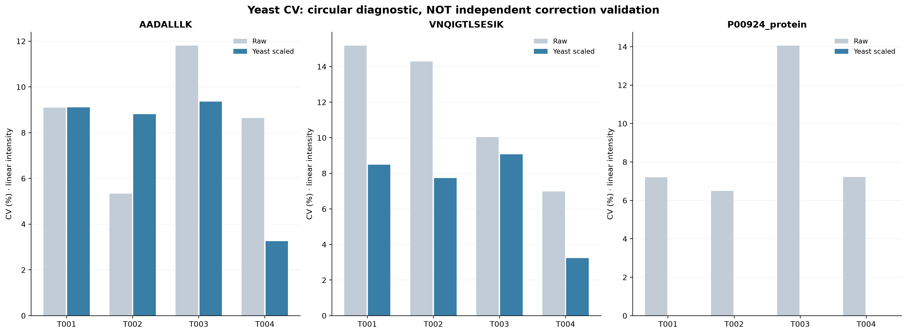
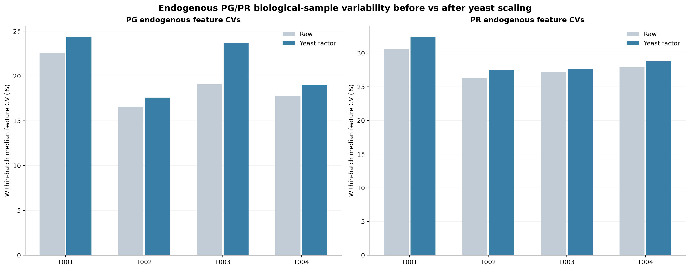

# Experimental yeast internal-standard normalization: 40 NYD samples

**Not the median normalization method described in MacCoss et al. 2026.**
The paper used proteome/peptide median-normalized data and checked
spiked-in yeast ENO1 as internal QC. The current test instead uses yeast
intensities themselves to derive reference-based scaling factors.

## Method

PG factor: median yeast P00924 protein signal across all 40 samples
divided by the sample's yeast P00924 signal.
PR factor: first add different precursor charge states of EACH peptide
on linear scale; then compute the reference/sample ratio independently
for AADALLLK and VNQIGTLSESIK, and take their geometric mean.
**The two DIFFERENT yeast peptides are never summed together.**
All sample intensities in the corresponding matrix are multiplied
by that sample factor. Raw source matrices remain intact.
No missing-value imputation, no batch-specific factor.

## Files

- NYD_pg_matrix2_yeast_protein_normalized.tsv: yeast-P00924-normalized PG matrix.
- NYD_pr_matrix2_yeast_two_peptide_normalized.tsv: yeast-two-peptide-normalized PR matrix.
- yeast_reference_factors.csv: two peptide ratios and PG/PR factor per sample.
- endogenous_batch_CV.csv: raw and yeast-corrected endogenous PG/PR CV distributions.
- yeast_CV_CIRCULAR.csv: raw and post yeast CV; cannot independently validate correction.
- endogenous_sample_stats.csv and endogenous_batch_stats.csv: descriptive sample summaries.
- run_manifest.json: source hashes and exact definition.

## PG: 40 sample boxplots before/after yeast protein reference correction

## PR: 40 sample boxplots before/after two yeast peptide reference correction

## Factor distributions by batch

## Yeast CV (CIRCULAR; not independent evidence)

By construction, the P00924 reference has a post-normalization CV
near zero because its own signal determined the correction factor.
This does NOT prove successful biological or technical correction.
The same caution applies to the two peptides used to calculate the PR factor.

## Endogenous PG/PR feature CV by batch

| Matrix | Batch | Raw median CV (%) | Yeast corrected median CV (%) | n features |
| --- | --- | ---: | ---: | ---: |
| PG | T001 | 22.58 | 24.36 | 3144 |
| PG | T002 | 16.57 | 17.59 | 3618 |
| PG | T003 | 19.09 | 23.70 | 3202 |
| PG | T004 | 17.79 | 18.98 | 3401 |
| PR | T001 | 30.65 | 32.41 | 22508 |
| PR | T002 | 26.30 | 27.53 | 30886 |
| PR | T003 | 27.21 | 27.67 | 23549 |
| PR | T004 | 27.89 | 28.80 | 27262 |

## Limitations

The yeast spike-in amount must truly be equal across all samples.
The two yeast peptides previously showed limited correlation, so a
two-peptide PR reference can be noisy. Known T003 low-detection sample
MAP26092326E01 is retained. Endogenous CV also contains biological
differences; without repeated pooled QCs, apparent changes are not
proof of batch-effect removal.
