# PACS new attempt: EN01 yeast protein replaces yeast peptide factor1

Archived previous results/ as **results_v3/**.
This new results/ contains two yeast-protein-based factor1 strategies;
the former Trial 2 factor2 and other calculation/plotting rules are unchanged.

## Source data

- Protein matrix: pg_matrix.tsv, SHA256 112d59739481b2fbf1d5252d0fc754c4a4494af60c77ff050af153fe423012be.
- Yeast protein input: EN01.xlsx, SHA256 08122d5a044689a7863cb85768d96797566d976a76925ecd3a71bdedcef09c45.
- HELP workbook: LH_ratio_tables_2026.10.13—ALL-HELP.xlsx, SHA256 5523ffca836fd7244610322f781084619541482835f108a92cdb350a6e3a4e53.
- The previous yeast **peptide** workbook is NOT used to calculate either factor1.
- Protein rows: 6675 (yeast P00924 and P00925 removed from main matrix).
- Samples: 75 (LM 6, pooled QC 15, HC 27, S 27).
- No input or older result files are modified by calculation.

## Rank two yeast proteins by row sum

Ranking uses the sum of valid original **linear** intensities for
**all 75 retained sample IDs**, omitting missing/nonpositive signals.
The two yeast protein intensities are positive in all 54 study samples.
Samples with missing yeast protein signal(s): LM_1.
Missing yeast values are NOT imputed or replaced. Both QC groups are left uncorrected.

| Source row identifier (verbatim) | Linear row sum (75 samples) | Chosen for single method |
| --- | ---: | --- |
| P00924_ENO1_YEAST | 5.9052681e+08 | Yes |
| P00925_ENO1_YEAST | 1.2572416e+08 | No |

Selected larger-row-sum row: **P00924_ENO1_YEAST**.
The two source rows are P00924_ENO1_YEAST and P00925_ENO1_YEAST;
the source names are kept as uploaded, including the P00925 naming discrepancy
documented in ENO1_DATA_CLEANUP_REPORT.md.

## Corrections in log2

Let x1_s and x2_s be the two original positive **linear** EN01 protein intensities.
All yeast references are the median across **54 Study samples** (HC and S).

**Variant 1: single_max_rowsum**
- Select the row with larger 75-sample row sum: P00924_ENO1_YEAST.
- y_s = log2(x_selected,s).
- factor1_s = median_Study(y) - y_s.

**Variant 2: sum_two**
- y_s = log2(x1_s + x2_s); sum linear intensities BEFORE log2.
- factor1_s = median_Study(y) - y_s.

**Unchanged Trial 2 HELP correction**
- mR_s = median_97HELP(log2(L/H) for valid positive ratios).
- ref_mR = median_15_pooled_QC(mR_s).
- factor2_s = ref_mR - mR_s.

Stages within each method:
- Raw: original protein intensity.
- Factor1: log2 corrected protein = log2(raw) + factor1.
- Factor1+Factor2: log2 corrected protein = log2(raw) + factor1 + factor2.
- **Only HC and S are corrected.** Internal-QC and pooled QC raw linear data are exactly unchanged.
- Factor1 and factor2 are added in log2; CV is sample SD(ddof=1)/arithmetic mean
  of original-scale positive intensities, times 100, with >=70% group detection, >=3 and mean >=1e-8.
- PCA and boxplots are log2; PCA imputes only for projection, uses >=70% observed
  common proteins per view; PCA refitted at each stage, so PC coordinates are not directly aligned.

## Computed references

- Larger-row-sum protein Study log2 median: 22.7457546728.
- Two-protein linear sum Study log2 median: 22.9925370384.
- Pooled QC HELP ref_mR log2: -5.69001011213.

## Median per-protein CV (%)

| Method | Stage | Internal-QC | pooled QC | HC | S |
| --- | --- | ---: | ---: | ---: | ---: |
| single_max_rowsum | Raw | 63.88% | 10.41% | 23.04% | 28.82% |
| single_max_rowsum | Factor1 | 63.88% | 10.41% | 49.10% | 68.95% |
| single_max_rowsum | Factor1 + Factor2 | 63.88% | 10.41% | 50.03% | 89.54% |
| sum_two | Raw | 63.88% | 10.41% | 23.04% | 28.82% |
| sum_two | Factor1 | 63.88% | 10.41% | 49.01% | 68.60% |
| sum_two | Factor1 + Factor2 | 63.88% | 10.41% | 49.96% | 89.45% |

## Visualizations: all three stages together

2 methods × 2 views (all_groups / study_only) × 6 PNG = **24 PNG**; no SVG.
Each plot places Raw / Factor1 / Factor1+Factor2 next to each other.

### single_max_rowsum / all_groups

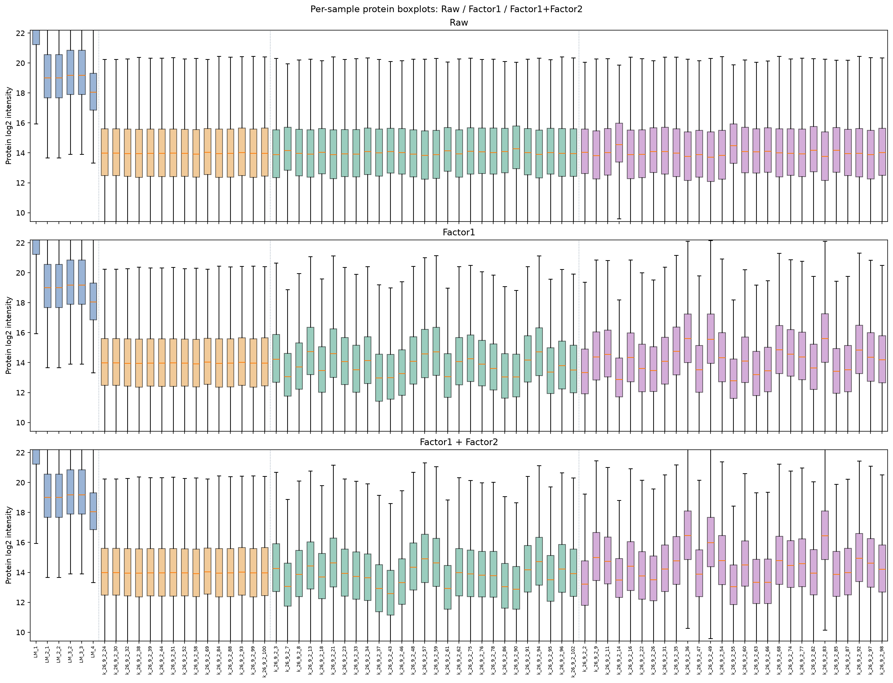

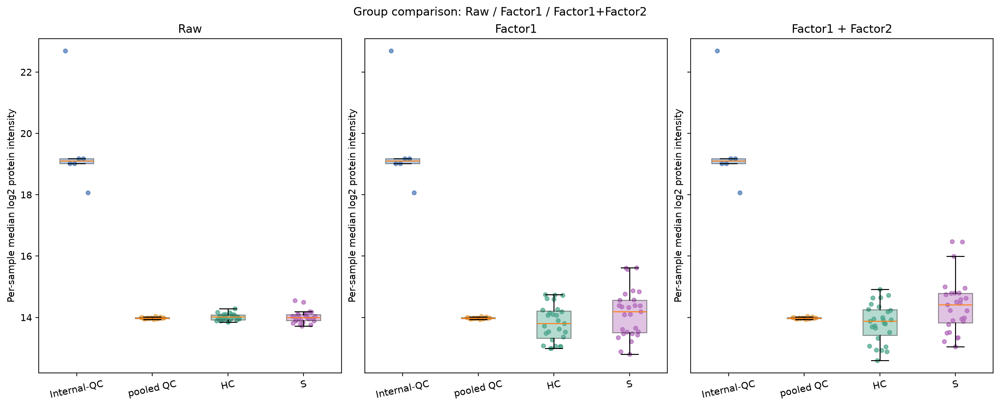

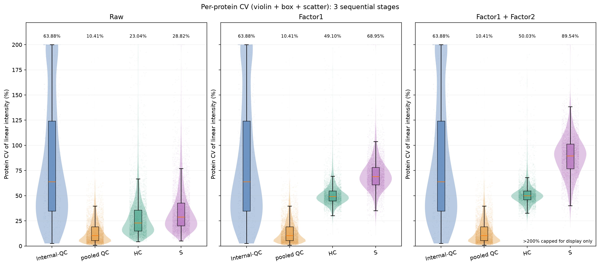

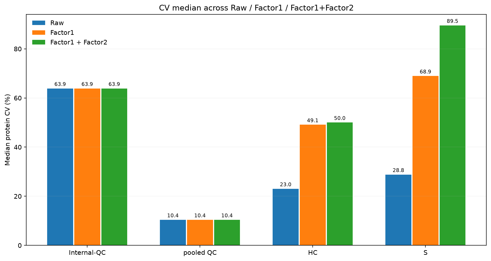

### single_max_rowsum / study_only

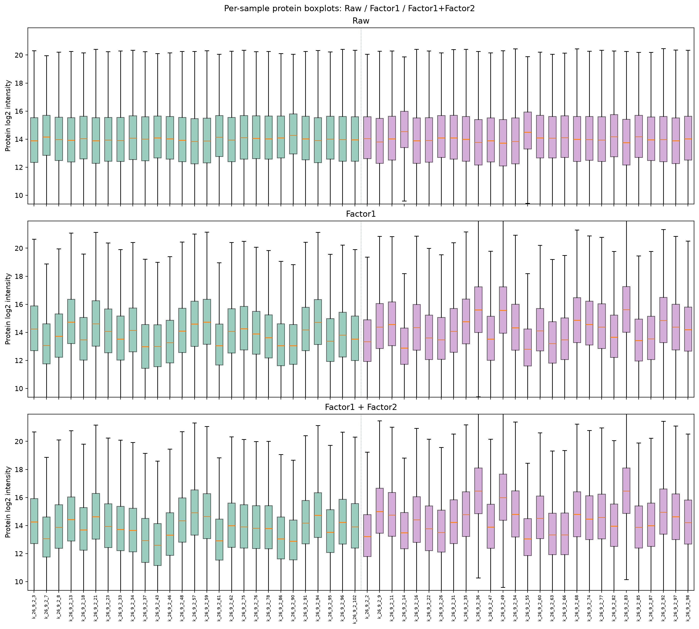

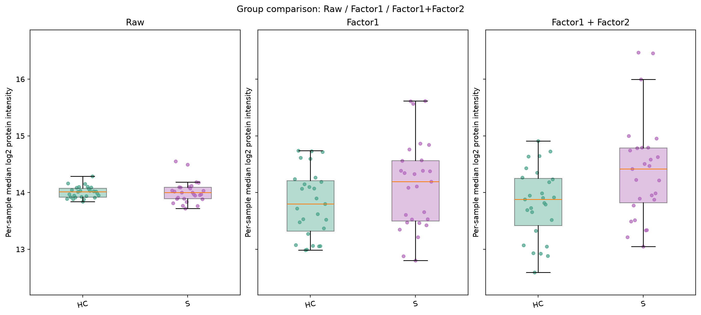

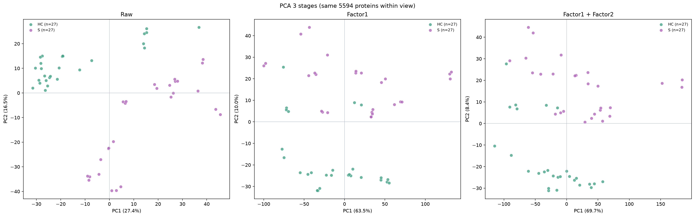

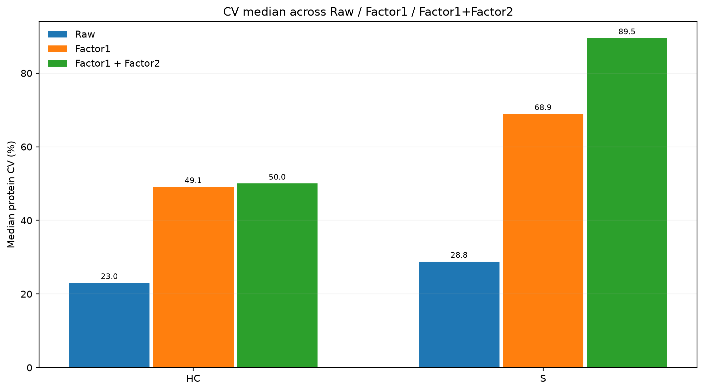

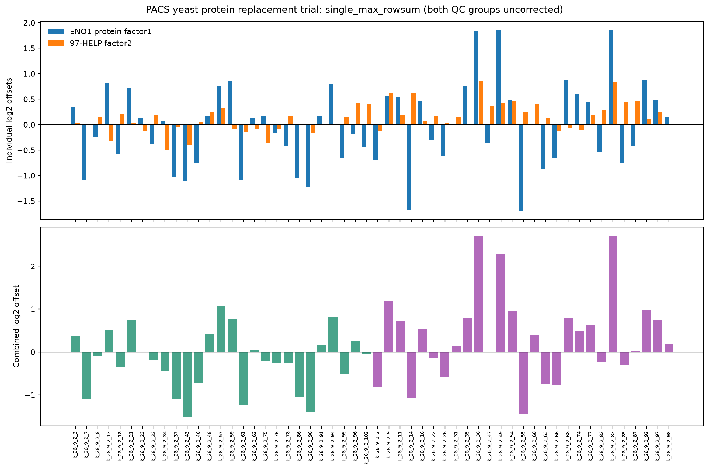

### sum_two / all_groups

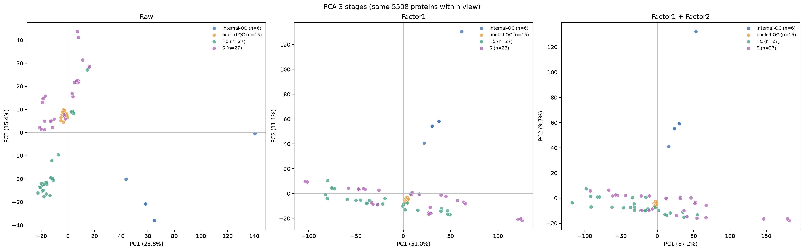

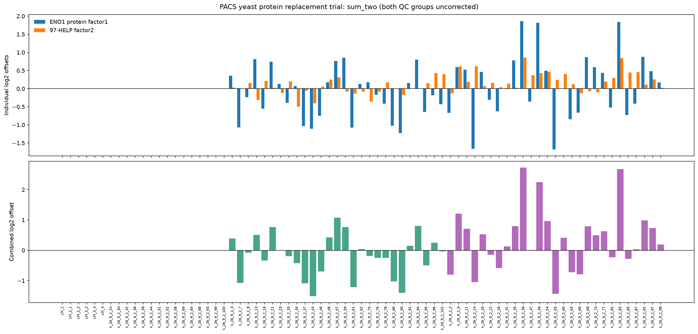

### sum_two / study_only

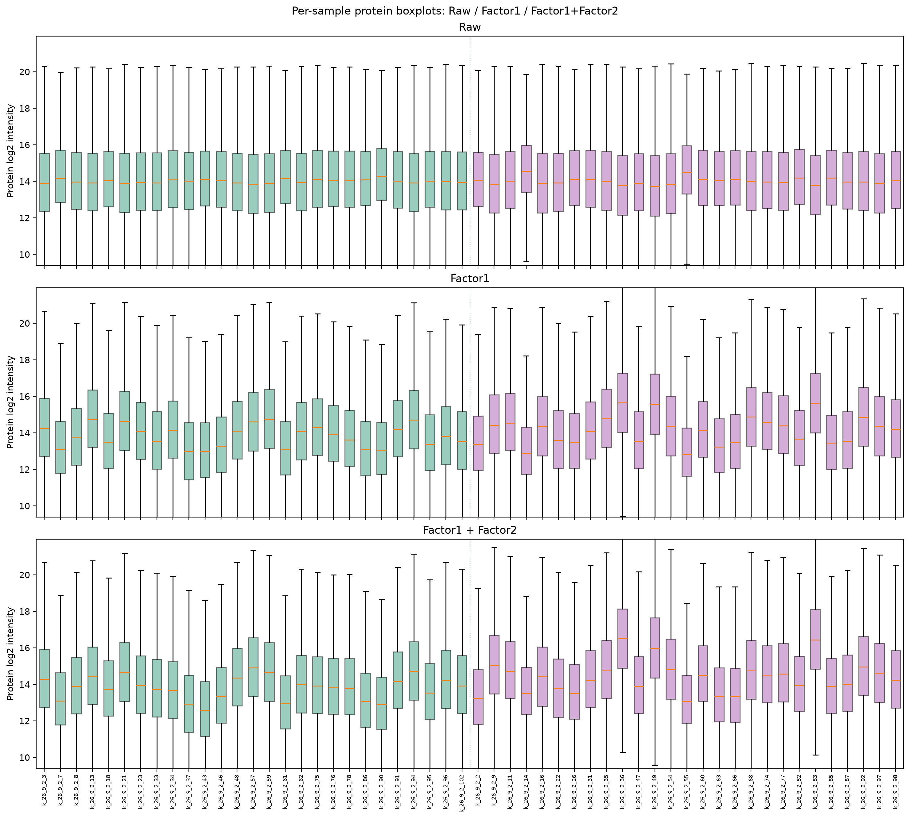

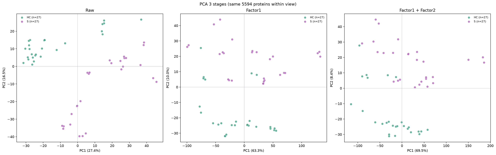

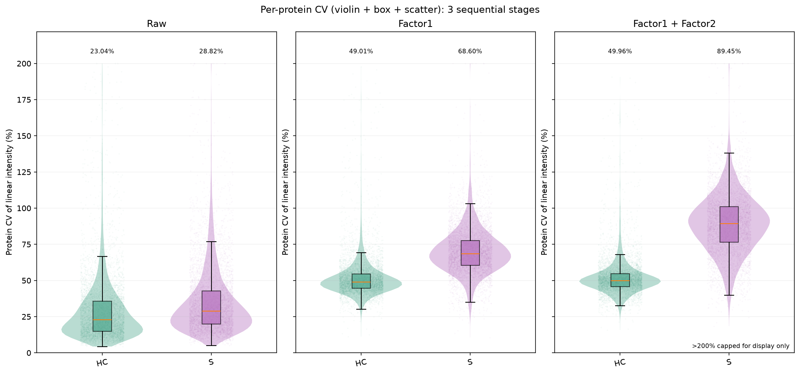

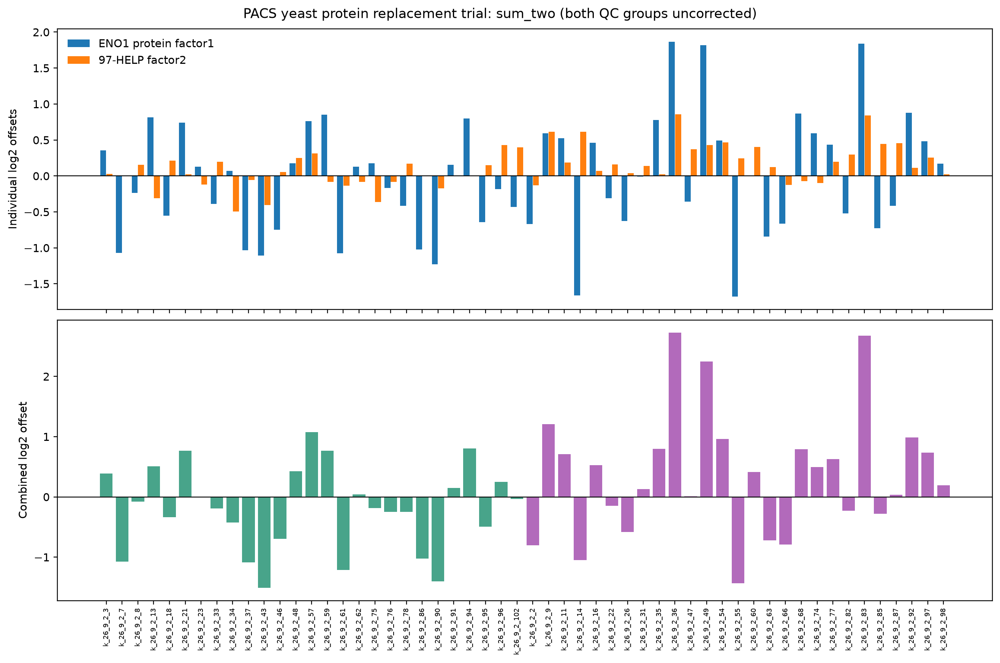

## PCA explained variance

| Method | View | Stage | Proteins | PC1 | PC2 |
| --- | --- | --- | ---: | ---: | ---: |
| single_max_rowsum | all_groups | raw | 5508 | 25.81% | 15.43% |
| single_max_rowsum | all_groups | factor1 | 5508 | 51.19% | 11.01% |
| single_max_rowsum | all_groups | factor1_factor2 | 5508 | 57.38% | 9.67% |
| single_max_rowsum | study_only | raw | 5594 | 27.37% | 16.47% |
| single_max_rowsum | study_only | factor1 | 5594 | 63.52% | 9.98% |
| single_max_rowsum | study_only | factor1_factor2 | 5594 | 69.66% | 8.40% |
| sum_two | all_groups | raw | 5508 | 25.81% | 15.43% |
| sum_two | all_groups | factor1 | 5508 | 50.98% | 11.05% |
| sum_two | all_groups | factor1_factor2 | 5508 | 57.23% | 9.70% |
| sum_two | study_only | raw | 5594 | 27.37% | 16.47% |
| sum_two | study_only | factor1 | 5594 | 63.33% | 10.04% |
| sum_two | study_only | factor1_factor2 | 5594 | 69.53% | 8.44% |

## Data files

- eno1_rowsum_ranking.csv: both original linear protein row sums and selected row.
- eno1_protein_details.csv: both raw protein intensities, two-protein sum, references and factors by sample.
- sample_factors.csv: both factor1 candidates and applied factors plus unchanged HELP factor2.
- pg_matrix_filtered.tsv, screening_report.json: unchanged source protein screening.
- all_stage_cv_summary.csv, all_stage_pca_summary.csv: comparable method/stage summaries.
- method_single_max_rowsum/ and method_sum_two/: corrected linear/log2 matrices
  at Factor1 and Factor1+Factor2 stages, per-protein CV, PCA data, offsets
  and six joint-stage PNGs for all_groups and study_only.

## Interpretation caveats

An improvement in HC/S CV alone is insufficient to prove batch-effect removal:
biological variability contributes to study CV. Neither QC group is corrected
in the main outputs, so their unchanged CV cannot serve as independent validation.
This is a method comparison, not a claim of successful batch normalization.
