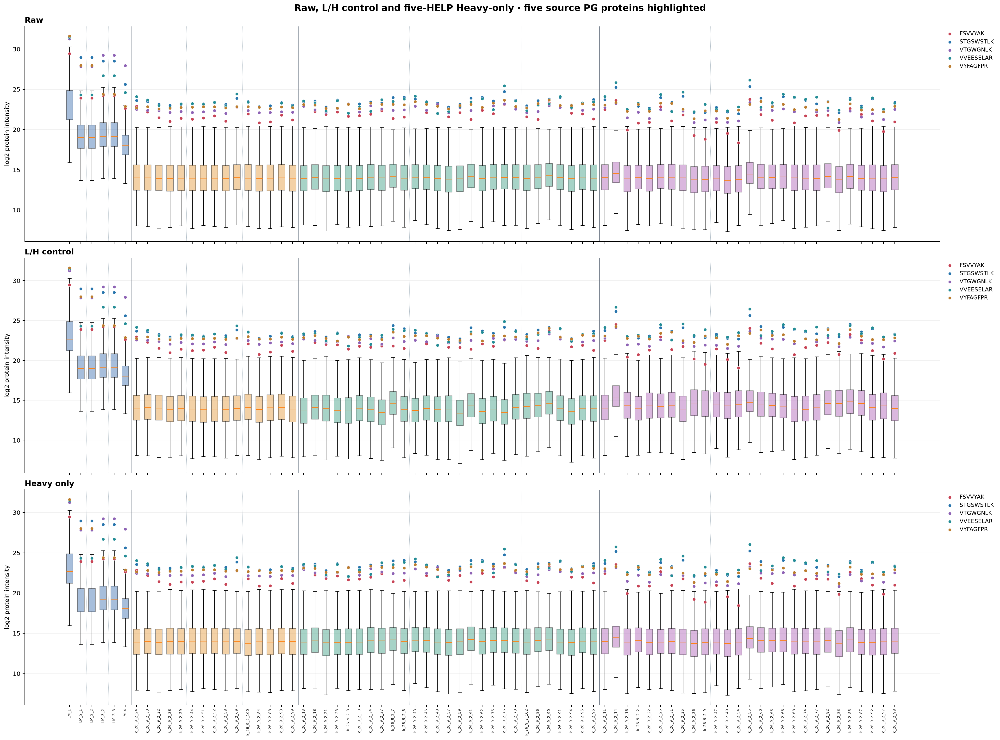
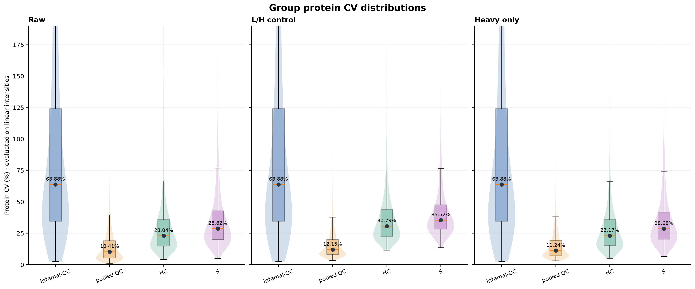
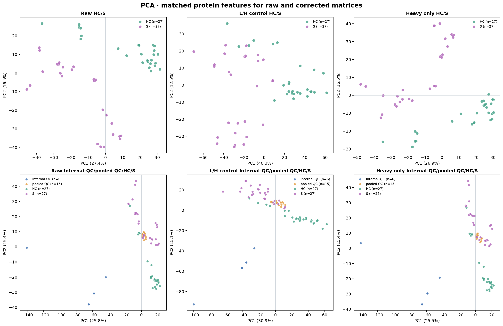
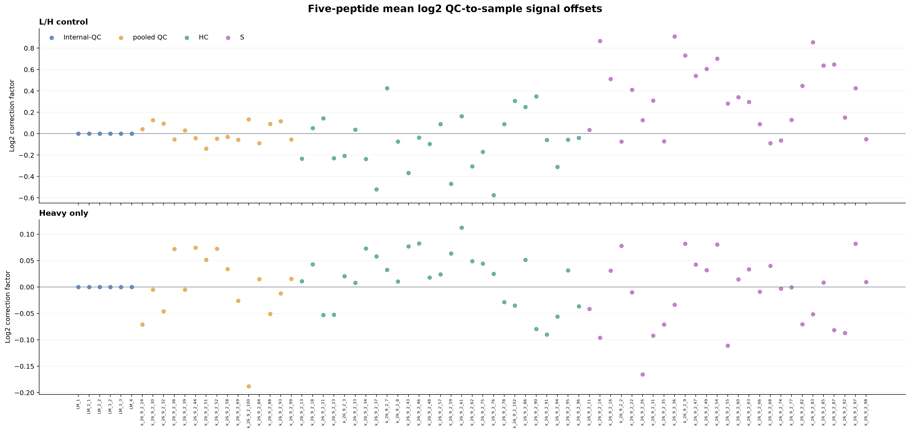
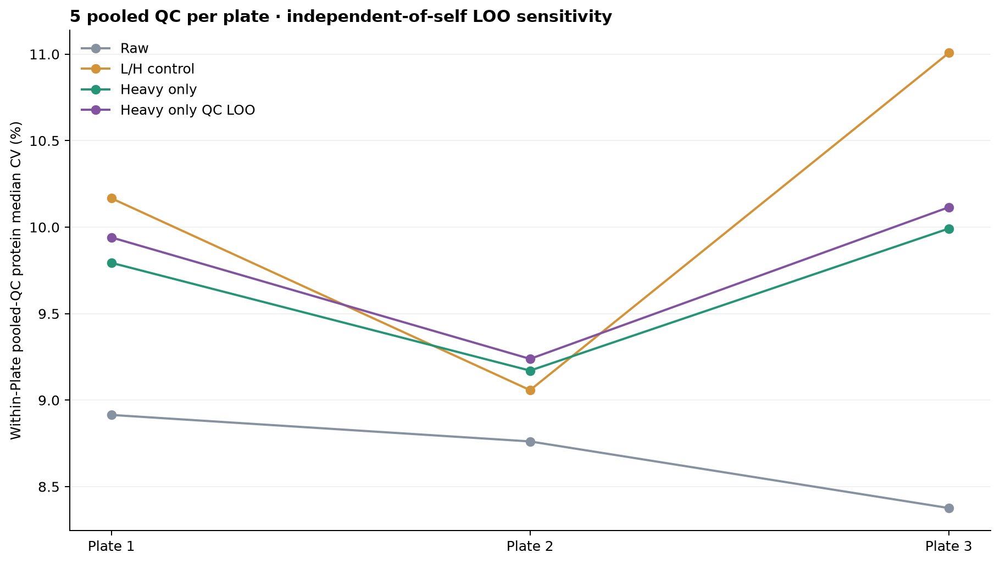

# PACS Heavy-only five-HELP normalization

Raw Heavy intensity from 2026.10.13 workbook, not L/H.
Reference: for each of the 5 peptides, median log2(Heavy) across 15 pooled QC.
A sample log2 factor is the mean over all five individual differences
between that peptide QC median and the sample log2 Heavy signal.
Thus the original-scale multiplier is the geometric mean of
the five H_QC/H_sample values.
Matched L/H uses same formula only as a direct control.
HC/S and pooled QC get their factor, while 6 Internal-QC are unchanged.
No previous results or source workbooks are touched.

## Median per-protein CV (%) on corrected linear scale

| Method | HC | S | pooled QC | Internal-QC |
| --- | ---: | ---: | ---: | ---: |
| Raw | 23.04 | 28.82 | 10.41 | 63.88 |
| L/H control | 30.79 | 35.52 | 12.15 | 63.88 |
| Heavy only | 23.17 | 28.68 | 11.24 | 63.88 |
| Heavy only QC LOO | 23.17 | 28.68 | 11.33 | 63.88 |

## Visualizations

## Outputs and caveats

sample_factors.csv stores 5 individual log2 contributions, 75 samples
for each of Heavy and matched L/H control. Two complete 6675 x 75
corrected log2 PG matrices, per-protein CVs, group summary, and PCA
results are also available. Raw data unchanged.
Leave-one-out pooled QC diagnostics exclude the evaluated QC sample
from its own per-peptide median reference, but the QC pool still
determines the reference population; not an independent held-out QC.
HC/S group CV includes genuine biological variation and cannot
alone prove technical calibration.
Heavy spiked just before loading cannot account for earlier
sample extraction, digestion or recovery differences.
