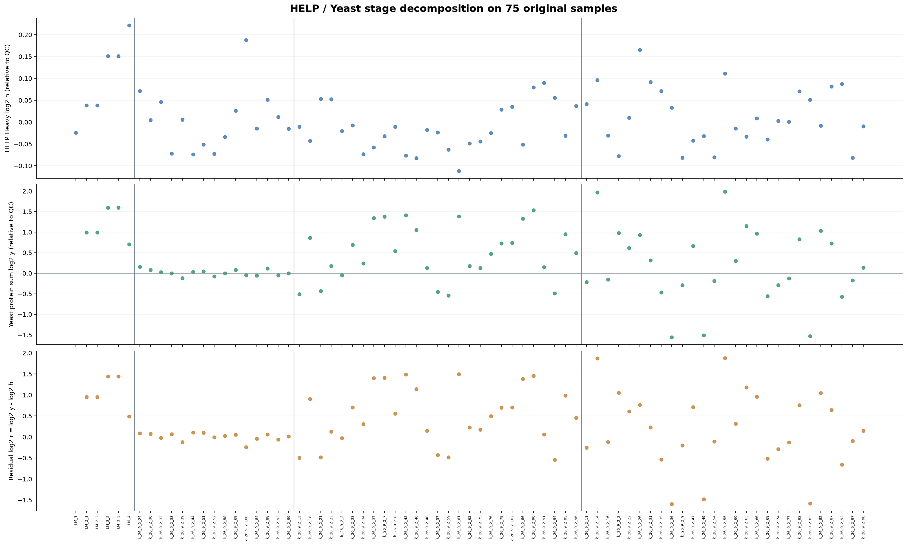
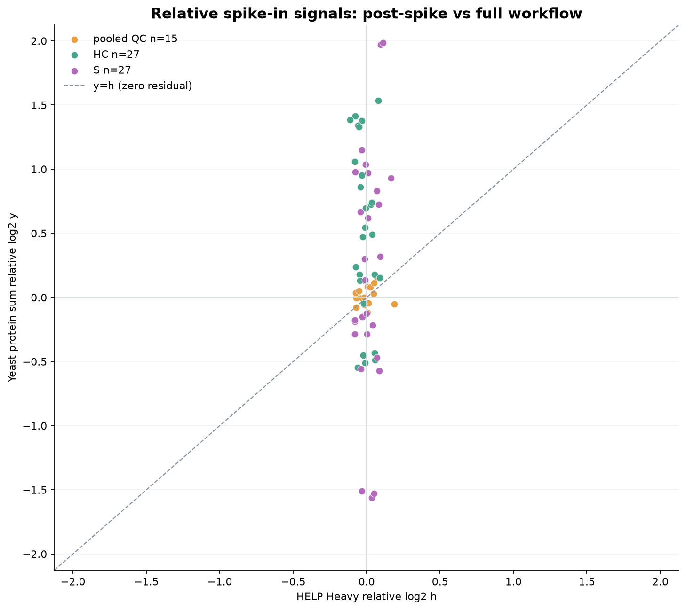
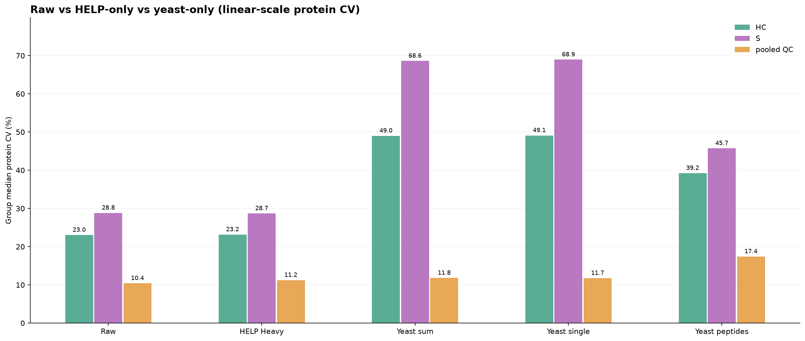
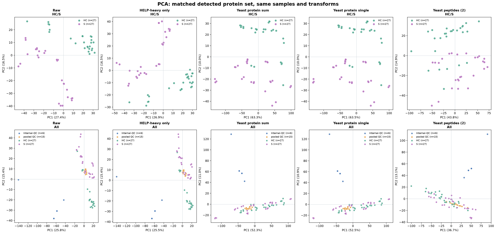
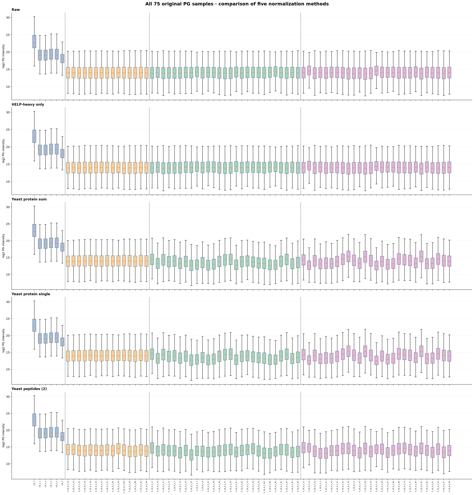
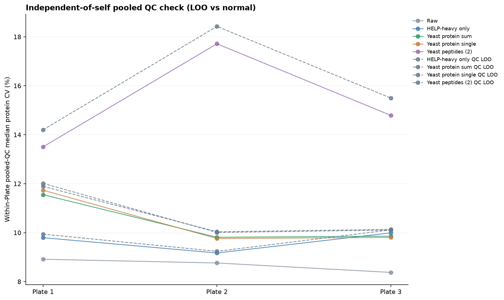

# Five-HELP Heavy and Yeast full-protein / peptide spike-in comparison

**Independent 75-sample, 6675-protein normalization trial** using
raw HELP Heavy from the October 13 file, EN01.xlsx protein signals,
and sample-QC-InternalQC-HELP_yeast.xlsx yeast peptide signals.
No source files or previous results were modified.

## Main calculations

For each of five fixed Heavy HELP, reference is its own median log2 intensity
across 15 pooled QCs. HELP log2 relative signal h_i is the equally weighted
mean of five (sample - QC reference) log2 differences.
For yeast proteins, two original rows P00924_ENO1_YEAST and
P00925_ENO1_YEAST are **summed in original linear intensity** per sample
then log2-transformed and compared to the pooled-QC median.
One selected row (larger all-sample linear row sum) and 2 peptide-wise yeast
intensities are secondary robustness variants.
For each method, protein log2 intensity receives negative reference signal.
Pooled QC and HC/S get factors; Internal-QC remains unchanged.

## Stage decomposition

log2 h = mean HELP log2(sample/QC) ; HELP-only correction factor = -log2 h.
log2 y = yeast log2(sample/QC) ; yeast-only correction = -log2 y.
Residual after HELP: log2 r = log2 y - log2 h.
Two-step correction HELP + residual = -log2 h - (log2 y - log2 h)
= -log2 y, **mathematically exactly equal to yeast-only**.
Therefore the combined two-stage pathway is reported as factor decomposition,
not as a separate new corrected matrix.

## Median protein CV by group (%)

| Method | HC | S | pooled QC | Internal-QC |
| --- | ---: | ---: | ---: | ---: |
| Raw | 23.04 | 28.82 | 10.41 | 63.88 |
| HELP-heavy only | 23.17 | 28.68 | 11.24 | 63.88 |
| Yeast protein sum | 49.01 | 68.60 | 11.80 | 63.88 |
| Yeast protein single | 49.10 | 68.95 | 11.74 | 63.88 |
| Yeast peptides (2) | 39.25 | 45.72 | 17.40 | 63.88 |

### QC leave-one-out sensitivity

Each pooled QC is corrected using only the OTHER 14 pooled QCs
to estimate each reference; not an independent held-out cohort.
See pooled_QC_LOO_group_cv.csv and pooled_QC_plate_CV.csv.

## Figures

## Source audit

Two original yeast protein rows are used without assuming their accession
or repeated ENO1 protein naming is confirmed. The protein-sum main variant
does not count the two rows as independent proteins.
Check run_manifest.json for missing signals and the selected single-protein row.

## Interpretation caveats

Within-HC/S protein CV includes biological variance, not just technical noise.
Yeast residual may reflect sample aliquoting or recovery, not solely digestion.
The fixed-ng peptide aliquot vs fixed-volume step is unspecified;
therefore exact source of pre-HELP variance cannot be identified.
Same pooled QC reference is used for factors and internal QC summaries;
LOO is a sensitivity analysis, not independent verification.
No double multiplication of two unadjusted correction factors is performed.

## Files

sample_help_yeast_factors.csv: raw/relative H, yeast, r, corrected log2 factors,
per-peptide H and per-row yeast signals, QC LOO references.
QC_reference_per_feature.csv: per-reference pooled QC log2 median.
Four complete corrected PG matrices in log2 (HELP, yeast sum, yeast single,
yeast peptides), per-protein CV, PCA, batch QC CV tables and source hashes.
