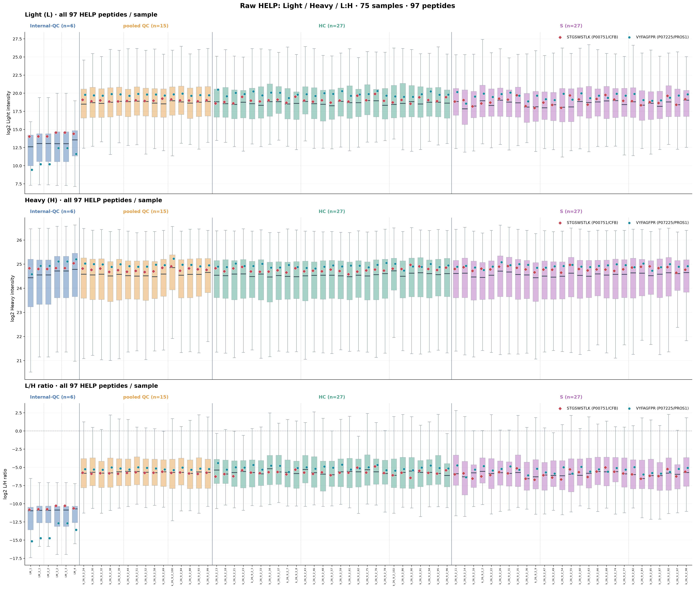

# 97 HELP peptides: Light / Heavy / L:H 75-sample boxplots

All boxplots show RAW 2026.10.13 HELP source workbook values.
Exactly 97 HELP peptide sequences constitute each per-sample boxplot
(excluding only nonpositive / invalid measurements, with no imputation).
All values shown on log2 scale. No Plate/sample correction or factor1/factor2.

Two highlighted peptides in every sample:
- Red diamond: STGSWSTLK (P00751/CFB).
- Blue circle: VYFAGFPR (P07225/PROS1).

## Figures

- [Light L](01_all_HELP_L_75sample_boxplots_highlight_two.png)
- [Heavy H](02_all_HELP_H_75sample_boxplots_highlight_two.png)
- [L/H ratio](03_all_HELP_ratio_75sample_boxplots_highlight_two.png)
- [Three-sheet overview](00_combined_three_layer_overview.png)

Boxes are sample distributions across up to 97 HELP peptide signals.
Colored points are individual highlighted peptide values on that same
log2 axis. Minor horizontal offsets are for visibility only.
Samples sorted Internal-QC / pooled QC / HC / S, then Plate and sample ID.
Solid vertical boundaries denote groups; dotted lines denote Plates.

## Source checks

| Source sheet | Finite positive / 7275 | Missing or nonpositive |
| --- | ---: | ---: |
| L | 7227 | 48 |
| H | 7274 | 1 |
| ratio_LH | 7226 | 49 |

All 75 columns match metadata. 97 peptides uniquely identified on every sheet.
Both focused peptides have valid values for all 75 samples in all sheets.
For these two sequences, log2(L/H) matches log2(L)-log2(H),
up to floating-point precision.

## Audit tables

- all_HELP_sample_box_summaries.csv: 225 observations, 75 samples x 3 sheets.
- two_HELP_positions_by_sample.csv: 450 observations, 75 samples x 3 sheets x 2 peptides,
  with source values, log2 values, sample median and percentile positions.
- run_manifest.json: source hash, checks, and plotting definitions.

No existing experimental results or original spreadsheets were modified.
