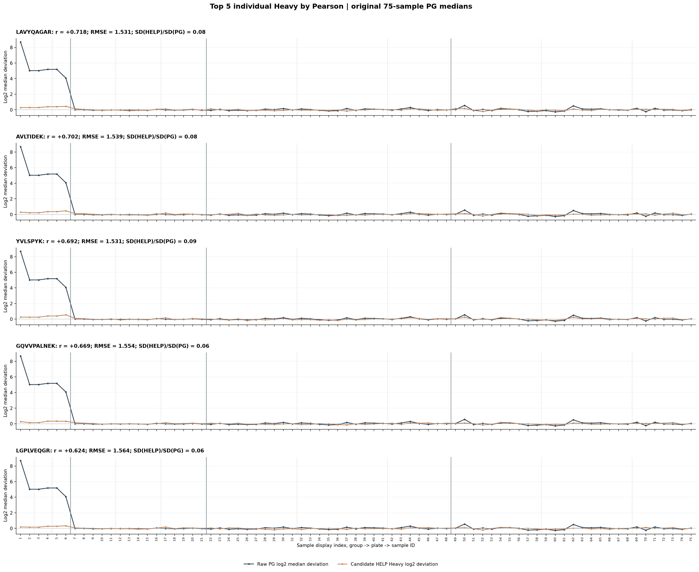
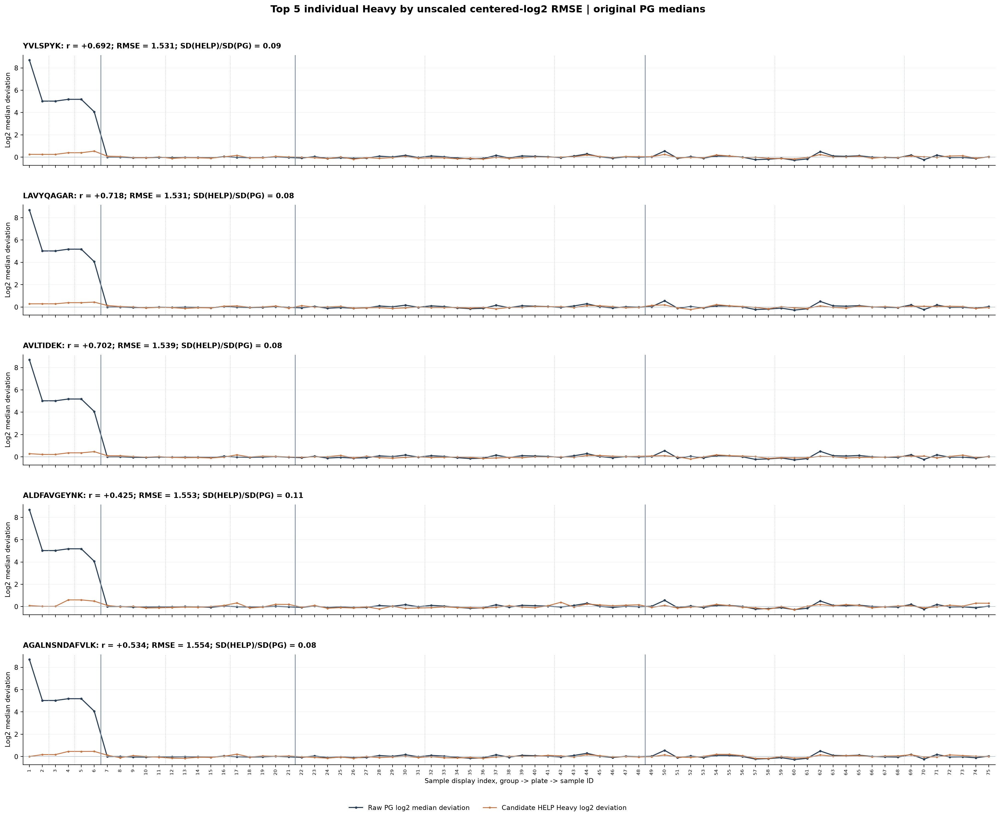
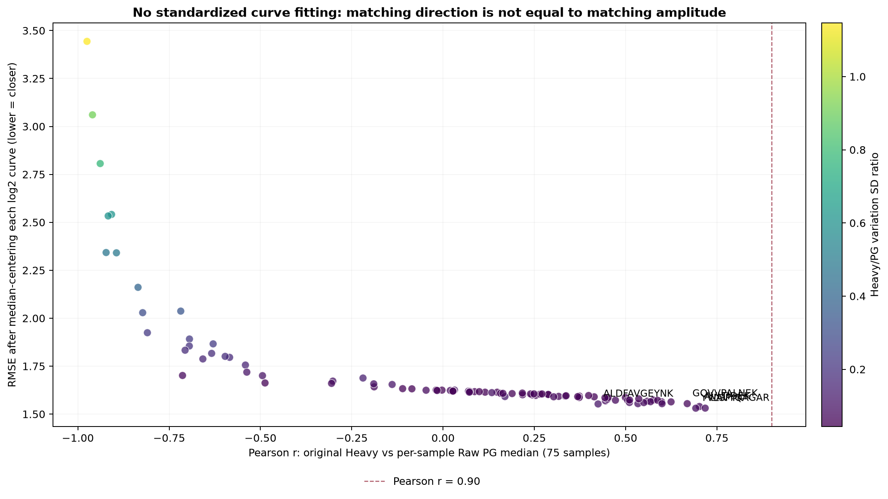
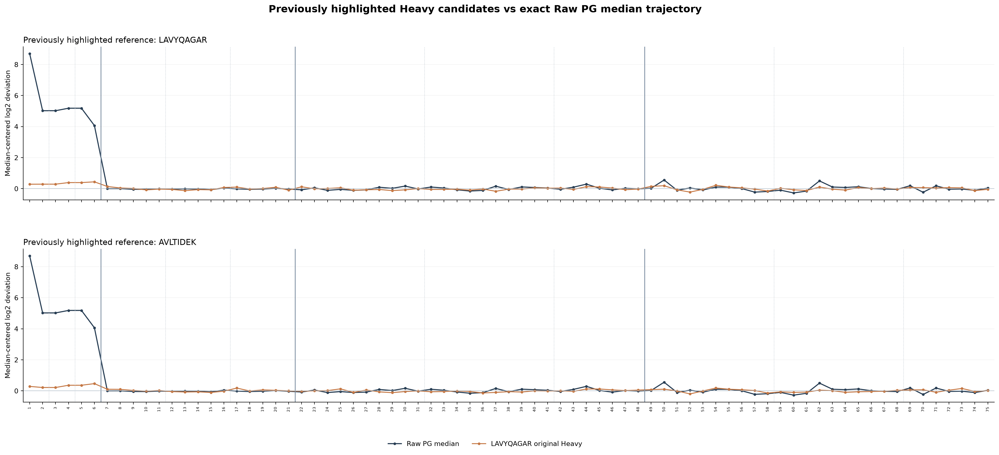

# Which Heavy HELP really follows the PG median across all 75 samples?

One fixed approach: m_i = median(log2(valid positive original PG intensities in sample i)).
For each complete peptide j, H_ji = log2(original Heavy intensity).
To compare ACTUAL amplitude in plot units, subtract median_i(m_i) and
median_i(H_ji) from the two 75-point curves, then compute RMSE.
Pearson only checks linear covariation; it does NOT check amplitude.

## Screening results

- Full-75 Heavy HELP sequences: 96.
- Best Pearson: LAVYQAGAR, r=0.7179.
- No. with r >= 0.90: 0.
- No. with r >= 0.80: 0.
- Raw sample PG median SD on log2: 1.5704.

### Top five by Pearson (shape, scale ignored)

| HELP | r | median-centered RMSE log2 | SD(Heavy)/SD(PG) | Neighbor step r |
|---|---:|---:|---:|---:|
| LAVYQAGAR | +0.718 | 1.531 | 0.08 | +0.104 |
| AVLTIDEK | +0.702 | 1.539 | 0.08 | +0.102 |
| YVLSPYK | +0.692 | 1.531 | 0.09 | +0.213 |
| GQVVPALNEK | +0.669 | 1.554 | 0.06 | +0.237 |
| LGPLVEQGR | +0.624 | 1.564 | 0.06 | +0.016 |

### Top five by median-centered RMSE (actual shape AND amplitude)

| HELP | RMSE log2 | r | SD(Heavy)/SD(PG) | Neighbor step r |
|---|---:|---:|---:|---:|
| YVLSPYK | 1.531 | +0.692 | 0.09 | +0.213 |
| LAVYQAGAR | 1.531 | +0.718 | 0.08 | +0.104 |
| AVLTIDEK | 1.539 | +0.702 | 0.08 | +0.102 |
| ALDFAVGEYNK | 1.553 | +0.425 | 0.11 | +0.199 |
| AGALNSNDAFVLK | 1.554 | +0.534 | 0.08 | +0.031 |

## Charts

## Caveats

- Samples are heterogeneous HC/S/QC/Internal-QC, not the same biological sample.
- Median of own detected PG is associated with missingness/composition.
- Pearson and RMSE computed across all 75 with no per-plate centering.
- Neighbor-step calculations only cross adjacent plotted samples within the
  same group and plate, and are NOT a validated acquisition-order trend.
- No raw PG normalization or HELP calibration is performed here.
- Selecting on this dataset then claiming calibrated improvement on the
  same dataset would be circular without a holdout or independent QC test.

## Files

- 00_all96_ranking_by_overall_Pearson.csv
- 01_all96_ranking_by_centered_RMSE.csv
- 02_all96_ranking_by_neighbor_curve_changes.csv
- 03_sample_curve_values.csv
- summary.json
