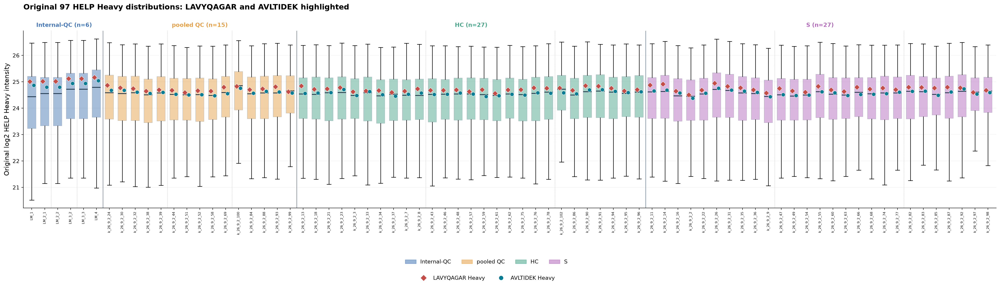
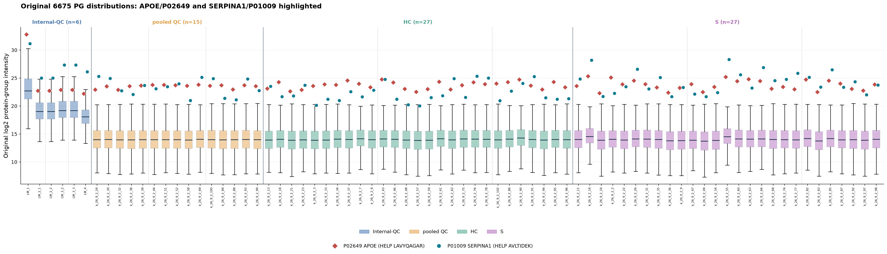
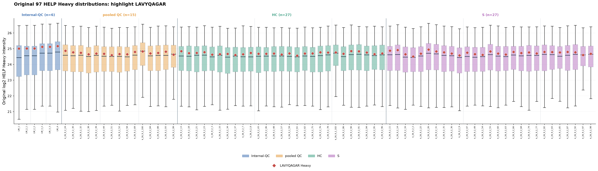
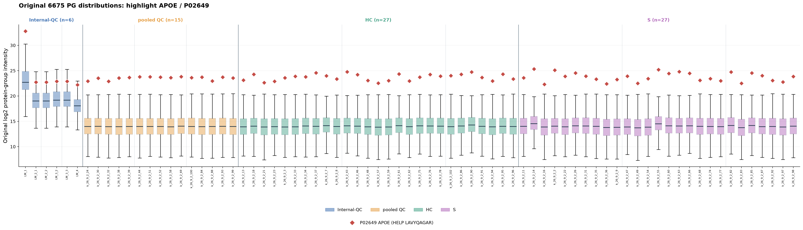
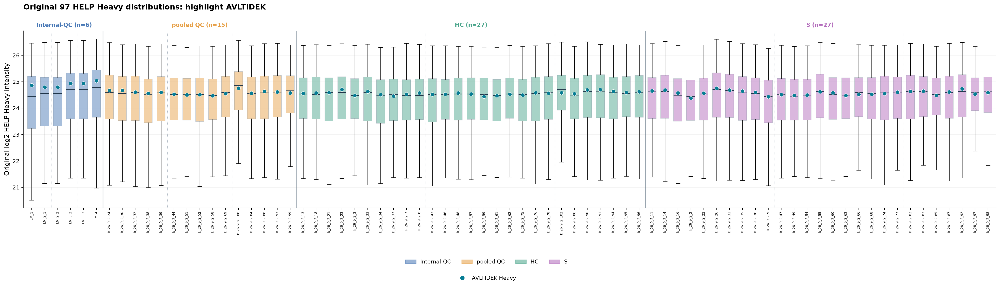
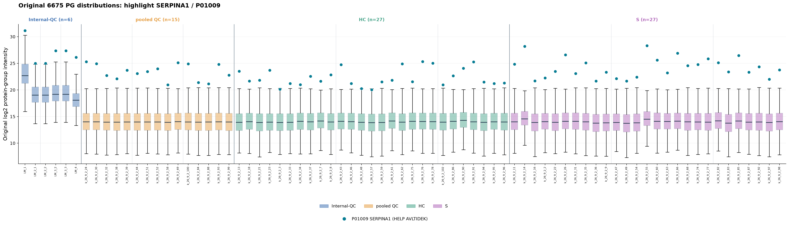
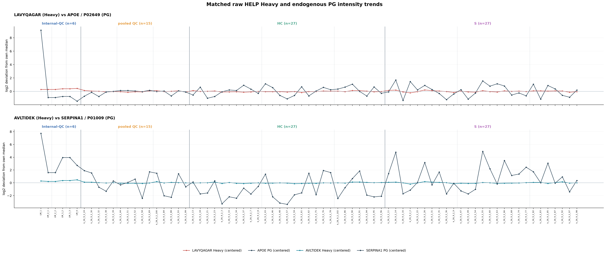

# PACS 75-sample HELP Heavy and matched protein highlights

Mappings supplied by project owner: LAVYQAGAR -> P02649 / APOE;
AVLTIDEK -> P01009 / SERPINA1.

Original source H-sheet peptide values are plotted against 97 HELP Heavy
per sample; original matched protein-group values are plotted against
6675 PG per sample. Positive intensities transformed to log2.
No normalization; missing values not imputed.
All 75 samples use group -> plate -> sample ID ordering.
Target protein row identity is verified via exact accession tokens and Gene.
Legends are beneath axes in dedicated blank figure space.

## Matched protein rows

| HELP | UniProt | Gene | PG source row incl header | Positive PG samples |
| --- | --- | --- | ---: | ---: |
| LAVYQAGAR | P02649 | APOE | 953 | 75 |
| AVLTIDEK | P01009 | SERPINA1 | 884 | 75 |

## Highlight charts

## Tables

- target_PG_mapping.csv: exact source protein rows and annotations.
- 75_samples_target_intensities.csv: ordered sample-level highlight values.
- manifest.json: source hashes, mapping, plotting details.
