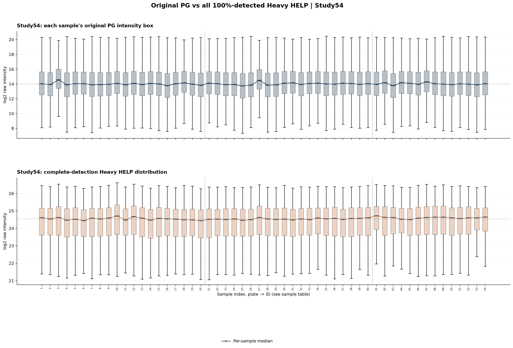
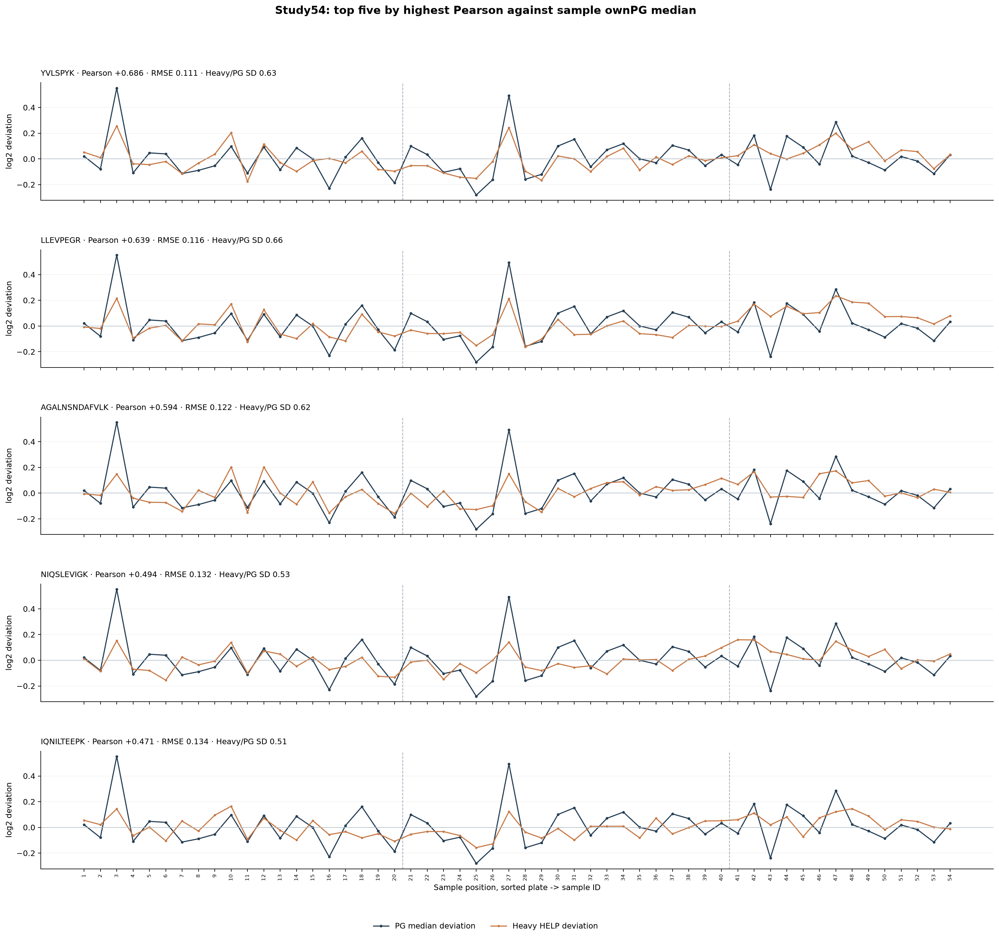
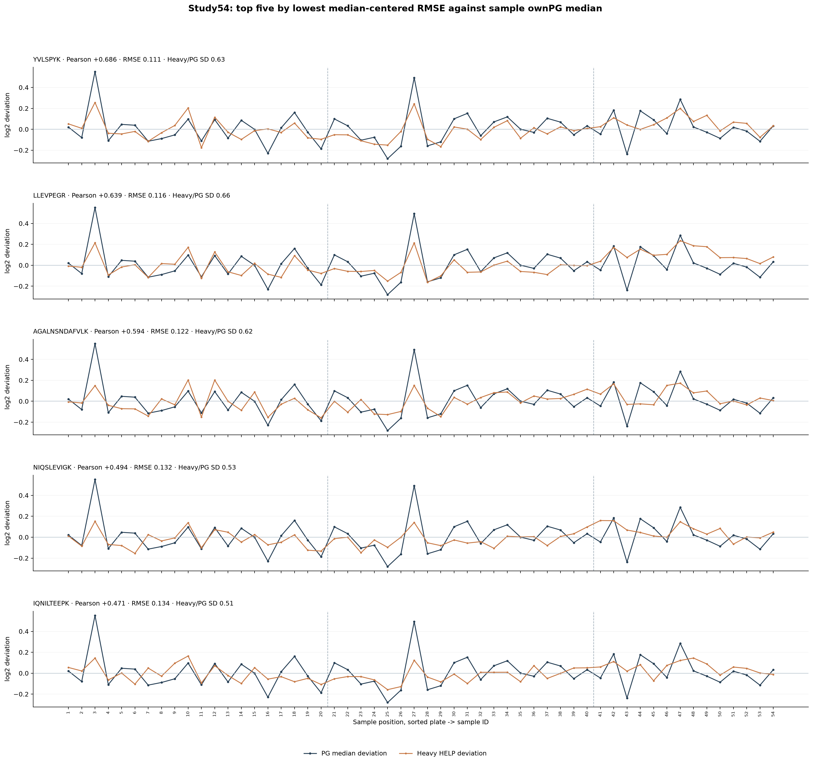
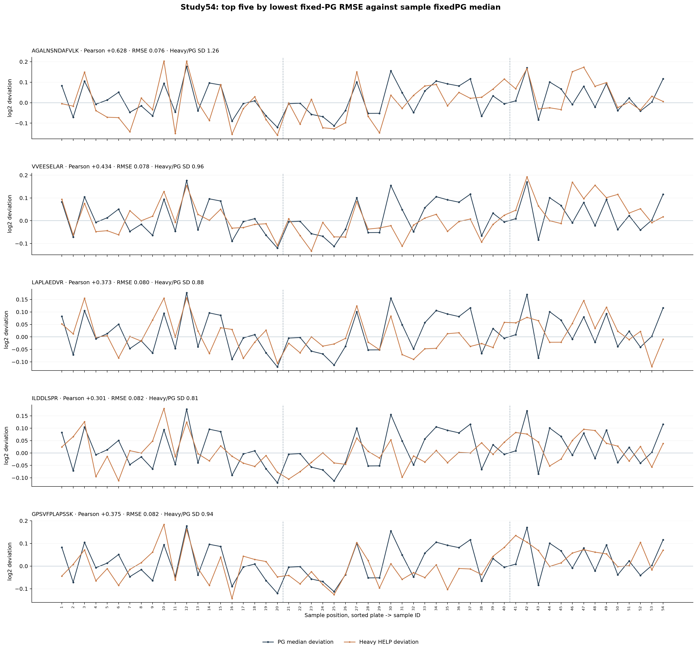
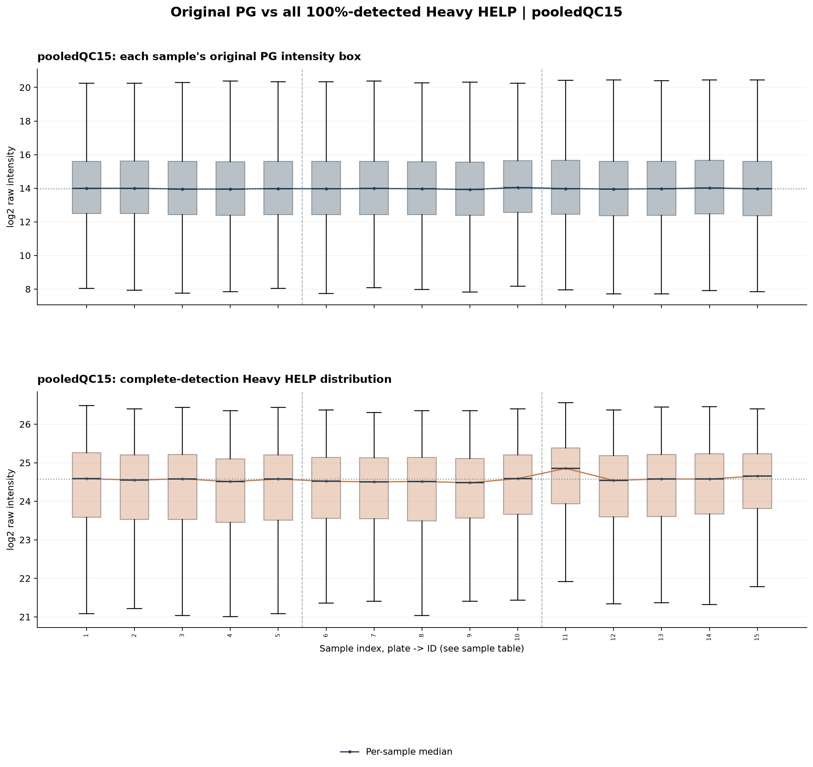
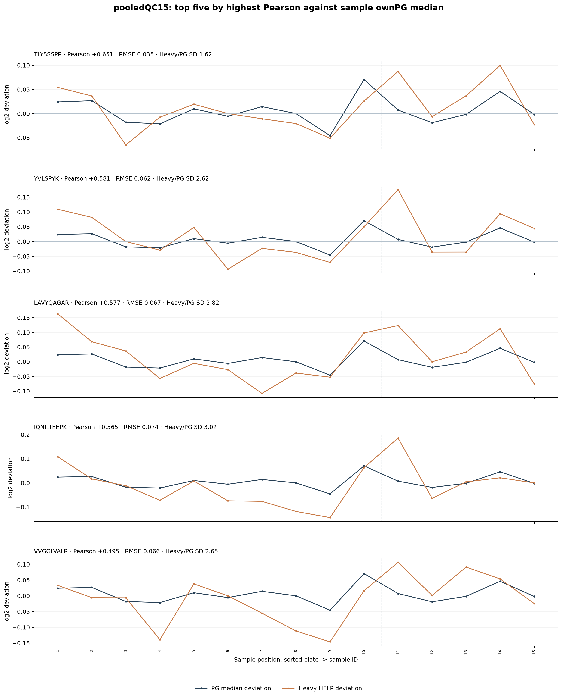
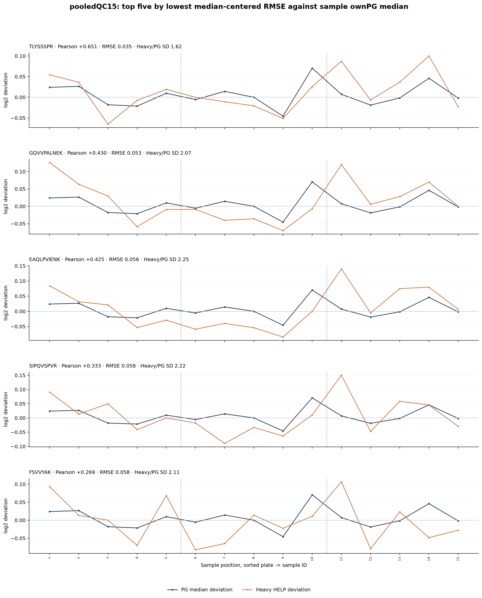
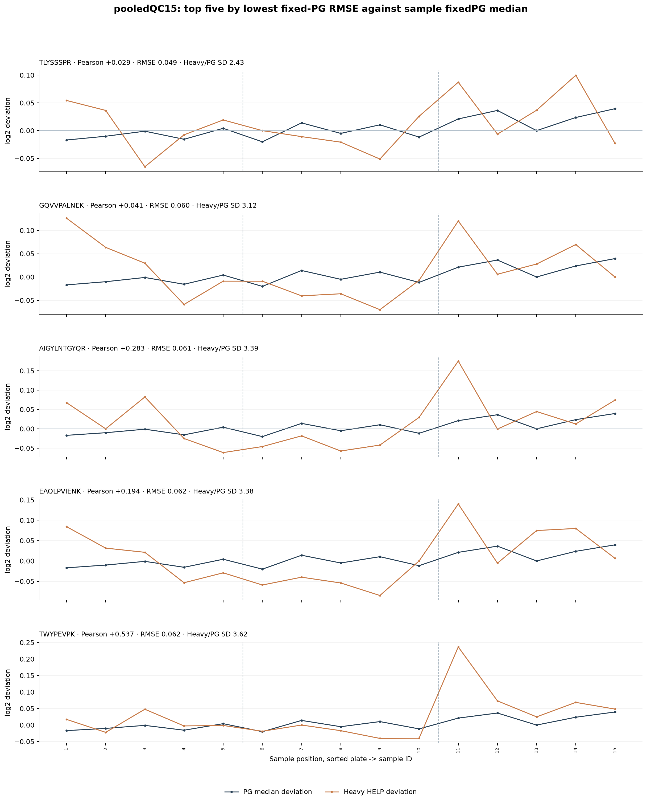
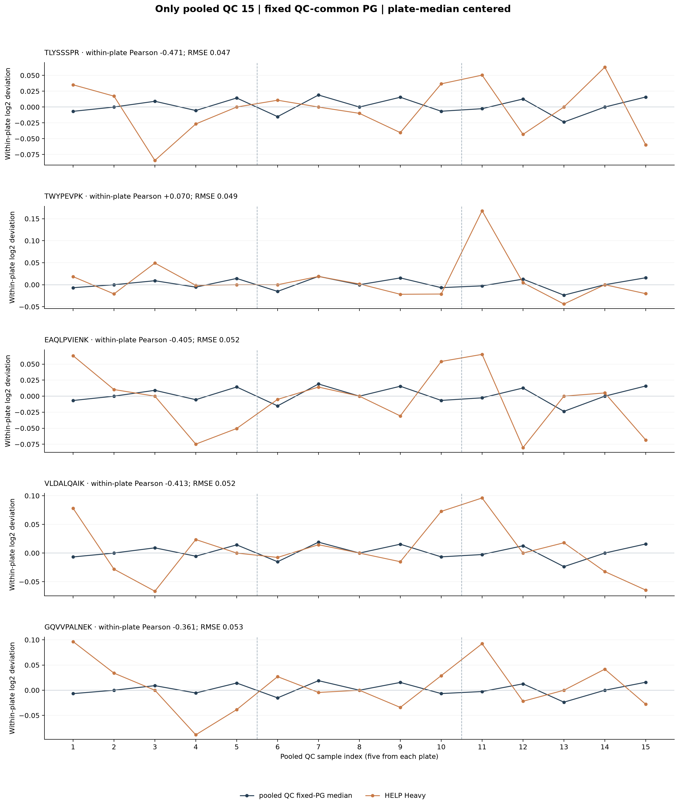

# PACS Heavy HELP vs Raw protein sample-median trends | Study54 and pooledQC15

**No Internal-QC.** All research is split into two separate and non-overlapping groups:
**Study54 = HC27 + S27 combined**, and **pooledQC15 = 15 pooled QC**.
Sample positions within each group are sorted plate then sample_id.

## Fixed protein universes

- Study54 PG common to all 54 samples: 3965.
- pooledQC15 PG common to all 15 QC samples: 5227.
- Fully detected Heavy HELP sequences in Study54: 97.
- Fully detected Heavy HELP sequences in pooledQC15: 97.

PG own-detected medians reflect varying detection sets. FixedPG means the
SAME PG rows per group are used in every sample within that group.
No z-score / regression scaling is applied to the matching RMSE.
Only original, log2 positive intensities are used.

## Best candidates for each group, using each sample's own-detected PG median

### Study54 (n=54)

| Top rank | HELP | Pearson r | Centered log2 RMSE | SD Heavy / SD PG |
| ---: | --- | ---: | ---: | ---: |
| 1 | YVLSPYK | +0.686 | 0.111 | 0.63 |
| 2 | LLEVPEGR | +0.639 | 0.116 | 0.66 |
| 3 | AGALNSNDAFVLK | +0.594 | 0.122 | 0.62 |
| 4 | NIQSLEVIGK | +0.494 | 0.132 | 0.53 |
| 5 | IQNILTEEPK | +0.471 | 0.134 | 0.51 |

### pooledQC15 (n=15)

| Top rank | HELP | Pearson r | Centered log2 RMSE | SD Heavy / SD PG |
| ---: | --- | ---: | ---: | ---: |
| 1 | TLYSSSPR | +0.651 | 0.035 | 1.62 |
| 2 | GQVVPALNEK | +0.430 | 0.053 | 2.07 |
| 3 | EAQLPVIENK | +0.425 | 0.056 | 2.25 |
| 4 | SIPQVSPVR | +0.333 | 0.058 | 2.22 |
| 5 | FSVVYAK | +0.269 | 0.058 | 2.11 |

## pooledQC15 plate-centered technical-trend diagnostic

Five pooled QC per plate. Both Heavy and PG curves have the own-plate
median removed before comparing their technical fluctuations.

## Cautions

- HC and S are jointly analyzed as 54 Study samples; their real biology remains.
- QC trends are more relevant to technical calibration, but only 15 QC exist.
- PG may already be upstream-normalized; Heavy may be more noisy.
- A HELP with high r but tiny Heavy/PG SD ratio does not match raw amplitude.
- No selected candidate is claimed to be a validated calibration reference.
- RMSE-based same-data selection must be tested on held-out QCs.

## Audit files

- 00_*_sample_order_and_medians.csv: exact included sample IDs
- 00_*_common_PG_list.csv: source PG identity of fixed intersection
- 01_*_completeHELP_all_metrics.csv: independent group-wise metrics
- 02 to 05 group-specific ranking tables; 07,08 QC within-plate rankings
- run_manifest.json includes exact source SHA256 and sample lists
