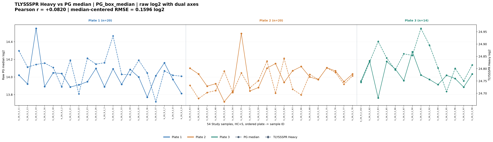
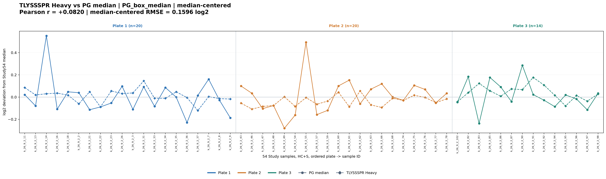
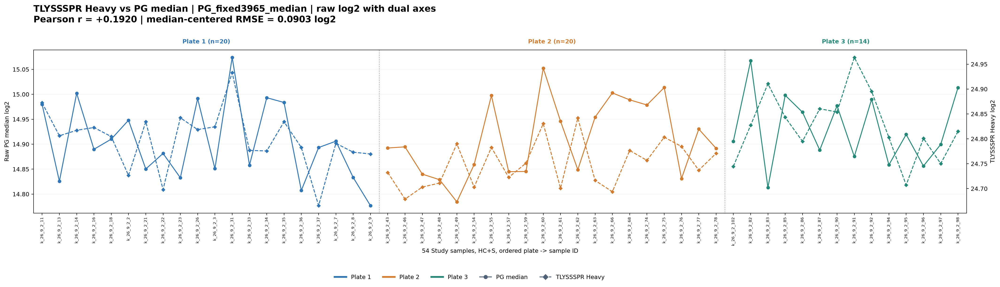
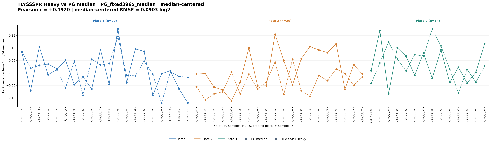

# TLYSSSPR in Study54 (HC+S); plate colored

Original PG and Heavy from PACS. No Internal-QC, pooled QC, normalization, or missing-value fill.
54 Study samples: Plate1=20, Plate2=20, Plate3=14. Solid circles=PG median, dashed diamonds=Heavy.

| Reference | Study Pearson | Study centered RMSE (log2) |
|---|---:|---:|
| PG_box_median | +0.0820 | 0.1596 |
| PG_fixed3965_median | +0.1920 | 0.0903 |

Full 54-sample values in Study54_TLYSSSPR_and_PG_values.csv.
