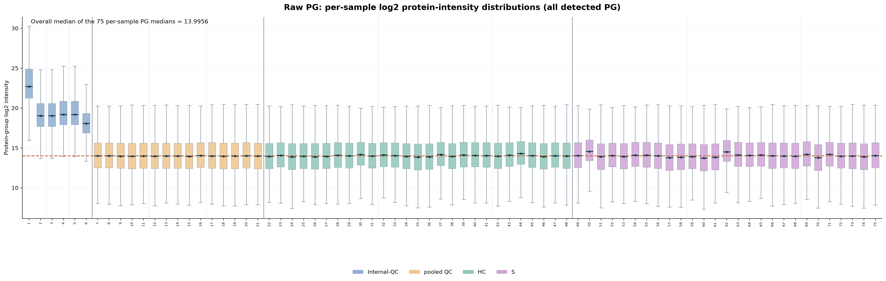
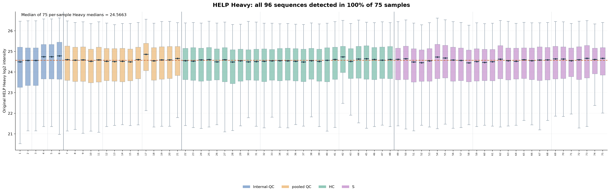
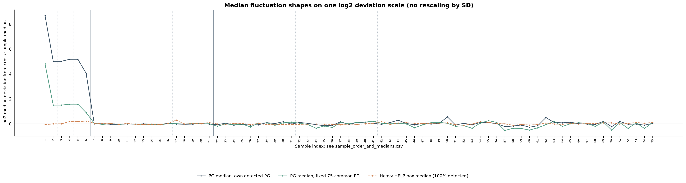
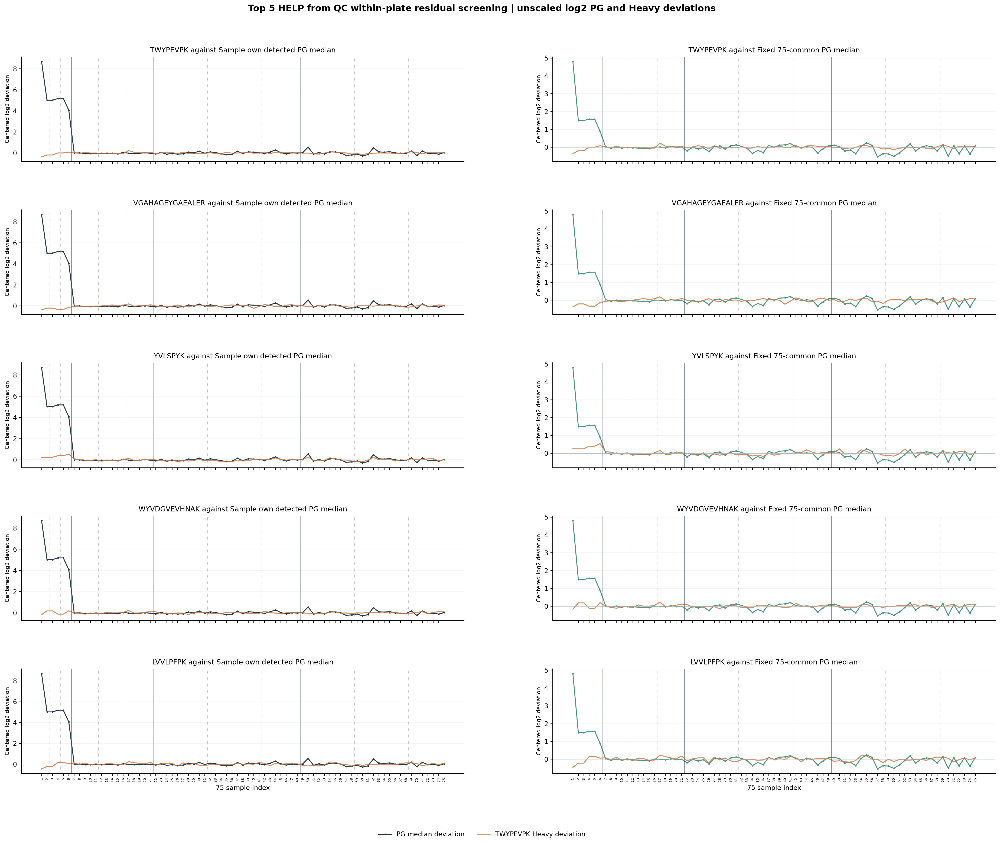
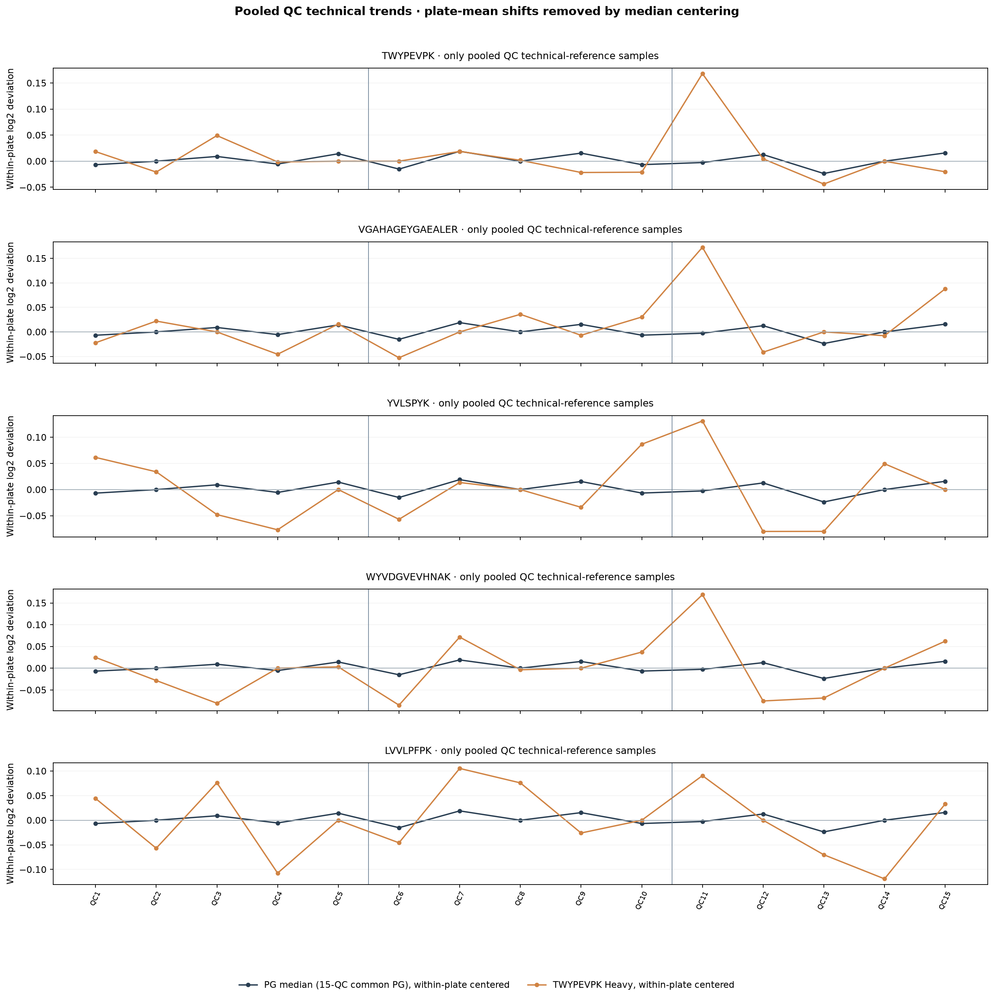
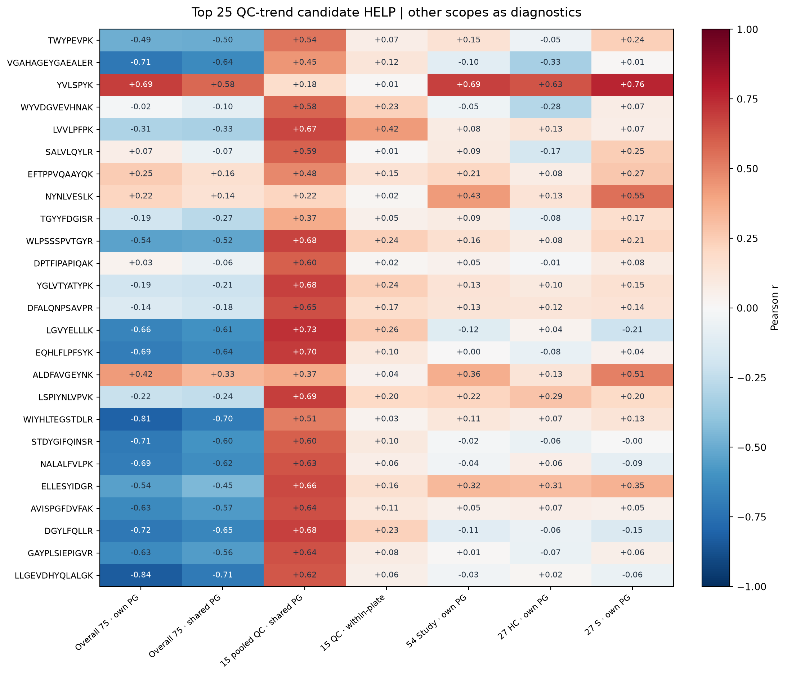

# PACS: select 100%-detected HELP Heavy that tracks original PG median trends

This is exploratory DISCOVERY, not a calibrated matrix. All references
use original (uncorrected) PACS 75-sample PG and original 97 HELP Heavy H values.
The three plates and all four groups are retained with original sample IDs.

## Detection and fixed PG sets

- HELP H with full positive-finite detection 75/75: **96/97**.
- PG common to all 75: **267** / 6675.
- PG common to all 15 pooled QC: **5227** / 6675.
- PG common to all 54 Study samples: **3965** / 6675.

Each sample's PG log2 median is computed (a) from that sample's all
detected PG, (b) a FIXED full75 common set. QC comparisons additionally
use the much larger PG intersection fixed within the 15 pooled QC.
All median shifts are defined by subtracting the MEDIAN across the
corresponding sample population; no z-score normalization or imputation.

## Ranking and safeguards

1. Require one HELP Heavy sequence present in all 75 samples.
2. Correlate each original Heavy H log2 trace against samplewise PG medians.
3. For QC technical trend, remove each plate's QC median from both
   HELP Heavy and PG (15-QC-shared PG) before Pearson, Spearman,
   log2 slope, and unscaled residual RMSE. Thus plate offsets cannot
   inflate within-plate technical tracking.
4. Eligible candidates need positive QC within-plate Pearson r AND
   slope PG vs Heavy between 0.5 and 2 (heuristic, not a validated cut).
5. Sort eligible by lowest centered QC deviation RMSE; use other
   correlations (overall 75, 54 Study, HC/S, per-plate) as diagnostics.
If no eligible candidate exists, the script falls back to positive-r
candidates, or all fully-detected sequences when none is positive.
This is an explicitly exploratory same-data selection, NOT proof
of superior spike-in calibration. p-values are unadjusted.

## Top 10 QC within-plate trend candidates (exploratory)

| Rank | HELP | QC residual Pearson r | QC residual slope PG/H | QC RMSE log2 | All75 own-PG r | All75 fixed-PG r |
|---:|---|---:|---:|---:|---:|---:|
| 1 | TWYPEVPK | +0.070 | 0.018 | 0.049 | -0.487 | -0.499 |
| 2 | VGAHAGEYGAEALER | +0.122 | 0.027 | 0.056 | -0.713 | -0.640 |
| 3 | YVLSPYK | +0.011 | 0.002 | 0.063 | +0.692 | +0.578 |
| 4 | WYVDGVEVHNAK | +0.229 | 0.042 | 0.064 | -0.016 | -0.096 |
| 5 | LVVLPFPK | +0.422 | 0.074 | 0.064 | -0.305 | -0.325 |
| 6 | SALVLQYLR | +0.012 | 0.002 | 0.069 | +0.070 | -0.068 |
| 7 | EFTPPVQAAYQK | +0.147 | 0.022 | 0.079 | +0.254 | +0.157 |
| 8 | NYNLVESLK | +0.017 | 0.003 | 0.083 | +0.218 | +0.143 |
| 9 | TGYYFDGISR | +0.049 | 0.007 | 0.084 | -0.189 | -0.266 |
| 10 | WLPSSSPVTGYR | +0.238 | 0.028 | 0.101 | -0.537 | -0.518 |

## Figures

### All PG per-sample boxplots

### All 75/75-detected original HELP Heavy per-sample boxplots

### Compare sample median deviation trends

### Top candidate sequence versus raw PG medians

### QC-only within-plate trend overlay: same pooled sample type

### Top 25 correlations across comparison populations

## Important cautions

- The 75 samples are heterogeneous, not technical replicates like the 39 NYD repeats.
- HC and S intensity variation can reflect genuine biology, not instrument error.
- The fixed all-75 PG set may be small due to different sample groups/missingness.
- Strong trend similarity in the same dataset may simply learn already-normalized PG.
- Selecting a HELP on QC then checking those same QC is NOT held-out validation.
- Standard +fi factor uses QC reference median minus HELP sample log2 Heavy.
  A raw-PG matching HELP with too little or too much amplitude can raise PG CV.
- Validate any proposed factor on separate QC or an independent dataset
  before promoting it to a technical-calibration method.

## Data outputs

- 00_all97_HELP_detection_and_CV.csv: 97 source HELP detection counts/Heavy CV.
- 01_full_detect_HELP_QC_trend_ranking.csv: eligible candidates & diagnostics.
- 02_all_spearman_pearson_slope_RMSE_by_scope.csv: per-peptide correlations.
- 03_sample_order_and_medians.csv: 75 ordered sample indices and intensities.
- 04_*_PG_list.csv: exact fixed 75/QC15/Study54 source protein identities.
- 05_QC_PG_median_technical_SD_by_plate.csv: per-plate PG median stability.
- run_manifest.json: source hashes, precise conditions and candidate names.
