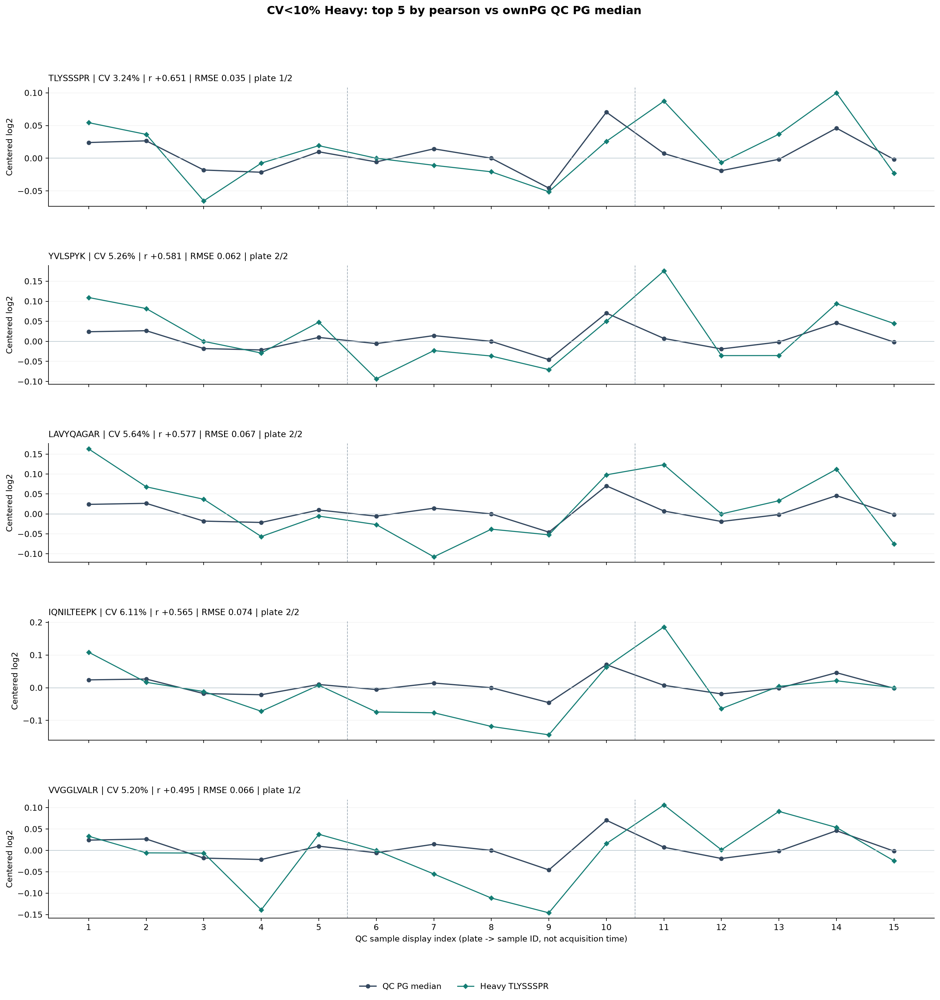
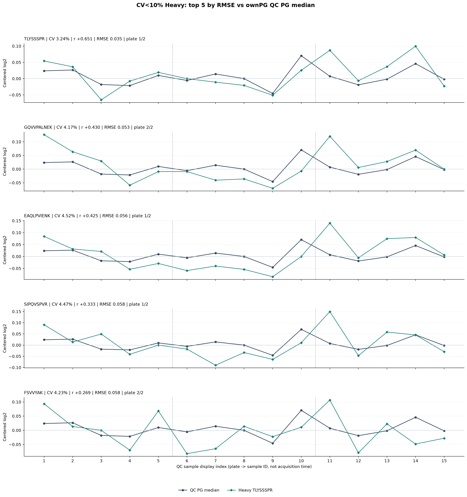
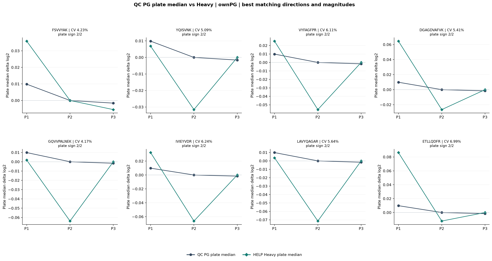
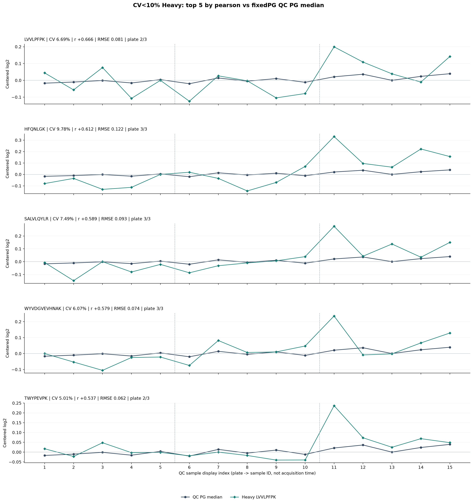
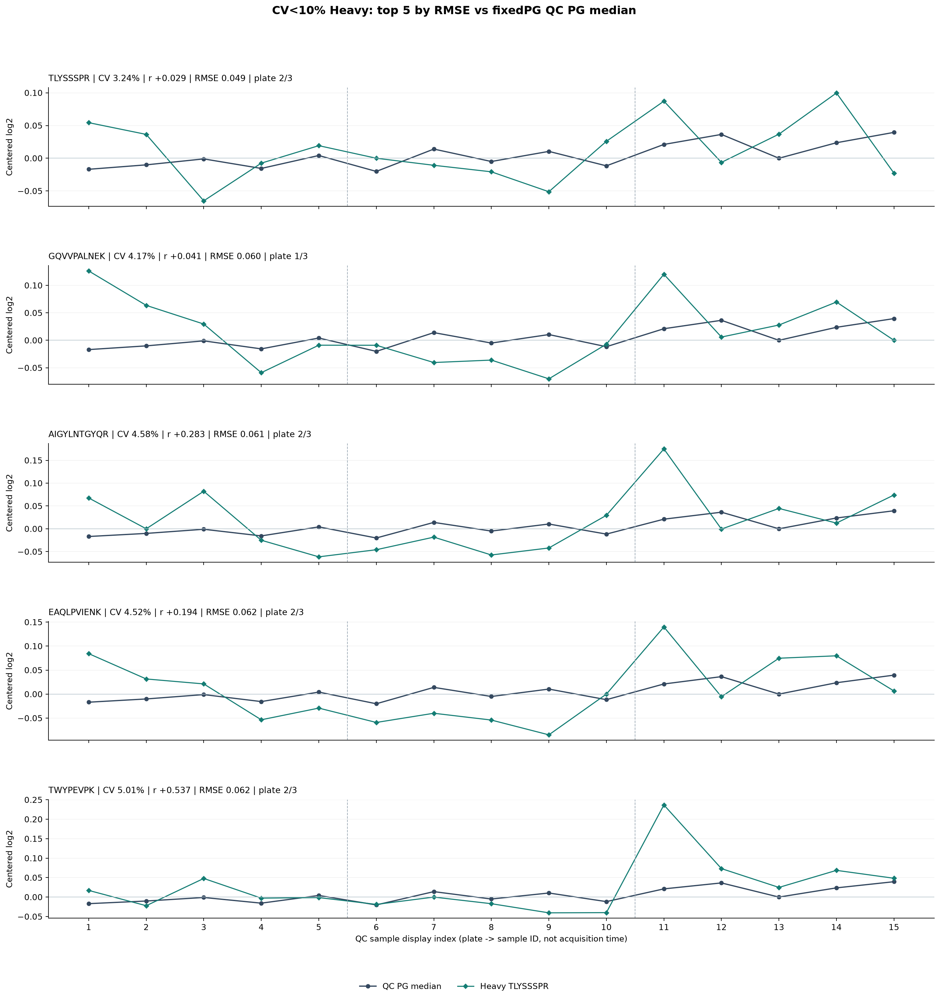
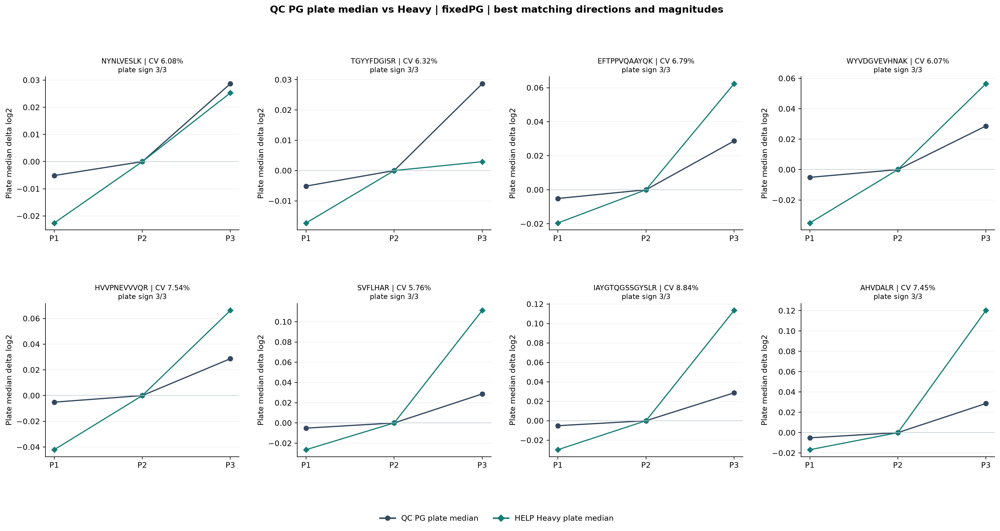

# Scheme A: pooled QC Heavy trend screening

- Heavy fully detected in all 69 non-Internal-QC samples.
- QC linear Heavy CV must be strictly <10% across ALL 15 pooled QC samples.
- No residual MAD, no normalization, no imputation.
- Compare each CV-passed Heavy with 15 QC PG sample-box medians:
  Pearson, unscaled median-centered log2 RMSE, plate-pair direction.
- Also use fixed 5227 PG present in all 15 pooled QC for robustness.
- Compare all 3 plate pairs but recognize only 2 are independent.
- A PG plate contrast <0.005 log2 is flagged as weak evidence.

Original HELP: 97, full 69 detected: 97,
QC Heavy CV<10% passing: **68**.

## Reference QC PG plate medians

| Plate | per-sample box median log2 | fixed 5227 PG log2 |
|---|---:|---:|
| 1 | 13.98145 | 14.36015 |
| 2 | 13.97160 | 14.36528 |
| 3 | 13.97000 | 14.39395 |

## ownPG: top five by RMSE

| HELP | CV QC15 % | Pearson | RMSE log2 | plate same/important |
|---|---:|---:|---:|---:|
| TLYSSSPR | 3.24 | +0.651 | 0.0346 | 1/2 |
| GQVVPALNEK | 4.17 | +0.430 | 0.0526 | 2/2 |
| EAQLPVIENK | 4.52 | +0.425 | 0.0565 | 1/2 |
| SIPQVSPVR | 4.47 | +0.333 | 0.0584 | 1/2 |
| FSVVYAK | 4.23 | +0.269 | 0.0584 | 2/2 |

## fixedPG: top five by RMSE

| HELP | CV QC15 % | Pearson | RMSE log2 | plate same/important |
|---|---:|---:|---:|---:|
| TLYSSSPR | 3.24 | +0.029 | 0.0485 | 2/3 |
| GQVVPALNEK | 4.17 | +0.041 | 0.0604 | 1/3 |
| AIGYLNTGYQR | 4.58 | +0.283 | 0.0610 | 2/3 |
| EAQLPVIENK | 4.52 | +0.194 | 0.0615 | 2/3 |
| TWYPEVPK | 5.01 | +0.537 | 0.0623 | 2/3 |

## Charts

## Files
- 00_all97_detection_CV_trend_metrics.csv (all 97 with gates and measures)
- 01_QC15_sample_medians.csv (samples and actual PG reference)
- 02_QC_plate_PG_medians.csv (plate-level PG reference)
- 03_ownPG_*_CV10_ranking.csv / 03_fixedPG_*_CV10_ranking.csv
- 04_all_CV10_peptides_metrics.csv (qualified only)
- run_manifest.json (conditions and source hashes)

Reminder: HC+S used only for Heavy 69/69 detection gate. No HC/S PG median
used to train QC trends. QC is identical material but 15 samples / 3 plates
is too small to claim external validity. Primary and fixed QC PG medians
can have opposing plate directions. No arbitrary Pearson cutoff introduced.
