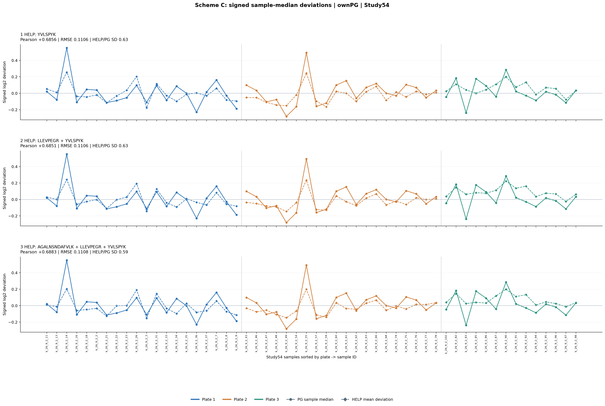
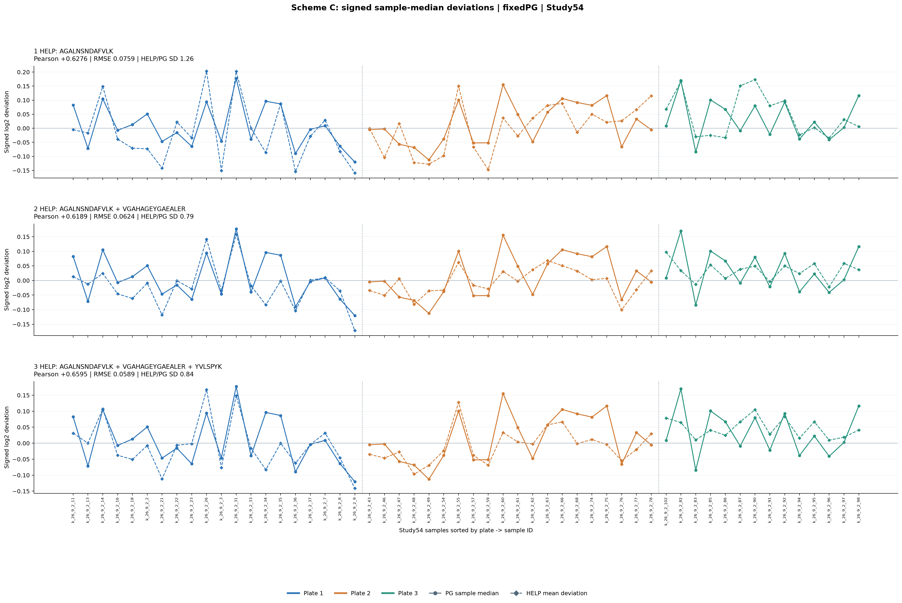

# Scheme C v1: sample signed-median deviations matched by HELP combinations

Study54 (HC27+S27) only. Pooled QC15 only for CV filter and QC diagnostic.
Internal-QC excluded. No original matrix changed.

## Equations

y[i] = median(log2 original detected-PG signals in Study sample i) - median_over_54(median log2 PG per Study sample).

x[j,i] = log2 Heavy[j,i] - median_over_54(log2 Heavy[j,:]).

predicted[i] = mean(x[j,i] for j in selected HELP), then subtract median_over_54(predicted).

RMSE = sqrt(mean_over_54((predicted[i]-y[i])^2)), unscaled. Pearson and Heavy/PG SD ratio also reported.

No negative weight, no free scaling, no intercept fitting. Equivalent to equal-weight combination in log2 (linear-scale geometric mean).

## Search

- 97/97 detected 69/69, 68 pass pooled QC15 raw Heavy linear CV<10%.
- Enumerated 2278 pairs and 50116 triples, plus 68 singles, total 52462.
- Two independent PG targets: own-detected PG medians (main), fixed 3965 common Study PG (sensitivity).

## Best by minimum Study RMSE

| PG target | HELP count | HELP peptides | Study Pearson | Study RMSE (log2) | QC median PG CV raw -> after |
|---|---:|---|---:|---:|---|
| ownPG | 1 | YVLSPYK | +0.6856 | 0.1106 | 8.99% -> 10.21% |
| ownPG | 2 | LLEVPEGR + YVLSPYK | +0.6851 | 0.1106 | 8.99% -> 10.27% |
| ownPG | 3 | AGALNSNDAFVLK + LLEVPEGR + YVLSPYK | +0.6883 | 0.1108 | 8.99% -> 10.37% |
| fixedPG | 1 | AGALNSNDAFVLK | +0.6276 | 0.0759 | 8.99% -> 11.28% |
| fixedPG | 2 | AGALNSNDAFVLK + VGAHAGEYGAEALER | +0.6189 | 0.0624 | 8.99% -> 10.06% |
| fixedPG | 3 | AGALNSNDAFVLK + VGAHAGEYGAEALER + YVLSPYK | +0.6595 | 0.0589 | 8.99% -> 9.93% |

## Graphics

## QC diagnostic definition

For each winning combination, use its mean log2 Heavy signal within 15 QC, median-center across QC, subtract from all positive PG in the fixed 5227-QC-common set; report median per-protein linear CV before/after.
This is a diagnostic, not proof; optimization only targets Study PG medians.

## Cautions

- Perfectly flattening training PG sample medians does not demonstrate correction; the Study PG medians include true biological heterogeneity.
- The own-detected PG target can be confounded by changing detected PG counts.
- All 52k combination scores are in 01_all_equal_weight_combinations_1to3.csv.
- Only three plates; leave-one-plate-out and external projects remain essential.
- For independent technical benefit evaluate QC protein CV, plate dependence, and HC/S biological preservation; do not optimize PCA grouping alone.

## Files

- 01_all_equal_weight_combinations_1to3.csv
- 02_*_top50_* .csv (independent rankings, each PG definition and size)
- 03_winning_combinations_with_QC_diagnostics.csv
- summary.json
