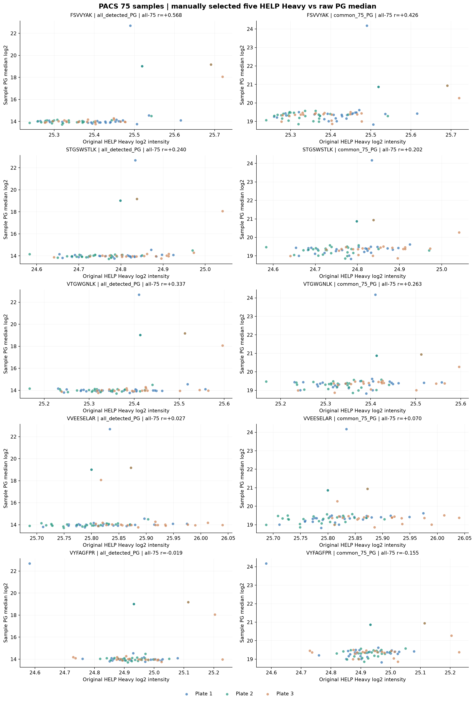
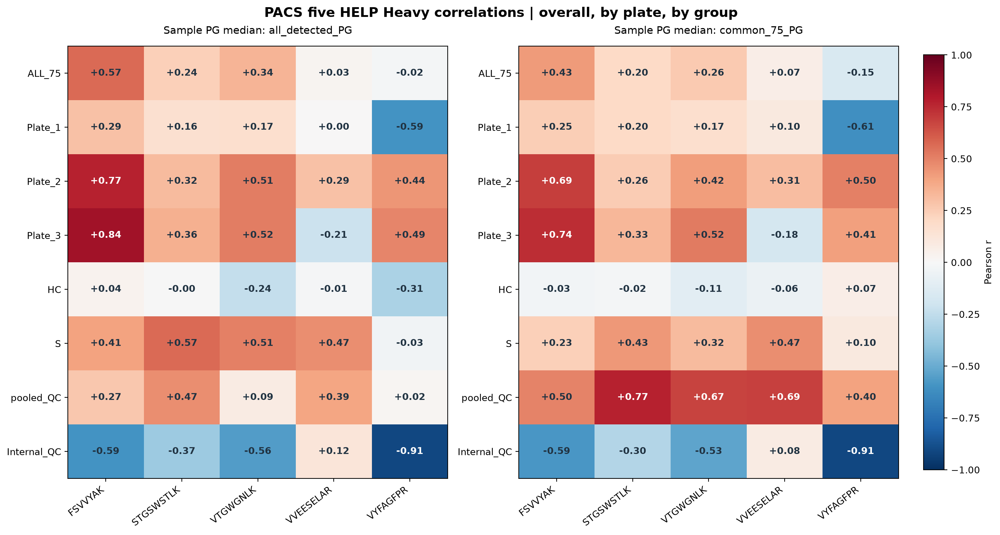

# PACS 75 samples | user-selected five HELP Heavy vs sample raw PG medians

Uses 75 original samples and these five MANUALLY chosen HELP peptide sequences:
FSVVYAK, STGSWSTLK, VTGWGNLK, VVEESELAR, VYFAGFPR
. Heavy intensity is from H sheet, NOT ratio_LH.
No normalization/factor is applied here. Study, pooled-QC and Internal-QC
samples are all included. This is not NYD; biological sample heterogeneity matters.

## Matched protein sets

1. all_detected_PG: each sample independently uses all its own valid PGs.
2. common_75_PG: the exact same rows valid across all 75 samples.
Common set size is 267 out of 6675 original PGs.

Both sample summaries take median(log2(original linear PG intensity)).
Pearson is across sample observations, overall and within each plate.
Group-stratified results are supplementary; unequal group composition
across plates is a potential confounder of overall/plate correlation.
The 5HELP composite is the mean of the five peptide-wise centered Heavy log2
intensities; it is not a correction factor and is included only as an extra diagnostic.
No missing-value imputation; p-values unadjusted.

## Overall Pearson r across 75 samples

| HELP | All detected PG median | Fixed 75-common PG median |
| --- | ---: | ---: |
| FSVVYAK | +0.568 | +0.426 |
| STGSWSTLK | +0.240 | +0.202 |
| VTGWGNLK | +0.337 | +0.263 |
| VVEESELAR | +0.027 | +0.070 |
| VYFAGFPR | -0.019 | -0.155 |
| 5HELP_mean_centered_log2 | +0.310 | +0.213 |

## By-plate Pearson r

Each cell displays all_detected_PG / common_75_PG.

| HELP | Plate 1 (n=27) | Plate 2 (n=27) | Plate 3 (n=21) |
| --- | ---: | ---: | ---: |
| FSVVYAK | +0.290 / +0.246 | +0.769 / +0.691 | +0.839 / +0.740 |
| STGSWSTLK | +0.162 / +0.196 | +0.318 / +0.257 | +0.358 / +0.334 |
| VTGWGNLK | +0.167 / +0.168 | +0.515 / +0.419 | +0.515 / +0.521 |
| VVEESELAR | +0.003 / +0.100 | +0.290 / +0.308 | -0.213 / -0.177 |
| VYFAGFPR | -0.594 / -0.614 | +0.440 / +0.501 | +0.492 / +0.412 |
| 5HELP_mean_centered_log2 | -0.024 / -0.014 | +0.621 / +0.572 | +0.585 / +0.531 |

## Figures

## Files
- pearson_summary_overall_plate_group.csv: overall, 3 plates, 4 sample groups.
- sample_75_Heavy_and_PG_log2_medians.csv: all 75 records with source group/plate.
- PG_detected_count_vs_medians.csv: diagnostic of missingness/composition impact.
- common_75_PG_protein_list.csv: exact common protein set, with annotations.
- run_manifest.json: precise source hashes and methodology.

## Interpretation
HC and S are biologically different samples. Their combined correlations
are descriptive only; they are not technical repeatability metrics.
All charts place their legend OUTSIDE the plotting axes.
Correlation does not demonstrate that either +fi or -fi improves data.
