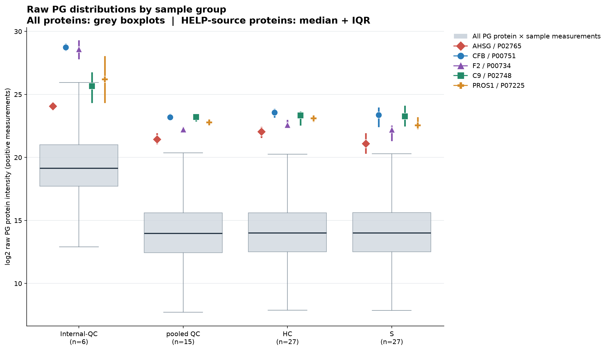
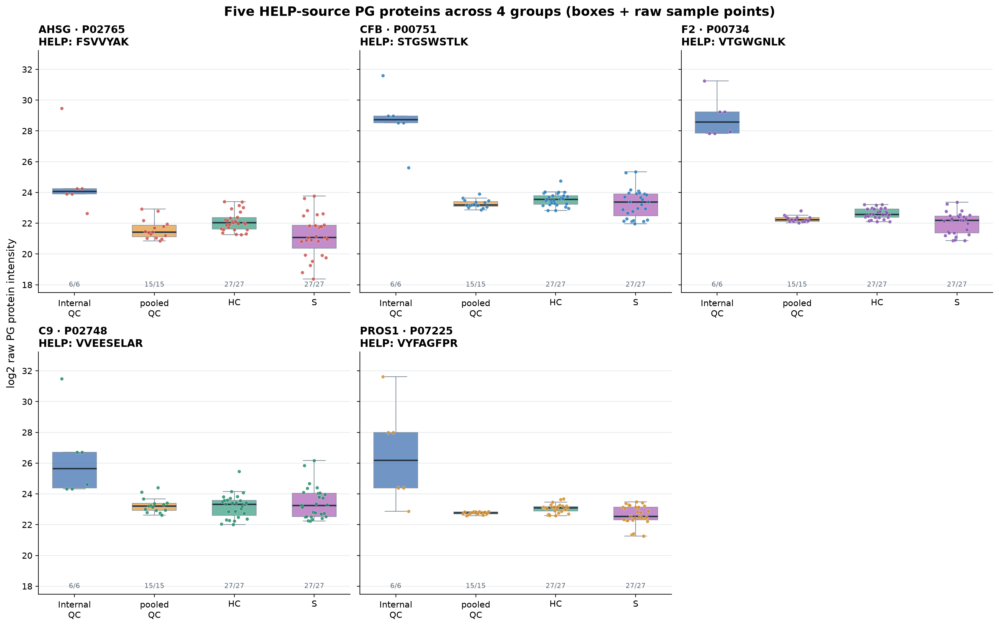
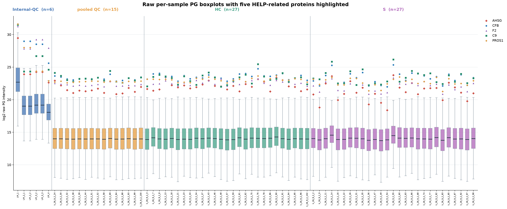

# Five HELP-source proteins · grouped raw PG boxplots

This is an exploratory check of the original, UNCORRECTED protein-level pg_matrix.tsv.
Protein intensities are log2-transformed only for plotting.
Missing/nonfinite/nonpositive values are excluded from plotting without imputation.

## Matching and dataset

- Original protein matrix: 6675 protein groups × 75 sample columns.
- Group sizes: Internal-QC 6, pooled QC 15, HC 27, S 27.
- Target identity is matched exactly by accession token in Protein.Group or Protein.Ids.
- Each supplied accession must map to exactly one PG row (otherwise abort).
- Expected gene and protein names are independently audited; see matched_pg_protein_rows.csv.
- Peptide charge or heavy precursor entries are not extra rows in protein-group data.

| Accession | Protein name | Gene | HELP peptide | PG data row | Name matched | Gene matched | Detected samples |
| --- | --- | --- | --- | ---: | --- | --- | ---: |
| P02765 | FETUA_HUMAN | AHSG | FSVVYAK | 976 | Yes | Yes | 75/75 |
| P00751 | CFAB_HUMAN | CFB | STGSWSTLK | 875 | Yes | Yes | 75/75 |
| P00734 | THRB_HUMAN | F2 | VTGWGNLK | 864 | Yes | Yes | 75/75 |
| P02748 | CO9_HUMAN | C9 | VVEESELAR | 969 | Yes | Yes | 75/75 |
| P07225 | PROS_HUMAN | PROS1 | VYFAGFPR | 1121 | Yes | Yes | 75/75 |

## Figures

### 1. All protein × sample intensities pooled by group, with five proteins highlighted

Grey boxplots: all valid raw PG protein × sample intensities pooled within each group.
Five colored shapes: target protein group median; vertical colored strokes: target IQR.
Do not interpret the grey background as across-sample CV or per-protein variability.

### 2. Four group boxplots separately for each target protein

Each target panel compares samples within the four groups; colored dots are measured samples.
Numbers under the boxes: detected / all sample count. Common y-axis across panels.

### 3. All 75 sample-level PG intensity boxplots, with five proteins overlaid

Each box represents all valid raw PG protein intensities in one sample.
Colored protein markers are the five matched proteins from that sample.

## Target protein statistics by group

| Gene | Group | Detected/Total | Median log2 | Q1–Q3 log2 | CV (linear) |
| --- | --- | ---: | ---: | ---: | ---: |
| AHSG | Internal-QC | 6/6 | 24.08 | 23.91–24.24 | 216.95% |
| AHSG | pooled QC | 15/15 | 21.43 | 21.12–21.88 | 52.38% |
| AHSG | HC | 27/27 | 22.05 | 21.61–22.36 | 49.62% |
| AHSG | S | 27/27 | 21.09 | 20.37–21.86 | 96.72% |
| CFB | Internal-QC | 6/6 | 28.74 | 28.52–28.97 | 139.33% |
| CFB | pooled QC | 15/15 | 23.19 | 23.10–23.41 | 20.30% |
| CFB | HC | 27/27 | 23.57 | 23.23–23.79 | 33.26% |
| CFB | S | 27/27 | 23.38 | 22.48–23.91 | 76.16% |
| F2 | Internal-QC | 6/6 | 28.59 | 27.86–29.23 | 118.69% |
| F2 | pooled QC | 15/15 | 22.22 | 22.12–22.37 | 15.19% |
| F2 | HC | 27/27 | 22.58 | 22.39–22.92 | 23.90% |
| F2 | S | 27/27 | 22.20 | 21.37–22.47 | 48.63% |
| C9 | Internal-QC | 6/6 | 25.65 | 24.39–26.70 | 219.58% |
| C9 | pooled QC | 15/15 | 23.21 | 22.93–23.39 | 40.72% |
| C9 | HC | 27/27 | 23.33 | 22.61–23.58 | 70.97% |
| C9 | S | 27/27 | 23.26 | 22.52–24.04 | 106.02% |
| PROS1 | Internal-QC | 6/6 | 26.19 | 24.38–27.99 | 201.37% |
| PROS1 | pooled QC | 15/15 | 22.78 | 22.69–22.83 | 6.03% |
| PROS1 | HC | 27/27 | 23.10 | 22.88–23.19 | 20.60% |
| PROS1 | S | 27/27 | 22.55 | 22.32–23.13 | 37.72% |

## Data outputs

- matched_pg_protein_rows.csv: strict accession matches and source annotations.
- five_protein_sample_intensities.csv: 5 × 75 sample-level raw/log2 values.
- target_group_statistics.csv: each target's group distributions and CV.
- all_pg_background_group_stats.csv: pooled all-protein values per group.
- run_manifest.json: source SHA-256, group counts, original data provenance.
- Source data and prior correction results were not modified.
