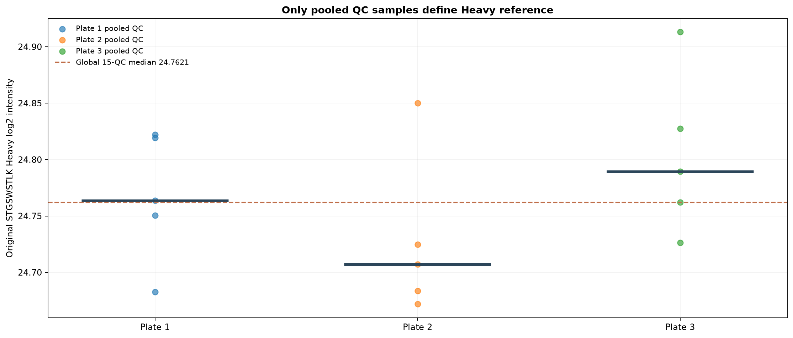
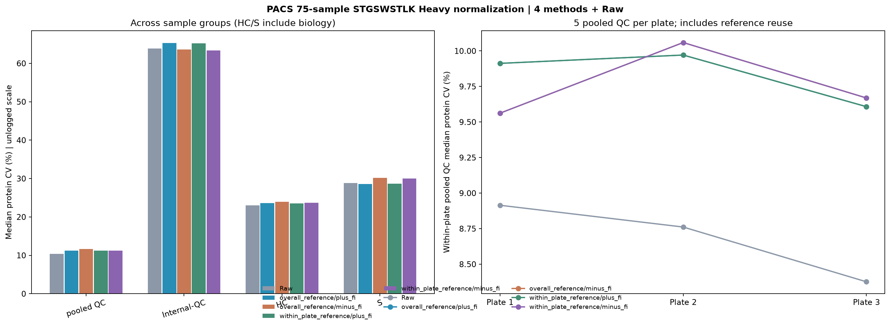
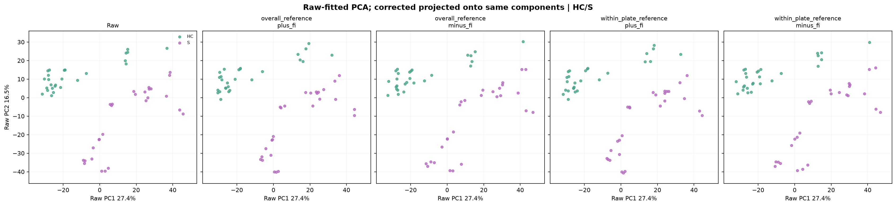
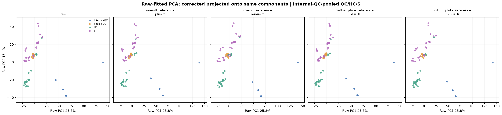

# PACS 75-sample STGSWSTLK Heavy correction from pooled QC

Unlike NYD, these are not identical biological repeats. We do not
transfer the NYD T001–T004 sign pattern to the three PACS plates.
Instead the same raw Heavy-derived factor is evaluated in both signs.

## Input and exactly applied formulas

- Original pg_matrix.tsv (6,675 PG x 75 samples) and H worksheet
  of LH_ratio_tables_2026.10.13—ALL-HELP.xlsx.
- STGSWSTLK only (no other HELP enters the reference).
- Overall reference: median log2 Heavy of all 15 pooled QC.
- Within-plate reference: median log2 Heavy of 5 pooled QC from the same plate.
- fi(sample) = reference - log2(STGSWSTLK Heavy in that sample).
- plus_fi = raw PG log2 + fi; minus_fi = raw PG log2 - fi.
- Apply factor to all 75 samples individually (HC, S, pooled QC, Internal-QC).
- Internal-QC does NOT define the reference. The 15 pooled QC do.
- Use the full-precision reference values; preserve missingness.

## QC reference values (log2 Heavy)

- Overall 15-QC reference: 24.762065471942
- Plate 1 5-QC reference: 24.763577511215
- Plate 2 5-QC reference: 24.707099261818
- Plate 3 5-QC reference: 24.789440611988

## Median per-protein CV by sample group (%)

| Method | pooled QC | Internal-QC | HC | S |
|---|---:|---:|---:|---:|
| Raw | 10.41 | 63.88 | 23.04 | 28.82 |
| overall_reference/plus_fi | 11.23 | 65.28 | 23.60 | 28.61 |
| overall_reference/minus_fi | 11.62 | 63.64 | 23.99 | 30.18 |
| within_plate_reference/plus_fi | 11.25 | 65.24 | 23.55 | 28.64 |
| within_plate_reference/minus_fi | 11.26 | 63.33 | 23.67 | 30.04 |

## Within-plate pooled QC median protein CV (%)

| Method | Plate 1 | Plate 2 | Plate 3 |
|---|---:|---:|---:|
| Raw | 8.91 | 8.76 | 8.38 |
| overall_reference/plus_fi | 9.91 | 9.97 | 9.61 |
| overall_reference/minus_fi | 9.56 | 10.06 | 9.67 |
| within_plate_reference/plus_fi | 9.91 | 9.97 | 9.61 |
| within_plate_reference/minus_fi | 9.56 | 10.06 | 9.67 |

## Outputs

- Four full corrected PG log2 TSV matrices, under overall_reference/ and within_plate_reference/.
- Each matrix has 6,675 PG and 75 sample columns plus the 5 PG annotations.
- Four Raw-vs-corrected boxplots with matching axis limits.
- sample_75_factors_and_medians.csv: actual reference, original Heavy and per-sample offsets.
- group_protein_CV_summary.csv and per_protein_CV_long.csv.
- pooled_QC_within_plate_CV.csv: CV within each plate's 5 pooled QC.
- QC_leave_one_out_sensitivity.csv: pooled QC leave-one-out only, not held-out QC.
- PCA_raw_fitted_details.json: Raw feature/axes/projection provenance.
- run_manifest.json: exact source hashes, formulas and provenance.

## Interpretation

Pooled QC-based factor evaluation is partially circular because these QC
samples are the ones used for reference estimation. Leave-one-out
diagnostics remove own-sample reuse but are not independent external QCs.
HC/S CV mixes biological and technical differences.
Internal-QC may be a different preparation and is corrected as requested,
not assumed to have the same Heavy baseline as pooled QC.
Batch-internal QC CV is identical for global vs within-plate reference
at the same sign because those factors differ only by a plate constant.
Neither an increased PCA separation nor a flat sample boxplot proves calibration.
