# PACS Trial 2, new uploaded protein matrix (stepwise)

> **Five-HELP rerun — Trial 2 stepwise, yeast peptide a/b.** The historical procedure has been re-executed with exactly the following five HELP sequences: FSVVYAK, STGSWSTLK, VTGWGNLK, VVEESELAR, VYFAGFPR. The original 97-row workbook was not modified. Only the HELP ratio reader was replaced; all other algorithm choices and QC handling are inherited from the historical script. The protein source is the current 6675-row matrix.

Previously generated results/ has been archived at results_v4/.
The new results/ is an independent Trial 2 rerun on the filtered pg_matrix.tsv.
The root pg_matrix.tsv and older archive files are not changed.

## Input provenance

- Protein source: pg_matrix.tsv; sha256=112d59739481b2fbf1d5252d0fc754c4a4494af60c77ff050af153fe423012be.
- HELP source: LH_ratio_tables_2026.10.13—ALL-HELP.xlsx; sha256=5523ffca836fd7244610322f781084619541482835f108a92cdb350a6e3a4e53.
- Yeast source: sample-QC-InternalQC-HELP_yeast.xlsx; sha256=4813ebd8387ee704e55a2c9b2ae5ed8cebd86d3e3db8c4792d320d0e3aaccee8.
Both peptide workbooks were metadata-filtered to 75 samples before this run.
Previous trial outputs and filtered source workbooks were not modified.

## Sample screening

- New protein rows: 6675.
- Original sample columns: 75.
- Kept: 75 (Internal-QC 6, pooled QC 15, HC 27, S 27).
- Removed sample columns: 0.
- No imputation, filtering of protein rows, normalization or transformation of input raw data.

## Definitions (log2 except CV)

For each Study sample with yeast peptide log2 intensities y1 and y2:
- factor1a = median_study((y1+y2)/2) - (y1+y2)/2.
- factor1b = mean(median_study(y1), median_study(y2)) - (y1+y2)/2.
- factor2 = median_of_pooled_QC_sample_medians(log2 HELP L/H) - sample_median(log2 HELP L/H).
- Raw: original protein intensity.
- After factor1: log2 corrected protein = log2 raw protein + factor1.
- After factor1+factor2: log2 corrected protein = log2 raw + factor1 + factor2.
- Only HC and S are corrected. Internal-QC and pooled QC are entirely unchanged.
- CV uses unlogged positive intensity, SD(ddof=1)/arithmetic mean*100%,
  detection >= max(3,ceil(0.7*group n)), minimum mean 1e-8.
- PCA and boxplots use log2 intensities. PCA-only per-protein median imputation;
  each view selects >=70% detected proteins, same set across stages, centered not z-scored.
- PCA is separately fitted at each stage, so PC coordinates are not aligned between stages.

## References

- Yeast ref a: 23.6562336357.
- Yeast ref b: 23.6525507562.
- Common factor1 b minus a: -0.00368287950429.
- Pooled QC HELP reference log2: -5.75303556026.

## Per-group median protein CV (%)

| Method | Stage | Internal-QC | pooled QC | HC | S |
| --- | --- | ---: | ---: | ---: | ---: |
| a | Raw | 63.88% | 10.41% | 23.04% | 28.82% |
| a | Factor1 | 63.88% | 10.41% | 39.25% | 45.72% |
| a | Factor1 + Factor2 | 63.88% | 10.41% | 41.87% | 56.01% |
| b | Raw | 63.88% | 10.41% | 23.04% | 28.82% |
| b | Factor1 | 63.88% | 10.41% | 39.25% | 45.72% |
| b | Factor1 + Factor2 | 63.88% | 10.41% | 41.87% | 56.01% |

## Joint figures: Raw / Factor1 / Factor1+Factor2

Two yeast reference methods x two plotting views = 4 figure sets.
Each set contains six PNG charts (24 PNGs total), no SVG.

### Method a / all_groups

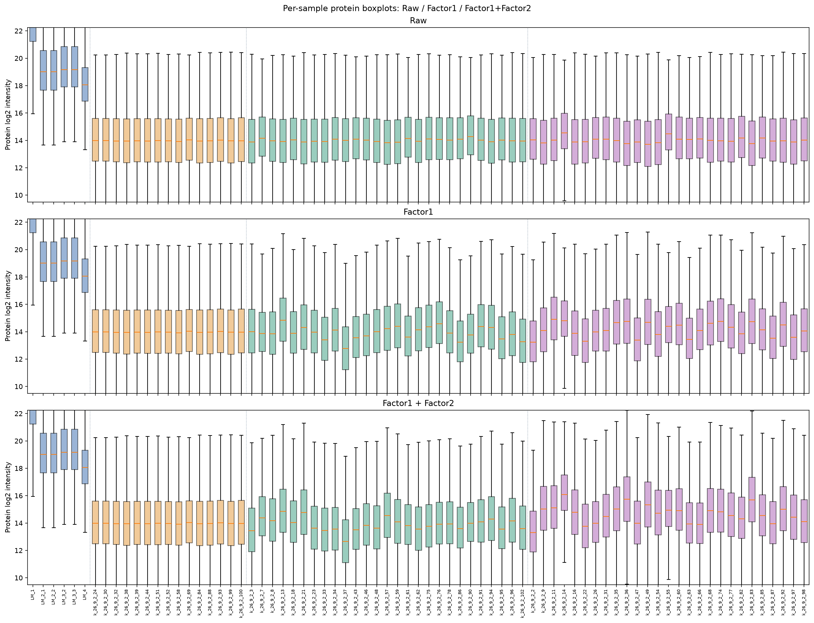

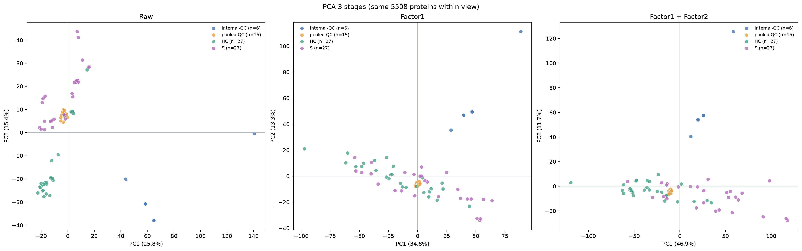

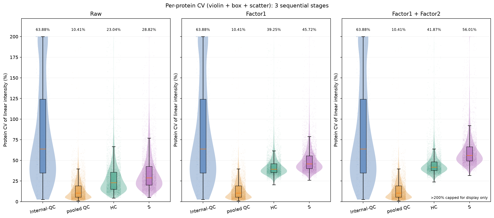

### Method a / study_only

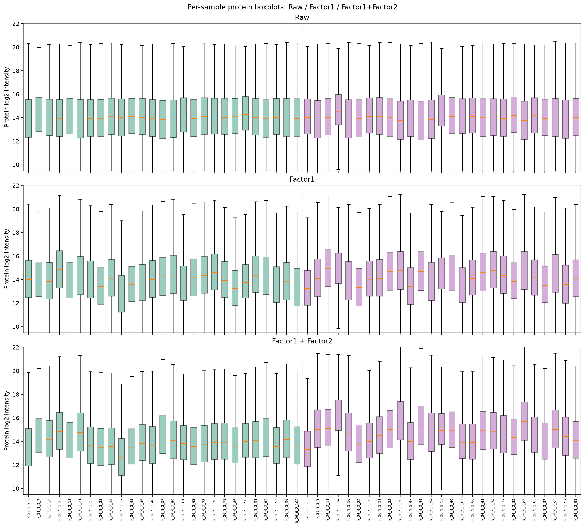

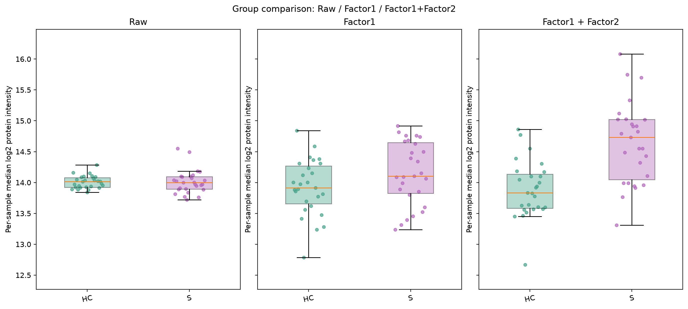

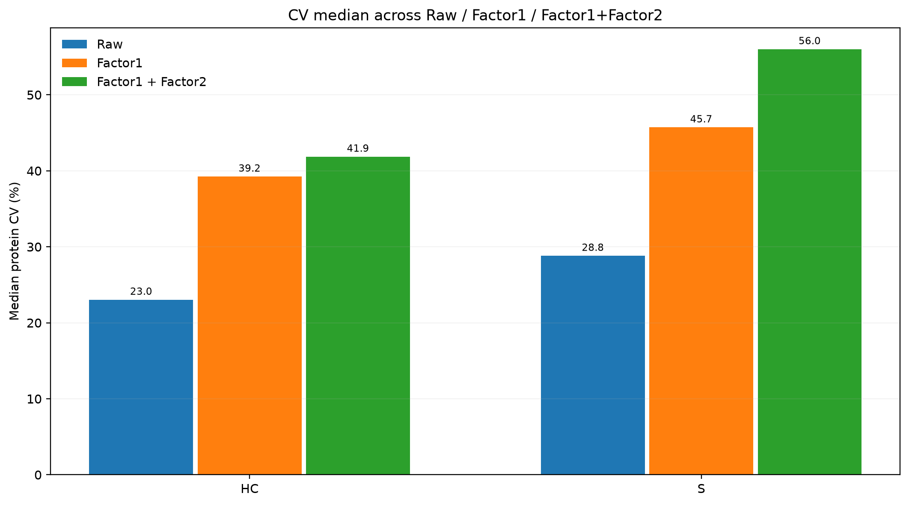

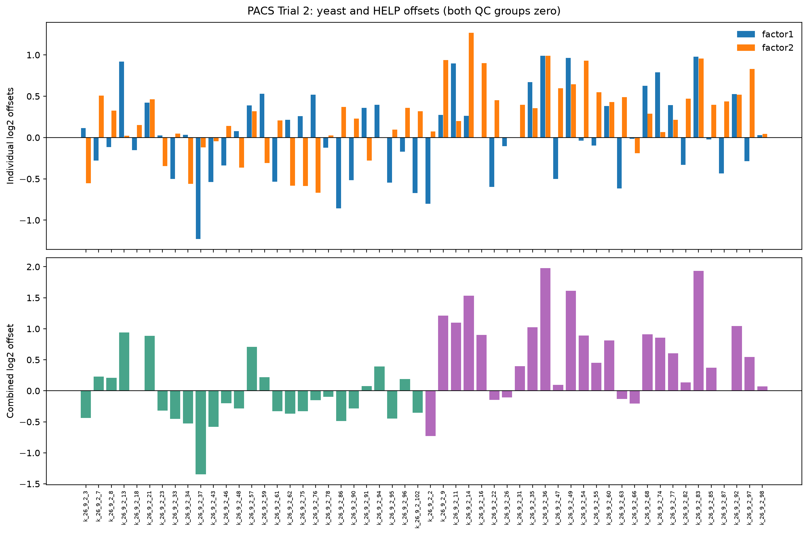

### Method b / all_groups

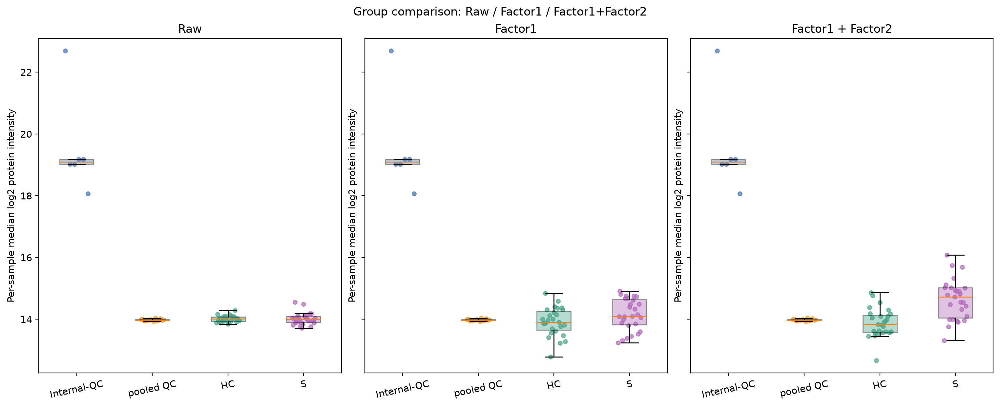

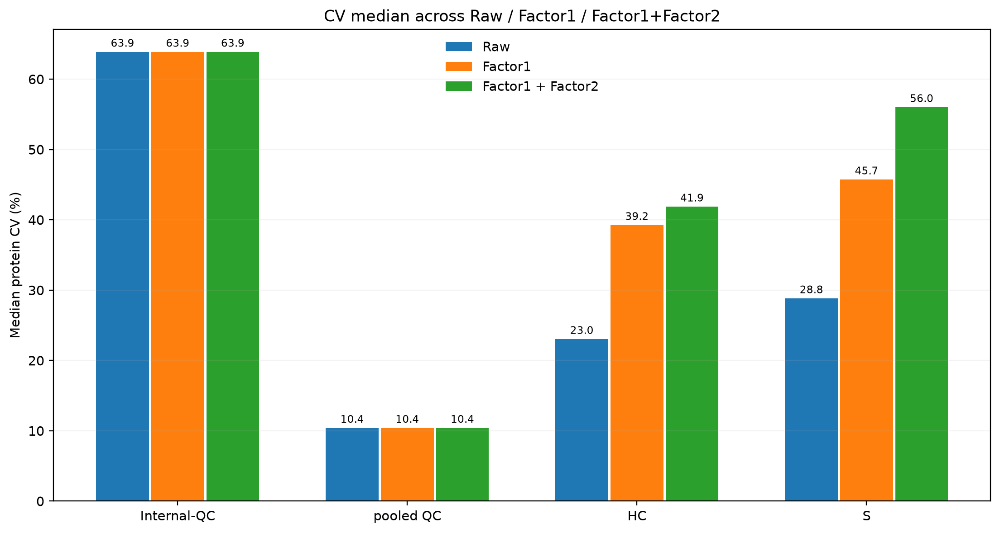

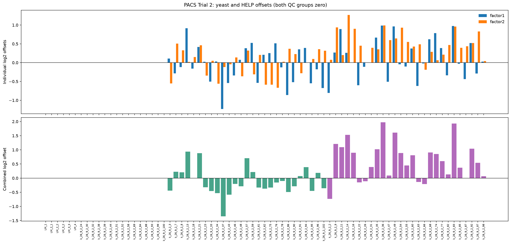

### Method b / study_only

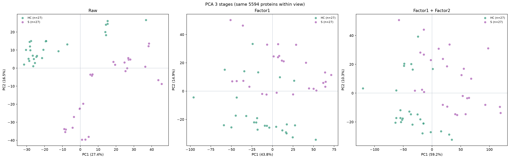

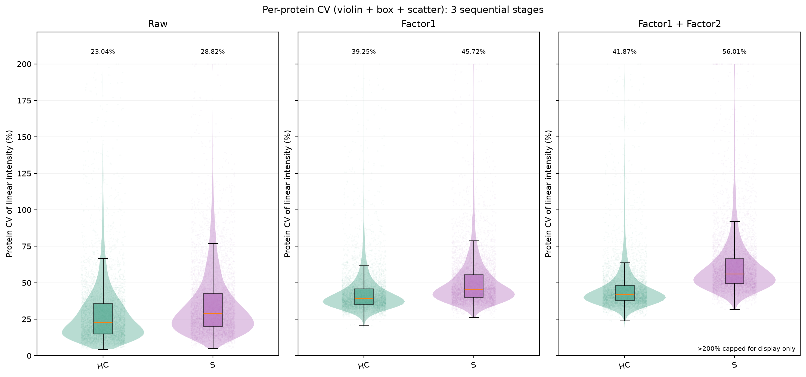

## PCA explained variance

| Method | View | Stage | Proteins | PC1 | PC2 |
| --- | --- | --- | ---: | ---: | ---: |
| a | all_groups | raw | 5508 | 25.81% | 15.43% |
| a | all_groups | factor1 | 5508 | 34.83% | 13.28% |
| a | all_groups | factor1_factor2 | 5508 | 46.85% | 11.67% |
| a | study_only | raw | 5594 | 27.37% | 16.47% |
| a | study_only | factor1 | 5594 | 43.84% | 14.92% |
| a | study_only | factor1_factor2 | 5594 | 59.23% | 10.25% |
| b | all_groups | raw | 5508 | 25.81% | 15.43% |
| b | all_groups | factor1 | 5508 | 34.85% | 13.28% |
| b | all_groups | factor1_factor2 | 5508 | 46.85% | 11.67% |
| b | study_only | raw | 5594 | 27.37% | 16.47% |
| b | study_only | factor1 | 5594 | 43.84% | 14.92% |
| b | study_only | factor1_factor2 | 5594 | 59.23% | 10.25% |

## Data products

- pg_matrix_filtered.tsv: screened source, unmodified protein intensities.
- sample_factors.csv: per-sample a/b factor1, factor2, and HELP ratio statistics.
- yeast_factor_details.csv: peptide-level log2 intensities and both reference methods.
- all_stage_cv_summary.csv and all_stage_pca_summary.csv: method x stage x group/view summaries.
- method_a/ and method_b/: linear and log2 factor1/factor1+factor2 corrected matrices;
  stage_offsets.csv, per_protein_cv_stages.csv, group_cv_stages.csv,
  pca_scores.csv, pca_summary.csv, sample_log2_medians.csv and PNG figures.

## Caution

CV for both QC groups must remain unchanged by design, and cannot validate
normalization effectiveness. HC/S CV includes biological variability.
Methods a/b differ by a common log2 offset and are expected to have
identical within-group CV; their all-groups PCA can differ because QC remains fixed.
PCA explained variance increasing does not imply better normalization.
