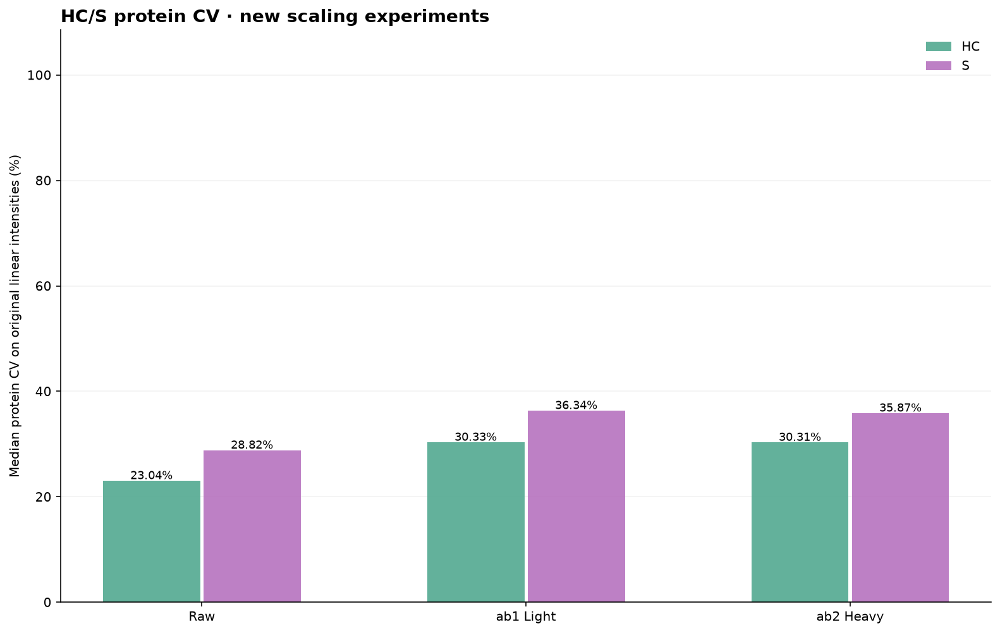
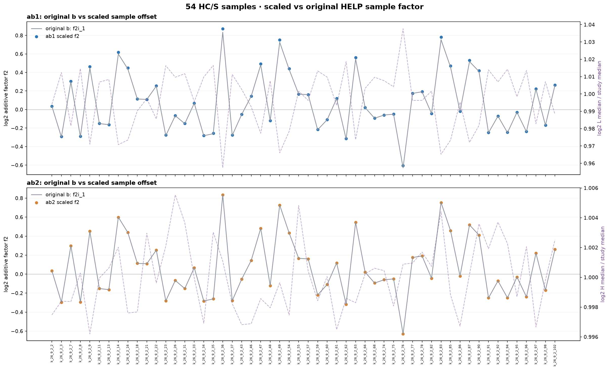

# PACS ab1 and ab2 · Light/Heavy-scaled b correction

Two new branches, both using STGSWSTLK (P00751 / CFB) and VYFAGFPR (P07225 / PROS1).
The original Plate-level a factor1 and all historical results are unchanged.

## Formula and scope

Every raw L/H ratio, Light intensity, Heavy intensity and PG intensity
is first converted to log2. We retain original b's pooled-QC Plate f1.
For the 54 Study samples: median_si = median of two log2 selected HELP ratios
after a's Plate correction; median_s = median across these 54 median_si;
f2i1 = median_s - median_si.

- ab1: median_li = median of the two log2 Light values in sample i;
  median_l = median of 54 Study median_li; f2l_i = median_li / median_l;
  final f2_i = f2i1 / f2l_i.
- ab2: median_hi = median of the two log2 Heavy values in sample i;
  median_h = median of 54 Study median_hi; f2h_i = median_hi / median_h;
  final f2_i = f2i1 / f2h_i.
- HC and S: corrected_log2_PG = raw_log2_PG + f1_plate + f2_i.
- pooled QC: raw_log2_PG + f1_plate, no f2; Internal-QC: unchanged.
- f2 is NOT further added to the HELP ratios. All other 95 HELP peptides unused.
- CV uses back-transformed original linear intensities, not log2 intensities.

The requested scaling is specifically the quotient of log2 medians.
This can be greater or smaller than 1 and does not guarantee shrinkage.

## Median protein CV (%)

| Method | HC | S | pooled QC | Internal-QC |
| --- | ---: | ---: | ---: | ---: |
| Raw | 23.04 | 28.82 | 10.41 | 63.88 |
| prior a | 23.32 | 29.13 | 11.02 | 63.88 |
| prior b | 30.33 | 35.87 | 11.02 | 63.88 |
| ab1 Light | 30.33 | 36.34 | 11.02 | 63.88 |
| ab2 Heavy | 30.31 | 35.87 | 11.02 | 63.88 |

## Output files per branch

Each of ab1 and ab2 includes the full 6675x75 log2 corrected PG matrix;
a per-sample CSV with f1, unscaled f2i1, log2 Light/Heavy medians,
global Light/Heavy medians, scale factor, final f2 and selected L/H
values; CV summaries, per-protein CV, PCA, reference metadata and five
plots: sample boxplots with targets, CV violin/box, PCA,
factor offsets, and pooled-QC Plate medians.

## L/H ratio consistency diagnostics

| Peptide | max(abs(log2 Light - log2 Heavy - log2 ratio)) |
| --- | ---: |
| STGSWSTLK | 0.00000000 |
| VYFAGFPR | 0.00000000 |

No original files or older result directories are overwritten.
This is an exploratory trial; HC/S CV may contain biological variation.
