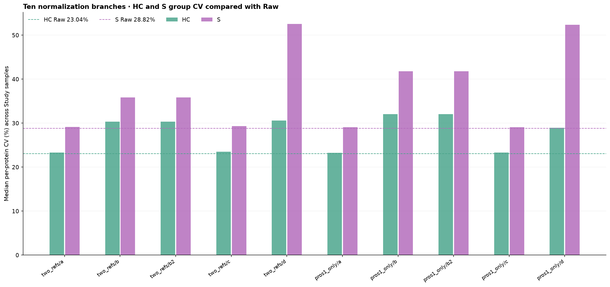

# Two HELP references / two PG source proteins: exploratory normalization trial

**10 completed methods:** a, b, b2, c, d with either STGSWSTLK+VYFAGFPR
(P00751+P07225) or only VYFAGFPR (P07225). No yeast or other 95 HELP peptides
are used for factor estimation. Uncorrected original PG and ratio data preserved.

## Rules used in this reproducible experiment

- All input intensities and HELP L/H ratios are log2-transformed first;
  nonpositive/missing source values are not imputed.
- 3 Plates; 5 pooled QC per Plate; 54 Study (HC+S); Internal-QC 6.
- Plate factor: within each plate median of the 5 pooled QC × 1 or 2
  selected reference measurements, then median of the three plate medians;
  f1_plate = median_of_plates - plate_median.
- Plate factor is added to HC/S and pooled QC protein intensities.
  For ratio-based a/b, it is ALSO added to the selected HELP ratios.
  Other 95 HELP ratios are not changed.
- For b, study factor is calculated from the stage-a adjusted HELP ratios;
  for b2, the very same sample-level operation starts from raw HELP
  ratios and raw PG intensity, WITHOUT f1 or plate corrections.
- For d, study factor is calculated directly from raw PG protein intensities.
- Study factor median_s = median of 54 study-sample reference medians;
  f2_s = median_s - individual sample median; applied to HC/S PG only.
- Internal-QC is **never corrected**; pooled QC receives ONLY f1
  in plate-correction branches, and no sample-level f2.
- For b, f2 adjusts PG intensities only, NOT the HELP ratios.
- Every stage uses log2 shifts. CV is evaluated on the
  **back-transformed linear corrected intensities** (standard CV).

## Reference PG mapping

| Peptide | UniProt accession | PG protein name | Genes | Data row |
| --- | --- | --- | --- | ---: |
| STGSWSTLK | P00751 | CFAB_HUMAN | CFB | 875 |
| VYFAGFPR | P07225 | PROS_HUMAN | PROS1 | 1121 |

## Ten methods and CV summary (%)

Uncorrected HC median CV 23.04%; S 28.82%.

| Reference | Branch | HC median CV | S median CV | HC Δ vs Raw (pp) | S Δ vs Raw (pp) |
| --- | --- | ---: | ---: | ---: | ---: |
| two_refs | [a_plate_ratio](two_refs/a_plate_ratio/) | 23.32% | 29.13% | +0.28 | +0.31 |
| two_refs | [b_plate_ratio_plus_sample](two_refs/b_plate_ratio_plus_sample/) | 30.33% | 35.87% | +7.29 | +7.05 |
| two_refs | [b2_sample_ratio_only](two_refs/b2_sample_ratio_only/) | 30.33% | 35.87% | +7.29 | +7.05 |
| two_refs | [c_plate_protein](two_refs/c_plate_protein/) | 23.51% | 29.35% | +0.47 | +0.53 |
| two_refs | [d_sample_protein_only](two_refs/d_sample_protein_only/) | 30.62% | 52.58% | +7.58 | +23.76 |
| pros1_only | [a_plate_ratio](pros1_only/a_plate_ratio/) | 23.25% | 29.05% | +0.21 | +0.23 |
| pros1_only | [b_plate_ratio_plus_sample](pros1_only/b_plate_ratio_plus_sample/) | 32.05% | 41.81% | +9.01 | +12.99 |
| pros1_only | [b2_sample_ratio_only](pros1_only/b2_sample_ratio_only/) | 32.05% | 41.81% | +9.01 | +12.99 |
| pros1_only | [c_plate_protein](pros1_only/c_plate_protein/) | 23.32% | 29.06% | +0.28 | +0.23 |
| pros1_only | [d_sample_protein_only](pros1_only/d_sample_protein_only/) | 28.97% | 52.38% | +5.93 | +23.56 |

## Files per method

Each method folder contains: corrected_pg_log2.tsv (6675 × 75),
sample_factors.csv (75 records with f1 and f2), selected_HELP_ratio_log2.csv
(selected peptides only, raw and after-plate values), protein_group_cv.csv,
group_cv_summary.csv, pca_summary.csv, factor_reference.json, and
five PNG figures: sample protein boxplots with both targets highlighted,
per-protein CV violin/box comparison, PCA Raw vs Corrected (all/Study),
sample factor offsets and pooled-QC plate median checks.

## Interpretation cautions

- Biological HC/S variation contributes to group CV, so lower/higher group
  CV is not conclusive evidence of removing/preserving batch effects.
- These two endogenous proteins may differ biologically; their raw variation
  is not assumed to be purely technical. This is exploratory as requested.
- Pooled-QC plate correction is not independent QC validation because the
  same 15 pooled QC samples were used to derive the plate offsets.
- This script does not select an optimal method or assert correction improves data.
- Results produced independently of past methods; no originals or historical
  result directories were altered.

## Audit metadata

See run_manifest.json for exact source hashes, reference use and definitions.
